# 第1回：なぜ行列で図形を変換できるのか？

## 数学的な仕組みを学ぼう

AutoCADの.NET APIを使えば、図形の移動・回転・座標変換などを実装できる。  
しかし、APIが計算をしてくれても、「どの座標系を基準にするか」「どのような変換を組み合わせるか」は開発者自身が考える必要がある。  
数学的な仕組みを理解することで、既存コードの意図を読み解き、想定外の結果の原因を調べ、新しい機能の実装方法を考える力につながる。  
この勉強会では、APIの使い方ではなく、APIが行っている計算の意味と、なぜその計算で図形を操作できるのかを学ぶ。  

第1回の目標は、**4×4の同次変換行列がなぜその構造なのか、各部分の意味を自分の言葉で説明できること**。

## 学習の流れと表記

次の7セクションに沿って学習する。末尾には復習用の補足を置く。

| セクション | 中心となる問い |
| --- | --- |
| ① 導入 | なぜ行列を使うのか？ |
| ② 行列の掛け算と基底ベクトル | なぜ行列を掛けると座標が変わるのか？ |
| ③ 2×2行列による回転 | なぜsin・cosを並べると回転になるのか？ |
| ④ 同次座標 | なぜ座標を1つ増やすと平行移動できるのか？ |
| ⑤ 3Dの4×4行列 | 各部分は何のために存在するのか？ |
| ⑥ 変換の合成 | なぜ行列の積で操作をまとめられるのか？ |
| ⑦ まとめ・宿題案内 | 4×4の構造を説明できるか？ |

数学の式はすべて**列ベクトル方式**で、変換は左から掛ける： $p'=Mp$ 。

$(x,y)$ と文章で書く点・ベクトルも、式では次のように縦に並べる。

$$
\begin{bmatrix}
x \\
y
\end{bmatrix}
$$

上付きの $\mathsf T$ は転置（行と列の交換）を表す。

- 2DはX軸が右、Y軸が上。正の角度は反時計回りで、回転の中心は原点とする。
- 3Dは右手系。Z軸周りの正の回転は、+Z側から原点を見ると反時計回りとする。
- 図では青を変換前、橙を変換後、紫を移動量に使う。軸は固定し、図形を動かす。
- 今回は**アフィン変換**（線形変換と平行移動の組み合わせ）を扱う。  
同次座標の最後の成分を $w$ と呼び、点は $w=1$ 、方向は $w=0$ とする。  
イメージとしては、行列による座標変換で平行移動を反映するかどうかを決める目印。

## ① 導入：なぜ行列を使うのか？

三角形を回転するとき、頂点ごとに別の操作を考える必要はない。  
同じ規則をすべての頂点に適用すれば、図形全体が回る。平行移動や拡大縮小も同様である。

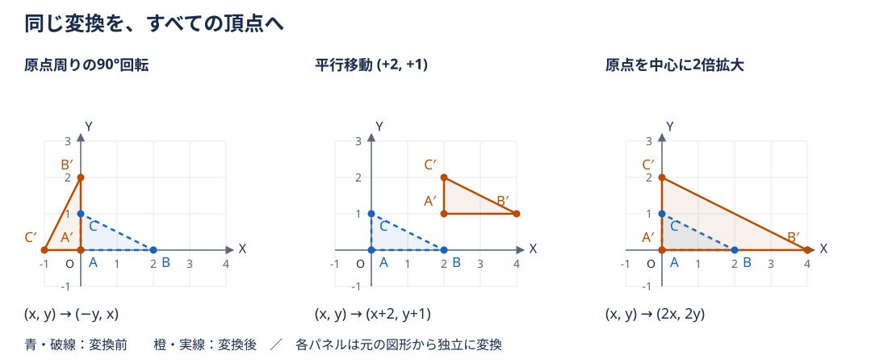

元の頂点を $A=(0,0)$ 、 $B=(2,0)$ 、 $C=(0,1)$ とすると、次のように変わる。  
各操作は元の三角形から独立に行っている。

| 操作 | 座標の変換ルール | 変換後の $A,B,C$ |
| --- | --- | --- |
| 90°回転 | $(x,y)\mapsto(-y,x)$ | $(0,0),(0,2),(-1,0)$ |
| 平行移動 | $(x,y)\mapsto(x+2,y+1)$ | $(2,1),(4,1),(2,2)$ |
| 2倍拡大 | $(x,y)\mapsto(2x,2y)$ | $(0,0),(4,0),(0,2)$ |

行列は座標の変換ルールを数の表で表現している。各頂点に適用する道具と考えよう。  
行列を用いると、複数の返還を1つの処理としてまとめられる。

## ② 行列の掛け算と基底ベクトル

### 2×2行列とベクトルを掛ける

行列の大きさは「行数×列数」で表現する。  
2×2行列 $A$ と2成分の列ベクトルの積を求めるには、行列の各行とベクトルの対応する成分を掛けて足す。

$$
\begin{aligned}
A &= \begin{bmatrix}
a & b \\
c & d
\end{bmatrix} \\
A\begin{bmatrix}
x \\
y
\end{bmatrix} &= \begin{bmatrix}
ax+by \\
cx+dy
\end{bmatrix}.
\end{aligned}
$$

具体的な例として、次の行列を考えてみよう。

$$
A=\begin{bmatrix}
2 & 1 \\
1 & 2
\end{bmatrix}.
$$

たとえば点 $p=(2,1)$ に掛けてみると、

$$
\begin{aligned}
Ap &= \begin{bmatrix}
2\cdot2+1\cdot1 \\
1\cdot2+2\cdot1
\end{bmatrix} \\
&= \begin{bmatrix}
5 \\
4
\end{bmatrix}.
\end{aligned}
$$

### (発展) 行列の「列」には意味がある

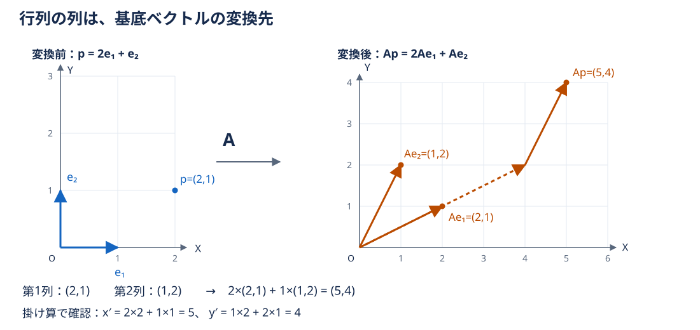

$e_1=(1,0)$ 、 $e_2=(0,1)$ を標準基底と言う。  
どのような2次元ベクトルも、X方向とY方向の標準基底をそれぞれ何倍して足すかで書ける。

$$
\begin{aligned}
p &= \begin{bmatrix}
x \\
y
\end{bmatrix} \\
&= xe_1+ye_2.
\end{aligned}
$$

先ほどの掛け算を列ごとに分けると、

$$
\begin{aligned}
A\begin{bmatrix}
x \\
y
\end{bmatrix} &= \begin{bmatrix}
ax \\
cx
\end{bmatrix}+\begin{bmatrix}
by \\
dy
\end{bmatrix} \\
&= x\begin{bmatrix}
a \\
c
\end{bmatrix}+y\begin{bmatrix}
b \\
d
\end{bmatrix}.
\end{aligned}
$$

一方、

$$
\begin{aligned}
Ae_1 &= \begin{bmatrix}
a \\
c
\end{bmatrix} \\
Ae_2 &= \begin{bmatrix}
b \\
d
\end{bmatrix}.
\end{aligned}
$$

したがって、 $Ap=xAe_1+yAe_2$ となる。**行列の第1列は $e_1$ の変換先、第2列は $e_2$ の変換先**である。  
例えば「Xに2、Yに1」という係数はそのままに、基底の向きと長さを置き換えている。  
上の図解では、向きと長さが変わった矢印がそれぞれ横に2回分、縦に1回分繋がっている。

とくに単位行列という特別な行列がある。

$$
I=\begin{bmatrix}
1 & 0 \\
0 & 1
\end{bmatrix}.
$$

これをベクトルに掛けても基底は変わらないので $Ip=p$ となる。  
もしも2倍拡大なら単位行列の2倍を考えればよく、両方の基底が2倍になる。

$$
S=\begin{bmatrix}
2 & 0 \\
0 & 2
\end{bmatrix}.
$$

**(発展) 確認：** 基底の変換先がわかれば、行列に何を書けばよいか？ → その座標を列に並べる。

## ③ なぜ2×2行列で回転できるのか？

### 単位円からsin・cosを定義する

半径1の円を単位円と呼ぶ。  
正のX軸から反時計回りに角度 $\theta$ だけ進んだ円上の点の座標は、 $(\cos\theta,\sin\theta)$ である。  
cosを横方向、sinを縦方向の成分と定義する。

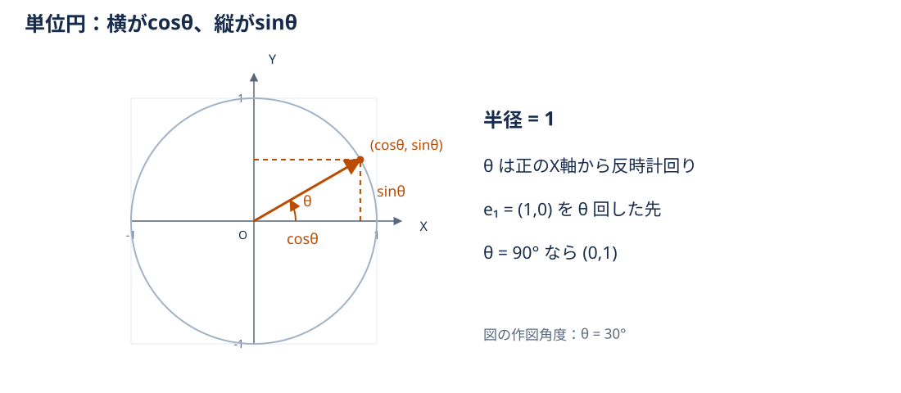

角度は式では $\theta$ 、数値例では度数法を使う。 $\cos90^\circ=0$ 、 $\sin90^\circ=1$ である。

### 回転した基底を列に並べる

$e_1$ を $\theta$ 回すと、単位円の定義から $(\cos\theta,\sin\theta)$ に移る。  
$e_2$ は $e_1$ より90°先にあるため、同じ角度だけ回した後も、その関係は変わらない。

第1の基底の回転先を $(c,s)$ と置く。  
この矢印をさらに90°反時計回りに回すと、横成分は縦成分へ、縦成分は負の横成分へ移り、 $(-s,c)$ になる。  
したがって回転後の基底は以下のようになる。

$$
\begin{aligned}
Re_1 &= \begin{bmatrix}
\cos\theta \\
\sin\theta
\end{bmatrix} \\
Re_2 &= \begin{bmatrix}
-\sin\theta \\
\cos\theta
\end{bmatrix}.
\end{aligned}
$$

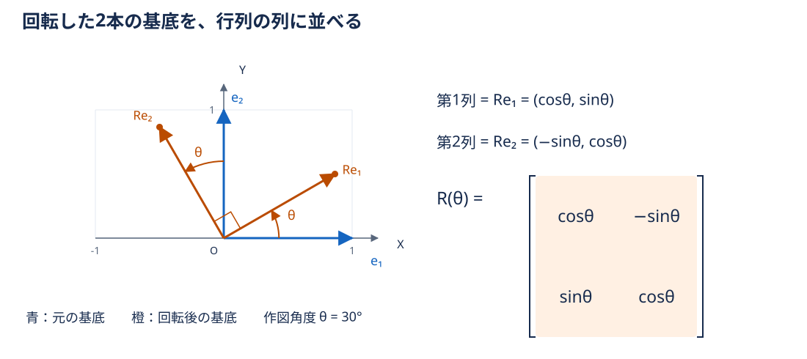

この2つを**列として**並べれば回転行列になる。

$$
R(\theta)=\begin{bmatrix}
\cos\theta & -\sin\theta \\
\sin\theta & \cos\theta
\end{bmatrix}.
$$

どのような点も $p=xe_1+ye_2$ と表現できるのだった。  
両方の基底を同じ角度だけ回して組み直すと、

$$
\begin{aligned}
Rp &= xRe_1+yRe_2 \\
&= \begin{bmatrix}
x\cos\theta-y\sin\theta \\
x\sin\theta+y\cos\theta
\end{bmatrix}.
\end{aligned}
$$

回転行列のsin・cosは、回転後の2本の基底の座標を表している。  
回転は長さと直角を保つので、図形の形状は変わらない！

### 例として、点 $(2,1)$ の90°回転を考えてみよう

$$
\begin{aligned}
R(90^\circ) &= \begin{bmatrix}
0 & -1 \\
1 & 0
\end{bmatrix} \\
R\begin{bmatrix}
2 \\
1
\end{bmatrix} &= \begin{bmatrix}
0\cdot2-1\cdot1 \\
1\cdot2+0\cdot1
\end{bmatrix} \\
&= \begin{bmatrix}
-1 \\
2
\end{bmatrix}.
\end{aligned}
$$

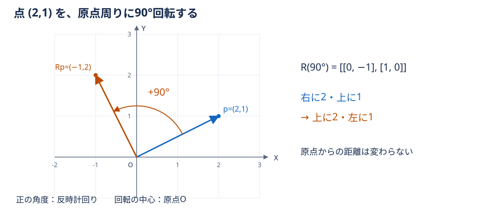

基底で読むなら、右に2・上に1という組み合わせが、上に2・左に1に変わったことになる。

### (発展) 回転が長さを保つことを式で確かめてみよう

$c=\cos\theta$ 、 $s=\sin\theta$ とすると、単位円から $c^2+s^2=1$ である。  
$(x,y)$の回転後の成分は $(cx-sy,sx+cy)$ なので、

$$
\begin{aligned}
(cx-sy)^2+(sx+cy)^2 &= (c^2+s^2)x^2+(c^2+s^2)y^2 \\
&= x^2+y^2.
\end{aligned}
$$

意味としては、原点からの距離は変わらない。  
回転後の2本の基底も長さ1で互いに直角なので、その組み合わせ全体が回る。

## ④ なぜ同次座標が必要なのか？

### 2×2行列では平行移動は表現できない！

どんな2×2行列でも、原点には次の結果しか返せない。

$$
\begin{bmatrix}
a & b \\
c & d
\end{bmatrix}\begin{bmatrix}
0 \\
0
\end{bmatrix} =\begin{bmatrix}
0 \\
0
\end{bmatrix}.
$$

つまりこれまでの説明にあった拡大縮小や回転などの(線形)変換では原点は動かない。

一方で $(+3,-2)$ の平行移動は原点を $(3,-2)$ に移す。  
この違いから、平行移動は2×2の線形変換だけでは表せない。

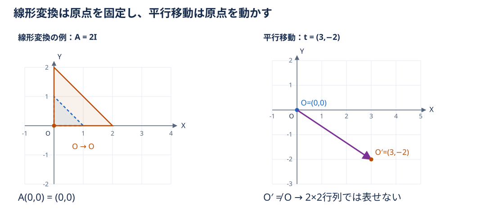

### いきなりだが、定数1を掛ける列を増やしてみよう

平行移動は $x'=x+t_x$ 、 $y'=y+t_y$ という定数の加算であると考える。  
入力を $(x,y,1)$ に増やすと、追加した1に移動量を掛けて足せる。

$$
\begin{aligned}
T\begin{bmatrix}
x \\
y \\
1
\end{bmatrix} &= \begin{bmatrix}
1 & 0 & t_x \\
0 & 1 & t_y \\
0 & 0 & 1
\end{bmatrix} \begin{bmatrix}
x \\
y \\
1
\end{bmatrix} \\
&= \begin{bmatrix}
x+t_x \\
y+t_y \\
1
\end{bmatrix}.
\end{aligned}
$$

最後の1は、平行移動の定数項を積に参加させるための成分であり、2D空間を拡張した高さ(Z軸)ではない。  
$T$ の最下行が $[0,0,1]$ なので、変換後も1のままになる。

例えば $(2,1)$ を $(+3,-2)$ 平行移動すると、

$$
\begin{aligned}
\begin{bmatrix}
1 & 0 & 3 \\
0 & 1 & -2 \\
0 & 0 & 1
\end{bmatrix} \begin{bmatrix}
2 \\
1 \\
1
\end{bmatrix} &= \begin{bmatrix}
2+3 \\
1-2 \\
1
\end{bmatrix} \\
&= \begin{bmatrix}
5 \\
-1 \\
1
\end{bmatrix}.
\end{aligned}
$$

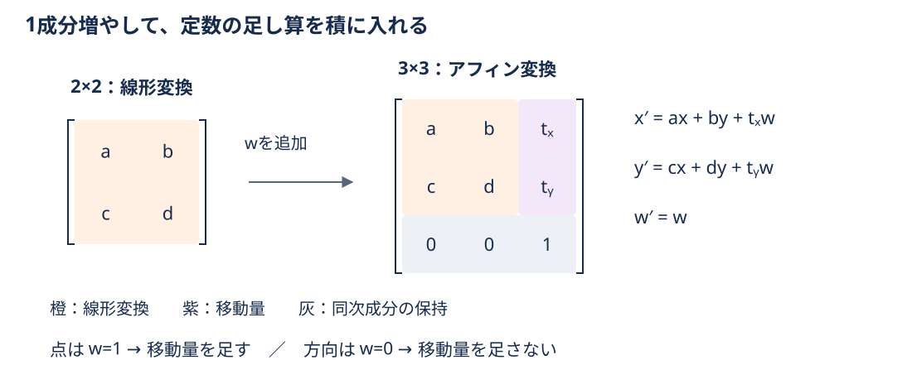

そうすると、たいへん嬉しいことに！回転などの線形変換 $A$ と平行移動 $t$ は、同じ形でまとめられる。

$$
\begin{aligned}
M &= \begin{bmatrix}
a & b & t_x \\
c & d & t_y \\
0 & 0 & 1
\end{bmatrix} \\
M\begin{bmatrix}
x \\
y \\
1
\end{bmatrix} &= \begin{bmatrix}
ax+by+t_x \\
cx+dy+t_y \\
1
\end{bmatrix}.
\end{aligned}
$$

これが $p'=Ap+t$ を行列1つで表す2Dの同次変換である。   
例えば原点周りに90°回転した後 $(3,-2)$ 移動する操作は、次の行列 $M$ で表せる。

$$
M=\begin{bmatrix}
0 & -1 & 3 \\
1 & 0 & -2 \\
0 & 0 & 1
\end{bmatrix}.
$$

この行列を掛けると、 $(2,1,1)$ は $(2,0,1)$ になる。

### (発展) 点は $w=1$ 、方向は $w=0$

一般の入力 $(x,y,w)$ に掛けると、移動量は $t_xw,t_yw$ として入る。

$$
M\begin{bmatrix}
x \\
y \\
w
\end{bmatrix} =\begin{bmatrix}
ax+by+t_xw \\
cx+dy+t_yw \\
w
\end{bmatrix}.
$$

点は位置を持つので $w=1$ 、方向ベクトルは「どちらへ、どれだけ」という2点の差を表現するものなので $w=0$ とする。

例えば $(2,1)$ を $(+3,-2)$ 平行移動する変換 $M$ は以下のようになっていた。

$$
M=\begin{bmatrix}
1 & 0 & 3 \\
0 & 1 & -2 \\
0 & 0 & 1
\end{bmatrix}
$$

すると、次の違いが現れる。

- 点 $(2,1,1)$ は $(5,-1,1)$ に動く。($w = 1$)
- 方向 $(2,1,0)$ は $(2,1,0)$ のままになる。($w = 0$)

方向も回転や拡大縮小では変わるが、平行移動では変わらない。

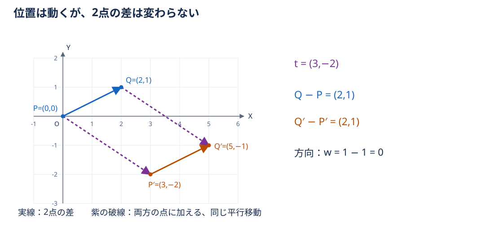

例えば $P=(0,0)$ 、 $Q=(2,1)$ の差は $(2,1)$ である。  
両方を $(3,-2)$ 動かすと $P'=(3,-2)$ 、 $Q'=(5,-1)$ になる。移動後も差は $(2,1)$ である。  
同次成分も $1-1=0$ になる。これが、2点の差である方向を $w=0$ とする理由である。

## ⑤ なぜ3Dでは4×4行列になるのか？

3Dには $e_1=(1,0,0)$ 、 $e_2=(0,1,0)$ 、 $e_3=(0,0,1)$ という3本の標準基底がある。  
各基底の変換先を列に並べると、線形変換は3×3行列 $A$ になる。  

$$
A=\begin{bmatrix}
r_{11} & r_{12} & r_{13} \\
r_{21} & r_{22} & r_{23} \\
r_{31} & r_{32} & r_{33} \\
\end{bmatrix}
$$

2Dと同様に、移動量を足すための成分 $w$ をつけ加えてみよう。

$$
\begin{aligned}
M &= \begin{bmatrix}
r_{11} & r_{12} & r_{13} & t_x \\
r_{21} & r_{22} & r_{23} & t_y \\
r_{31} & r_{32} & r_{33} & t_z \\
0 & 0 & 0 & 1
\end{bmatrix} \\
M\begin{bmatrix}
x \\
y \\
z \\
w
\end{bmatrix} &= \begin{bmatrix}
r_{11}x+r_{12}y+r_{13}z+t_xw \\
r_{21}x+r_{22}y+r_{23}z+t_yw \\
r_{31}x+r_{32}y+r_{33}z+t_zw \\
w
\end{bmatrix}.
\end{aligned}
$$

ここで $r_{ij}$ は左上の線形変換の成分を表す記号であり、回転だけに限定しない。

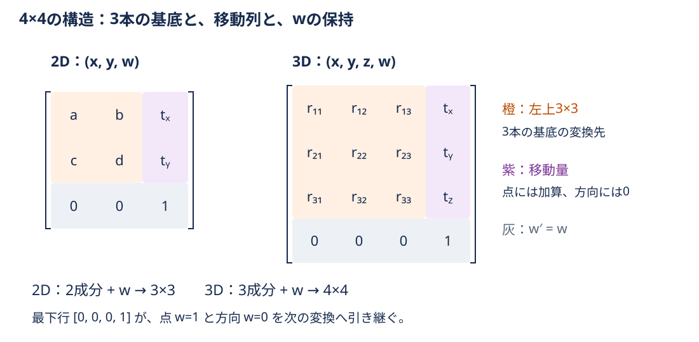

| 領域 | 意味 | なぜ必要か |
| --- | --- | --- |
| 左上3×3 | 3本の基底の変換先 | 回転・拡大縮小などを行う |
| 右端の上3成分 | $t=(t_x,t_y,t_z)$ | $w=1$ の点にだけ移動量を加える |
| 最下行 $[0,0,0,1]$ | $w'=w$ | 点と方向の区別を次の変換にも引き継ぐ |

4×4の4は「4次元の図形を作る」という意味ではない。3D座標の3成分に、定数加算を扱うための1成分を増やしている。

### (発展) ローカル座標からワールド座標へ

部品の原点を基準にしたローカル座標を、全体のワールド座標へ対応づける。行列の各部分は、次のように読める。

- 左上3×3の各列：ローカルの各基底をワールドで表したもの。
- 移動列：ローカル原点のワールドでの位置。

例えば、Z軸周りに90°回転し、原点を $(10,0,3)$ に配置するなら、

$$
\begin{aligned}
M
&=\begin{bmatrix}
\cos90^\circ & -\sin90^\circ & 0 & 10 \\
\sin90^\circ & \cos90^\circ & 0 & 0 \\
0 & 0 & 1 & 3 \\
0 & 0 & 0 & 1
\end{bmatrix} \\[6pt]
&=\begin{bmatrix}
0 & -1 & 0 & 10 \\
1 & 0 & 0 & 0 \\
0 & 0 & 1 & 3 \\
0 & 0 & 0 & 1
\end{bmatrix}.
\end{aligned}
$$

この行列では、各列が次の配置を表す。

- 第1列：ローカルX軸はワールド+Y方向を向く。
- 第2列：ローカルY軸はワールド−X方向を向く。
- 第3列：ローカルZ軸はワールド+Z方向を向く。
- 右端の列：ローカル原点のワールドでの位置。

$$
\begin{aligned}
M\begin{bmatrix}
2 \\
1 \\
0 \\
1
\end{bmatrix} &= \begin{bmatrix}
0\cdot2-1\cdot1+0\cdot0+10 \\
1\cdot2+0\cdot1+0\cdot0+0 \\
0\cdot2+0\cdot1+1\cdot0+3 \\
1
\end{bmatrix} \\
&= \begin{bmatrix}
9 \\
2 \\
3 \\
1
\end{bmatrix}.
\end{aligned}
$$

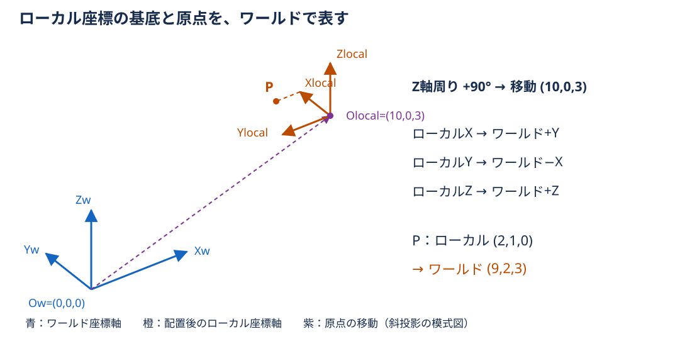

座標の対応は $p_{world}=Ap_{local}+t$ で表す。図を読むときは、次の2つを区別する。

- ローカルとワールドの図：異なる座標系を基準に、同じ点を表す。
- これまでの回転図：固定された同じ軸に対して、図形を動かす。

何を基準とする座標かは、添字で示す。

## ⑥ なぜ変換を合成できるのか？

回転 $R$ の後に平行移動 $T$ を適用すると、 $p'=T(Rp)$ になる。  
行列の積の結合法則により、 $T(Rp)=(TR)p$ とまとめられる。列ベクトル方式では、**右側の行列から先に作用する**。

例として、2Dの同次座標で90°回転とX方向+3の移動を考えてみよう。

$$
\begin{aligned}
R &= \begin{bmatrix}
0 & -1 & 0 \\
1 & 0 & 0 \\
0 & 0 & 1
\end{bmatrix} \\
T &= \begin{bmatrix}
1 & 0 & 3 \\
0 & 1 & 0 \\
0 & 0 & 1
\end{bmatrix}.
\end{aligned}
$$

行列同士の積も、左の行と右の列の対応する成分を掛けて足す。  
例えば $(TR)$ の右上成分は $1\cdot0+0\cdot0+3\cdot1=3$ になる。

$$
\begin{aligned}
TR &= \begin{bmatrix}
0 & -1 & 3 \\
1 & 0 & 0 \\
0 & 0 & 1
\end{bmatrix} \\
RT &= \begin{bmatrix}
0 & -1 & 0 \\
1 & 0 & 3 \\
0 & 0 & 1
\end{bmatrix}.
\end{aligned}
$$

点 $(1,0)$ では、次のように結果が異なる。

| 順序 | 途中の点 | 最後の点 | 合成行列 |
| --- | --- | --- | --- |
| 回転→移動 | $(0,1)$ | $(3,1)$ | $TR$ |
| 移動→回転 | $(4,0)$ | $(0,4)$ | $RT$ |

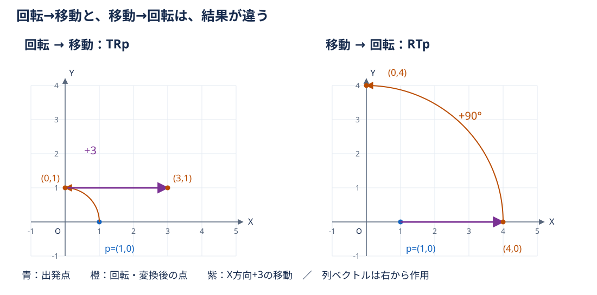

移動の後に回すと、先に加えた移動量の方向も回るため、結果が違う。結合法則で変えられるのは括弧の位置で、操作の順序は入れ替えられない。一般に $TR\ne RT$ である。

## ⑦ まとめ

| 行列 | 今回の使い方 | 構造の理由 |
| --- | --- | --- |
| 2×2 | 2Dの線形変換 | 2本の基底の変換先を列に並べる |
| 3×3 | 2Dの平行移動を含む変換 | 2成分に $w$ を加えて移動列を使う |
| 4×4 | 3Dの平行移動を含む変換 | 3成分に $w$ を加えて移動列を使う |
| 行列の積 | 変換の合成 | 続けて適用する操作を1つの行列にまとめる |

## 補足

### (発展)アフィン変換を続けても同じ形式になる

成分をまとまりとして書くと、

$$
M=\begin{bmatrix}
A & t \\
0 & 1
\end{bmatrix}.
$$

ここで $A$ は2×2または3×3、 $t$ は移動の列、 $0$ は必要な個数のゼロを並べた行を表す。

先に $M_1$ 、後に $M_2$ を適用すると、

$$
M_2M_1 =\begin{bmatrix}
A_2A_1 & A_2t_1+t_2 \\
0 & 1
\end{bmatrix}.
$$

この合成は、次の式と同じである。

$$
A_2(A_1p+t_1)+t_2=(A_2A_1)p+(A_2t_1+t_2)
$$

先の移動量 $t_1$ も、後の線形変換 $A_2$ を受ける。そのため、順序によって結果が変わる。

[この回のトップへ戻る](README.md)
