# 第1回：なぜ行列で図形を変換できるのか？ — 詳細解説

到達目標は、**4×4の同次変換行列がなぜその構造なのか、各部分の意味を自分の言葉で説明できること**。行列を初めて学ぶ.NET・C#開発者を想定する。

## 学習の流れと表記

次の7セクションに沿って学習する。末尾には復習用の補足を置く。

| セクション | 中心となる問い |
| --- | --- |
| ① 導入 | なぜCADで行列を使うのか？ |
| ② 行列の掛け算と基底ベクトル | なぜ行列を掛けると座標が変わるのか？ |
| ③ 2×2行列による回転 | なぜsin・cosを並べると回転になるのか？ |
| ④ 同次座標 | なぜ座標を1つ増やすと平行移動できるのか？ |
| ⑤ 3Dの4×4行列 | 各部分は何のために存在するのか？ |
| ⑥ 変換の合成 | なぜ行列の積で操作をまとめられるのか？ |
| ⑦ まとめ・宿題案内 | 4×4の構造を説明できるか？ |

数学の式はすべて**列ベクトル方式**で、変換は左から掛ける： $p'=Mp$ 。

$(x,y)$ と文章で書く点・ベクトルも、式では次のように縦に並べる。

$$
\begin{bmatrix}
x \\
y
\end{bmatrix}
$$

上付きの $\mathsf T$ は転置（行と列の交換）を表す。

- 2DはX軸が右、Y軸が上。正の角度は反時計回りで、回転の中心は原点とする。
- 3Dは右手系。Z軸周りの正の回転は、+Z側から原点を見ると反時計回りとする。
- 図では青を変換前、橙を変換後、紫を移動量に使う。軸は固定し、図形を動かす。
- 今回は**アフィン変換**（線形変換と平行移動の組み合わせ）を扱う。同次座標の最後の成分を $w$ と呼び、点は $w=1$ 、方向は $w=0$ とする。

## ① 導入：なぜCADで行列を使うのか？

三角形を回転するとき、頂点ごとに別の操作を考える必要はない。同じ規則をすべての頂点に適用すれば、図形全体が回る。平行移動や拡大縮小も同様である。

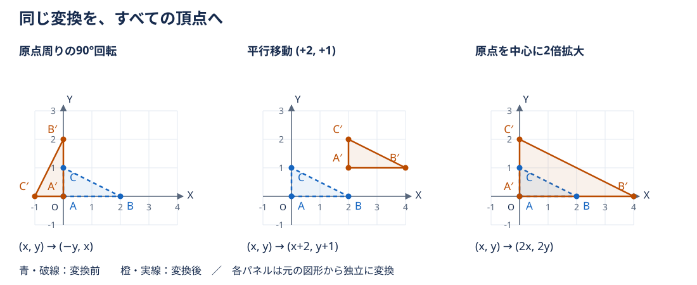

元の頂点を $A=(0,0)$ 、 $B=(2,0)$ 、 $C=(0,1)$ とすると、次のように変わる。各操作は元の三角形から独立に行っている。

| 操作 | 共通の規則 | 変換後の $A,B,C$ |
| --- | --- | --- |
| 90°回転 | $(x,y)\mapsto(-y,x)$ | $(0,0),(0,2),(-1,0)$ |
| 平行移動 | $(x,y)\mapsto(x+2,y+1)$ | $(2,1),(4,1),(2,2)$ |
| 2倍拡大 | $(x,y)\mapsto(2x,2y)$ | $(0,0),(4,0),(0,2)$ |

行列はこの共通の規則を数の表として持ち、各頂点に適用する道具になる。さらに、複数の操作を1つの規則にまとめられる。まずは「数をどう並べれば、目的の操作になるのか」を理解しよう。

## ② 行列の掛け算と基底ベクトル

### 2×2行列とベクトルを掛ける

行列の大きさは「行数×列数」で表す。2×2行列 $A$ と2成分の列ベクトルの積は、各行とベクトルの対応する成分を掛けて足す。

$$
\begin{aligned}
A &= \begin{bmatrix}
a & b \\
c & d
\end{bmatrix} \\
A\begin{bmatrix}
x \\
y
\end{bmatrix} &= \begin{bmatrix}
ax+by \\
cx+dy
\end{bmatrix}.
\end{aligned}
$$

例えば、

$$
A=\begin{bmatrix}
2 & 1 \\
1 & 2
\end{bmatrix}.
$$

と $p=(2,1)$ なら、

$$
\begin{aligned}
Ap &= \begin{bmatrix}
2\cdot2+1\cdot1 \\
1\cdot2+2\cdot1
\end{bmatrix} \\
&= \begin{bmatrix}
5 \\
4
\end{bmatrix}.
\end{aligned}
$$

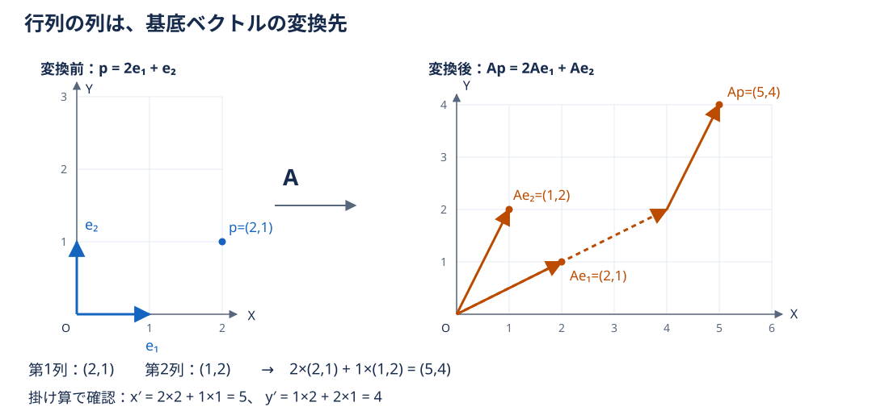

### なぜ「列」に意味があるのか

標準基底を $e_1=(1,0)$ 、 $e_2=(0,1)$ とする。任意のベクトルは、X方向の1単位とY方向の1単位を何個ずつ足すかで表せる。

$$
\begin{aligned}
p &= \begin{bmatrix}
x \\
y
\end{bmatrix} \\
&= xe_1+ye_2.
\end{aligned}
$$

先ほどの掛け算を列ごとに分けると、

$$
\begin{aligned}
A\begin{bmatrix}
x \\
y
\end{bmatrix} &= \begin{bmatrix}
ax \\
cx
\end{bmatrix}+\begin{bmatrix}
by \\
dy
\end{bmatrix} \\
&= x\begin{bmatrix}
a \\
c
\end{bmatrix}+y\begin{bmatrix}
b \\
d
\end{bmatrix}.
\end{aligned}
$$

一方、

$$
\begin{aligned}
Ae_1 &= \begin{bmatrix}
a \\
c
\end{bmatrix} \\
Ae_2 &= \begin{bmatrix}
b \\
d
\end{bmatrix}.
\end{aligned}
$$

なので、 $Ap=xAe_1+yAe_2$ である。つまり、**行列の第1列は $e_1$ の変換先、第2列は $e_2$ の変換先**になる。「Xに2、Yに1」という組み合わせを維持し、ものさしの向きと長さを置き換えている。

単位行列は、

$$
I=\begin{bmatrix}
1 & 0 \\
0 & 1
\end{bmatrix}.
$$

基底を変えず、 $Ip=p$ となる。先の2倍拡大なら、

$$
S=\begin{bmatrix}
2 & 0 \\
0 & 2
\end{bmatrix}.
$$

両方の基底が2倍になる。

**確認：** 基底の変換先がわかれば、行列に何を書けばよいか？ → その座標を列に並べる。

## ③ なぜ2×2行列で回転できるのか？

### 単位円からsin・cosを読む

半径1の円を単位円と呼ぶ。正のX軸から反時計回りに角度 $\theta$ だけ進んだ円上の点の座標が $(\cos\theta,\sin\theta)$ である。cosは横方向、sinは縦方向の成分を表す。

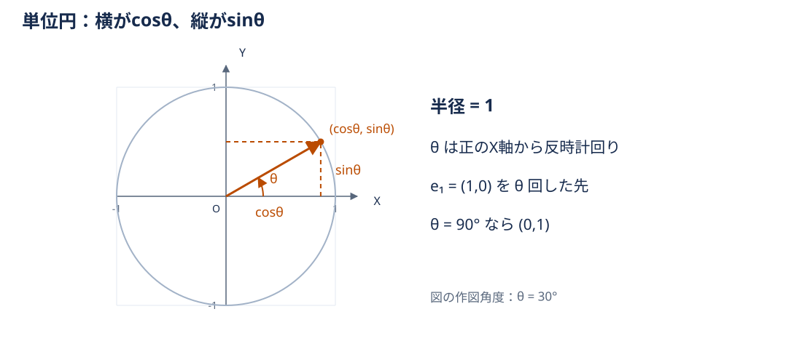

角度は式では $\theta$ 、数値例では度数法を使う。 $\cos90^\circ=0$ 、 $\sin90^\circ=1$ である。

### 回転した基底を列に並べる

$e_1$ を $\theta$ 回すと、単位円の定義から $(\cos\theta,\sin\theta)$ に移る。 $e_2$ は初めから $e_1$ より90°先にあるので、回転後も第1の基底より90°先にある。

第1の基底の回転先を $(c,s)$ と置こう。この矢印をさらに90°反時計回りに回すと、横成分は縦成分へ、縦成分は負の横成分へ移るため $(-s,c)$ になる。従って、

$$
\begin{aligned}
Re_1 &= \begin{bmatrix}
\cos\theta \\
\sin\theta
\end{bmatrix} \\
Re_2 &= \begin{bmatrix}
-\sin\theta \\
\cos\theta
\end{bmatrix}.
\end{aligned}
$$

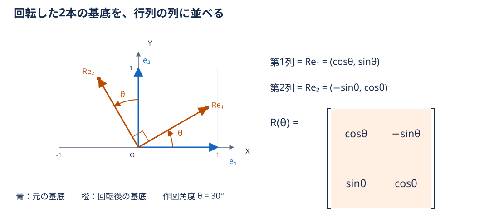

この2つを**列として**並べれば回転行列になる。

$$
R(\theta)=\begin{bmatrix}
\cos\theta & -\sin\theta \\
\sin\theta & \cos\theta
\end{bmatrix}.
$$

任意の点を $p=xe_1+ye_2$ と分けてから両方の基底を同じ角度だけ回して組み直すので、

$$
\begin{aligned}
Rp &= xRe_1+yRe_2 \\
&= \begin{bmatrix}
x\cos\theta-y\sin\theta \\
x\sin\theta+y\cos\theta
\end{bmatrix}.
\end{aligned}
$$

sin・cosの配置は丸暗記する規則ではなく、回転後の2本の基底の座標そのものである。回転は長さと直角を保つので、この組み直しで図形の形も保たれる（式による確認は補足）。

### 点 $(2,1)$ の90°回転

$$
\begin{aligned}
R(90^\circ) &= \begin{bmatrix}
0 & -1 \\
1 & 0
\end{bmatrix} \\
R\begin{bmatrix}
2 \\
1
\end{bmatrix} &= \begin{bmatrix}
0\cdot2-1\cdot1 \\
1\cdot2+0\cdot1
\end{bmatrix} \\
&= \begin{bmatrix}
-1 \\
2
\end{bmatrix}.
\end{aligned}
$$

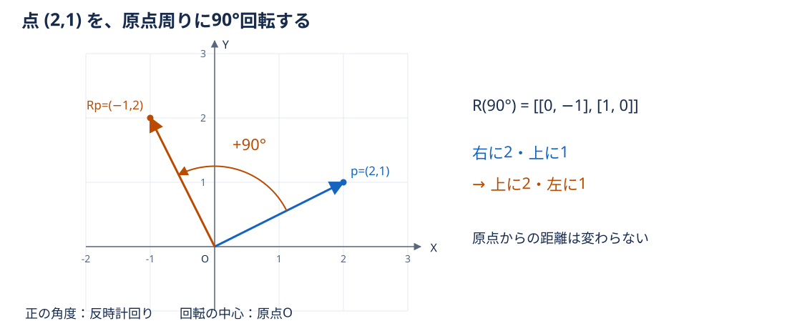

基底で読むなら、右に2・上に1という組み合わせが、上に2・左に1に変わったことになる。

## ④ なぜ同次座標が必要なのか？

### 2×2行列には定数の足し算がない

どんな2×2行列でも、原点には次の結果しか返せない。

$$
\begin{bmatrix}
a & b \\
c & d
\end{bmatrix}\begin{bmatrix}
0 \\
0
\end{bmatrix} =\begin{bmatrix}
0 \\
0
\end{bmatrix}.
$$

このような線形変換は原点を固定する。一方、 $(+3,-2)$ の平行移動は原点を $(3,-2)$ に移す。従って、2×2の線形変換だけでは表せない。

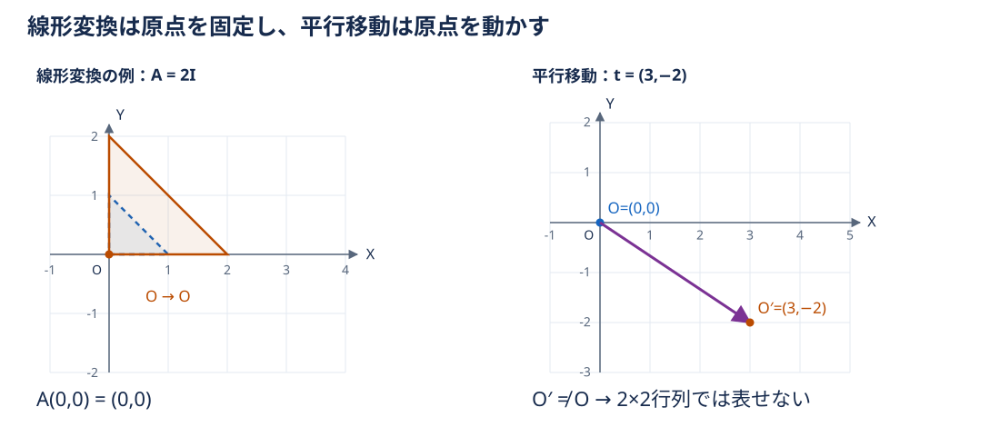

### 定数1を掛ける列を増やす

平行移動は $x'=x+t_x$ 、 $y'=y+t_y$ という定数の加算である。入力を $(x,y,1)$ に増やすと、追加した1に移動量を掛けて足せる。

$$
\begin{aligned}
T\begin{bmatrix}
x \\
y \\
1
\end{bmatrix} &= \begin{bmatrix}
1 & 0 & t_x \\
0 & 1 & t_y \\
0 & 0 & 1
\end{bmatrix} \begin{bmatrix}
x \\
y \\
1
\end{bmatrix} \\
&= \begin{bmatrix}
x+t_x \\
y+t_y \\
1
\end{bmatrix}.
\end{aligned}
$$

最後の1は2D空間の高さではなく、平行移動の定数項を積に参加させるための成分である。最後の行が $[0,0,1]$ なので、変換後もその成分は1のままになる。

例えば $(2,1)$ を $(+3,-2)$ 平行移動すると、

$$
\begin{aligned}
\begin{bmatrix}
1 & 0 & 3 \\
0 & 1 & -2 \\
0 & 0 & 1
\end{bmatrix} \begin{bmatrix}
2 \\
1 \\
1
\end{bmatrix} &= \begin{bmatrix}
2+3 \\
1-2 \\
1
\end{bmatrix} \\
&= \begin{bmatrix}
5 \\
-1 \\
1
\end{bmatrix}.
\end{aligned}
$$

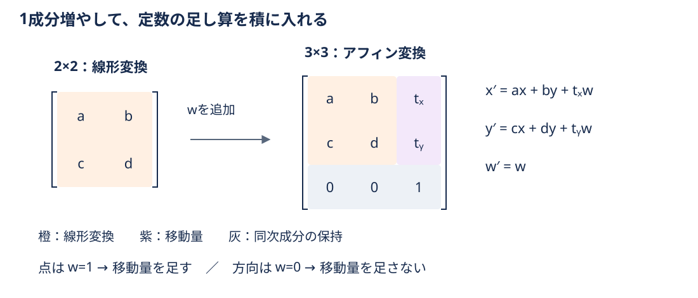

回転などの線形変換 $A$ と平行移動 $t$ は、同じ形でまとめられる。

$$
\begin{aligned}
M &= \begin{bmatrix}
a & b & t_x \\
c & d & t_y \\
0 & 0 & 1
\end{bmatrix} \\
M\begin{bmatrix}
x \\
y \\
1
\end{bmatrix} &= \begin{bmatrix}
ax+by+t_x \\
cx+dy+t_y \\
1
\end{bmatrix}.
\end{aligned}
$$

これが $p'=Ap+t$ を行列1つで表す2Dの同次変換である。例えば原点周りに90°回転した後 $(3,-2)$ 移動するなら、

$$
M=\begin{bmatrix}
0 & -1 & 3 \\
1 & 0 & -2 \\
0 & 0 & 1
\end{bmatrix}.
$$

と置けば、 $(2,1,1)$ は $(2,0,1)$ になる。

### 点は $w=1$ 、方向は $w=0$

一般の入力 $(x,y,w)$ に掛けると、移動量は $t_xw,t_yw$ として入る。

$$
M\begin{bmatrix}
x \\
y \\
w
\end{bmatrix} =\begin{bmatrix}
ax+by+t_xw \\
cx+dy+t_yw \\
w
\end{bmatrix}.
$$

点は位置を持つので $w=1$ 、方向ベクトルは「どちらへ、どれだけ」という差なので $w=0$ とする。同じ $T$ に対して、点 $(2,1,1)$ は $(5,-1,1)$ に動き、方向 $(2,1,0)$ は $(2,1,0)$ のままになる。方向も回転や拡大縮小では変わるが、平行移動では変わらない。

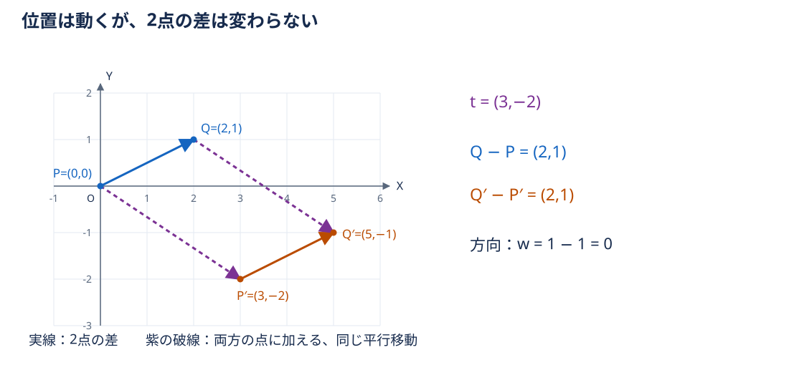

例えば $P=(0,0)$ 、 $Q=(2,1)$ の差は $(2,1)$ 。両方を $(3,-2)$ 動かすと $P'=(3,-2)$ 、 $Q'=(5,-1)$ で、差は依然 $(2,1)$ である。同次成分でも $1-1=0$ となり、方向が $w=0$ である理由がわかる。

## ⑤ なぜ3Dでは4×4行列になるのか？

3Dには $e_1=(1,0,0)$ 、 $e_2=(0,1,0)$ 、 $e_3=(0,0,1)$ という3本の標準基底がある。各基底の変換先を列に並べると、線形変換は3×3行列 $A$ になる。移動量を足すため、さらに $w$ を増やす。

$$
\begin{aligned}
M &= \begin{bmatrix}
r_{11} & r_{12} & r_{13} & t_x \\
r_{21} & r_{22} & r_{23} & t_y \\
r_{31} & r_{32} & r_{33} & t_z \\
0 & 0 & 0 & 1
\end{bmatrix} \\
M\begin{bmatrix}
x \\
y \\
z \\
w
\end{bmatrix} &= \begin{bmatrix}
r_{11}x+r_{12}y+r_{13}z+t_xw \\
r_{21}x+r_{22}y+r_{23}z+t_yw \\
r_{31}x+r_{32}y+r_{33}z+t_zw \\
w
\end{bmatrix}.
\end{aligned}
$$

ここで $r_{ij}$ は左上の線形変換の成分を表す記号であり、回転だけに限定しない。

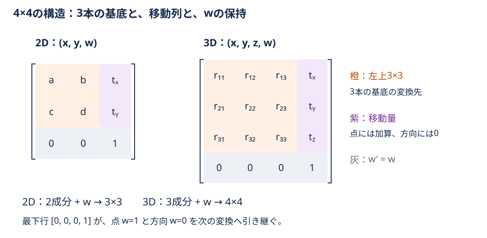

| 領域 | 意味 | なぜ必要か |
| --- | --- | --- |
| 左上3×3 | 3本の基底の変換先 | 回転・拡大縮小などを行う |
| 右端の上3成分 | $t=(t_x,t_y,t_z)$ | $w=1$ の点にだけ移動量を加える |
| 最下行 $[0,0,0,1]$ | $w'=w$ | 点と方向の区別を次の変換にも引き継ぐ |

4×4の4は「4次元の図形を作る」という意味ではない。3D座標の3成分に、定数加算を扱うための1成分を増やしている。

### ローカル座標からワールド座標へ

部品の原点を基準にしたローカル座標を、全体のワールド座標へ移す場合を考える。左上3×3の各列を「ローカルの各基底をワールドで表したもの」、移動列を「ローカル原点のワールドでの位置」として読める。

例えば、Z軸周りに90°回転し、原点を $(10,0,3)$ に配置するなら、

$$
M=\begin{bmatrix}
0 & -1 & 0 & 10 \\
1 & 0 & 0 & 0 \\
0 & 0 & 1 & 3 \\
0 & 0 & 0 & 1
\end{bmatrix}.
$$

第1列はローカルX軸がワールド+Y方向に、第2列はローカルY軸がワールド−X方向に、第3列はローカルZ軸がワールド+Z方向に向くことを表す。右端は原点の配置である。

$$
\begin{aligned}
M\begin{bmatrix}
2 \\
1 \\
0 \\
1
\end{bmatrix} &= \begin{bmatrix}
0\cdot2-1\cdot1+0\cdot0+10 \\
1\cdot2+0\cdot1+0\cdot0+0 \\
0\cdot2+0\cdot1+1\cdot0+3 \\
1
\end{bmatrix} \\
&= \begin{bmatrix}
9 \\
2 \\
3 \\
1
\end{bmatrix}.
\end{aligned}
$$

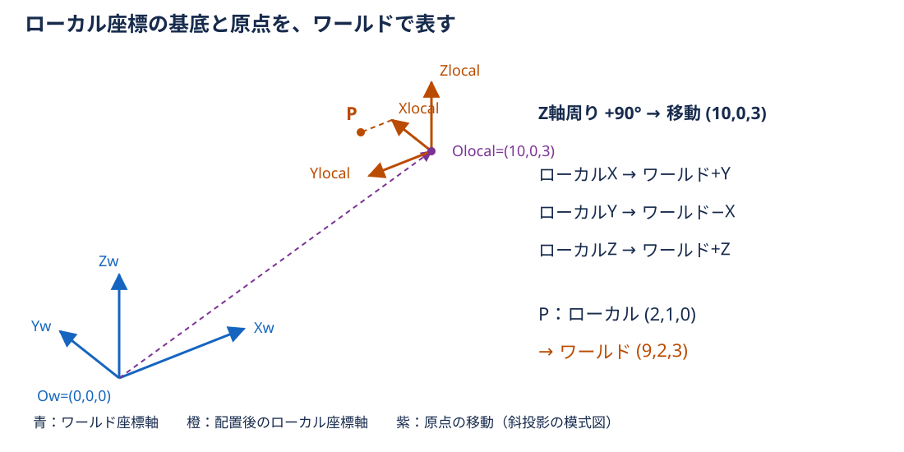

この変換は $p_{world}=Ap_{local}+t$ と座標を対応づける。図の座標系の説明ではローカルとワールドという異なる基準を使うが、これまでの回転図は固定された同じ軸で図形を動かしている。何を基準にした座標かを添字で区別すると混乱を避けられる。

## ⑥ なぜ変換を合成できるのか？

先に回転 $R$ 、次に平行移動 $T$ を適用すると、 $p'=T(Rp)$ になる。行列の積には結合法則があるため、 $T(Rp)=(TR)p$ とまとめられる。列ベクトル方式では、**右側にある行列から先に作用する**。

2Dの同次座標で、90°回転とX方向+3の移動を考える。

$$
\begin{aligned}
R &= \begin{bmatrix}
0 & -1 & 0 \\
1 & 0 & 0 \\
0 & 0 & 1
\end{bmatrix} \\
T &= \begin{bmatrix}
1 & 0 & 3 \\
0 & 1 & 0 \\
0 & 0 & 1
\end{bmatrix}.
\end{aligned}
$$

行列同士の積も「左の行×右の列」の掛け算と足し算で計算する。例えば $(TR)$ の右上成分は $1\cdot0+0\cdot0+3\cdot1=3$ になる。

$$
\begin{aligned}
TR &= \begin{bmatrix}
0 & -1 & 3 \\
1 & 0 & 0 \\
0 & 0 & 1
\end{bmatrix} \\
RT &= \begin{bmatrix}
0 & -1 & 0 \\
1 & 0 & 3 \\
0 & 0 & 1
\end{bmatrix}.
\end{aligned}
$$

点 $(1,0)$ では、次のように結果が異なる。

| 順序 | 途中の点 | 最後の点 | 合成行列 |
| --- | --- | --- | --- |
| 回転→移動 | $(0,1)$ | $(3,1)$ | $TR$ |
| 移動→回転 | $(4,0)$ | $(0,4)$ | $RT$ |

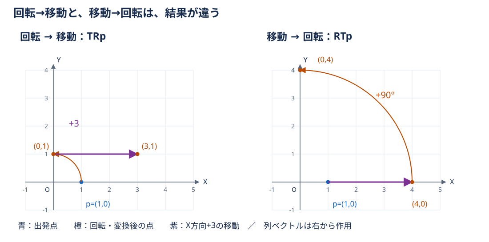

移動の後に回すと、先に加えた移動量の方向も回るため結果が違う。結合法則は括弧を変えられるという性質であり、順序を入れ替えられるという意味ではない。一般に $TR\ne RT$ である。

### .NETでは行ベクトル方式を使う

`System.Numerics.Matrix3x2` と `Matrix4x4` は行ベクトル方式で、ベクトルを左に置く $p_{row}'=p_{row}M_{row}$ という規約を使う。同じ幾何変換を表すには、数学で導いた行列を転置した配置になる。回転→移動は $p_{row}R_{row}T_{row}$ で、合成行列は $R_{row}T_{row}$ となる。規約は [Matrix3x2の公式資料](https://learn.microsoft.com/en-us/dotnet/api/system.numerics.matrix3x2?view=net-10.0) と [Matrix4x4の公式資料](https://learn.microsoft.com/en-us/dotnet/api/system.numerics.matrix4x4?view=net-10.0) のRemarksを参照。

| 項目 | 本文の列ベクトル方式 | .NETの行ベクトル方式 |
| --- | --- | --- |
| 掛ける側 | $Mp$ | $p_{row}M_{row}$ |
| 4×4の移動量 | 第4列の上3成分 | 第4行の先頭3成分：`M41,M42,M43` |
| 回転→移動の合成 | $TR$ | $R_{row}T_{row}$ |

本文の行列の数値をそのまま.NETの同じ行・列へ写すと、別の変換になる。`Matrix3x2` の省略された成分を含む対応は補足で確認する。

## ⑦ まとめ・宿題案内

| 行列 | 今回の使い方 | 構造の理由 |
| --- | --- | --- |
| 2×2 | 2Dの線形変換 | 2本の基底の変換先を列に並べる |
| 3×3 | 2Dの平行移動を含む変換 | 2成分に $w$ を加えて移動列を使う |
| 4×4 | 3Dの平行移動を含む変換 | 3成分に $w$ を加えて移動列を使う |
| 行列の積 | 変換の合成 | 続けて適用する操作を1つの行列にまとめる |

[4×4の構造図](images/09-homogeneous-structure.svg) を見直し、「左上3×3」「移動列」「最下行」の役割を自分の言葉で説明してみよう。最下行まで説明できれば、なぜこの形なのかがつながっている。

[復習用の宿題](homework/README.md) は基本3問＋発展1問。計算に加えて、基底・同次成分・順序という考え方を言葉で説明する。

## 補足：本編の後で読み返すために

### 回転が長さを保つことを式で確かめる

$c=\cos\theta$ 、 $s=\sin\theta$ とすると、単位円から $c^2+s^2=1$ である。回転後の成分は $(cx-sy,sx+cy)$ なので、

$$
\begin{aligned}
(cx-sy)^2+(sx+cy)^2 &= (c^2+s^2)x^2+(c^2+s^2)y^2 \\
&= x^2+y^2.
\end{aligned}
$$

交差する項が打ち消し合うため、原点からの距離が変わらない。さらに回転後の2本の基底は長さ1で互いに直角なので、基底の組み合わせ全体が回る。

### アフィン変換を続けても同じ形式になる

成分をまとまりとして書くと、

$$
M=\begin{bmatrix}
A & t \\
0 & 1
\end{bmatrix}.
$$

ここで $A$ は2×2または3×3、 $t$ は移動の列、 $0$ は必要な個数のゼロを並べた行を表す。

先に $M_1$ 、後に $M_2$ を適用すると、

$$
M_2M_1 =\begin{bmatrix}
A_2A_1 & A_2t_1+t_2 \\
0 & 1
\end{bmatrix}.
$$

これは、

$$
A_2(A_1p+t_1)+t_2=(A_2A_1)p+(A_2t_1+t_2)
$$

と同じ。先の移動量 $t_1$ も後の線形変換 $A_2$ を受けることが、順序で結果が変わる理由である。

### .NETの配置を成分で読む

本文の2D行列を転置して行ベクトル方式にすると、

$$
\begin{bmatrix}
a & b & t_x \\
c & d & t_y \\
0 & 0 & 1
\end{bmatrix}^{\mathsf T} =\begin{bmatrix}
a & c & 0 \\
b & d & 0 \\
t_x & t_y & 1
\end{bmatrix}.
$$

`Matrix3x2` はこの同次行列の固定された最後の列 $(0,0,1)$ を省いた6成分を保持する。従って `M11=a, M12=c, M21=b, M22=d, M31=tx, M32=ty` となり、 $x'=xM11+yM21+M31$ 、 $y'=xM12+yM22+M32$ と読む。

3Dでは本文の $M$ の転置が次の配置になる。

$$
M_{row}=\begin{bmatrix}
r_{11} & r_{21} & r_{31} & 0 \\
r_{12} & r_{22} & r_{32} & 0 \\
r_{13} & r_{23} & r_{33} & 0 \\
t_x & t_y & t_z & 1
\end{bmatrix}.
$$

行と列の読み方を変えた結果であり、幾何学的な操作は同じである。 $(TR)^{\mathsf T}=R^{\mathsf T}T^{\mathsf T}$ のため、合成順序の見た目も逆になる。これはメモリ上の格納順序の説明ではなく、ベクトルをどちら側に置いて計算するかの規約の違いである。

### 今回の範囲

3×3行列は3Dの線形変換にも使える。行列の大きさだけで用途は決まらず、入力の成分が何を表すかと合わせて読む。今回の表は2Dから3Dへの学習の流れに沿った使い方を示している。

今回は点を $w=1$ 、方向を $w=0$ とするアフィン変換に限定する。一般の同次座標や透視投影、行列式・逆行列の詳細、固有値、クォータニオンは扱わない。

[この回のトップへ戻る](README.md)
