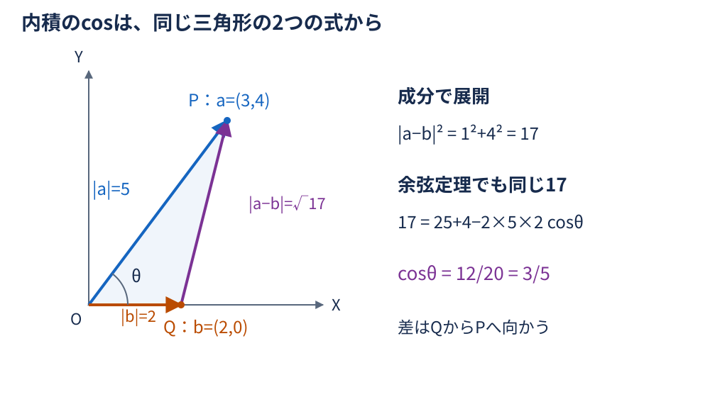
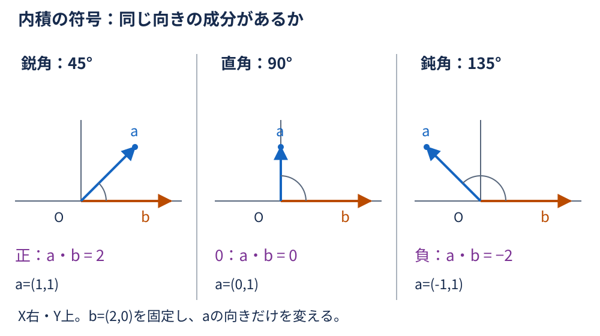
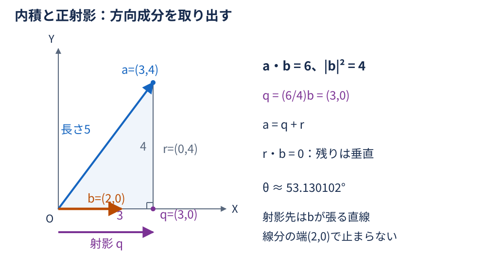
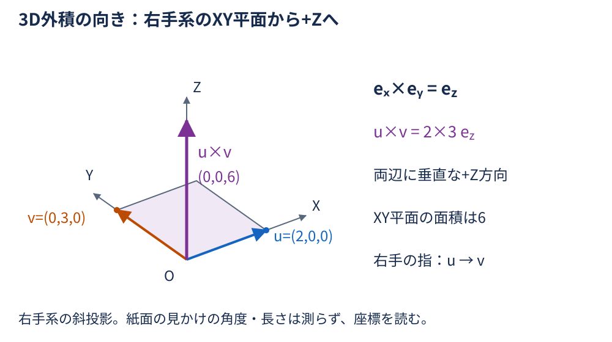
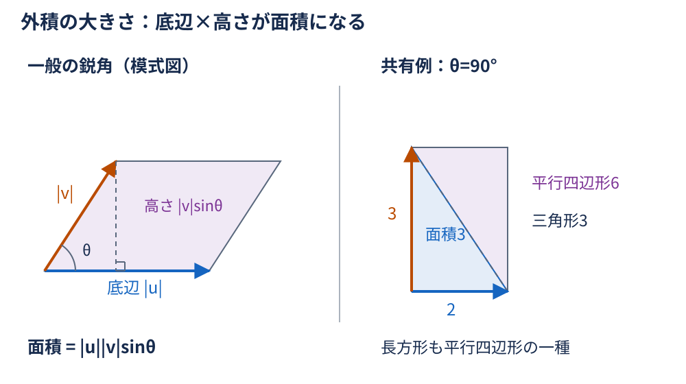
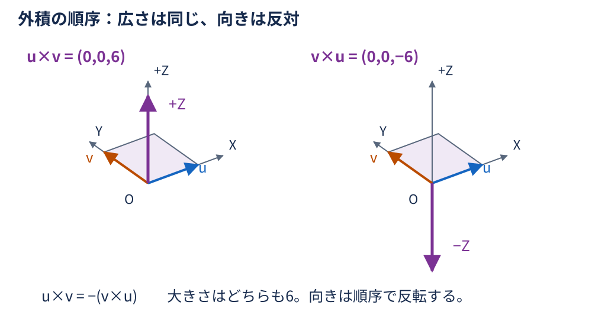
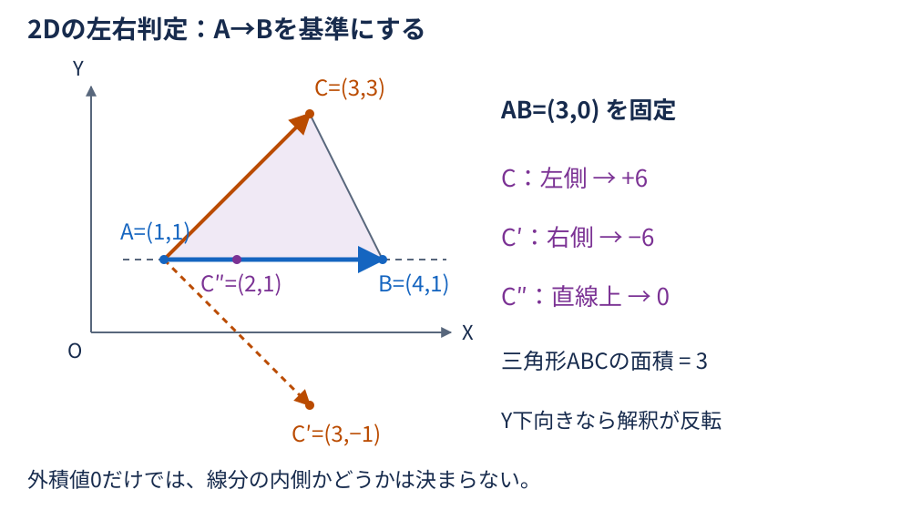
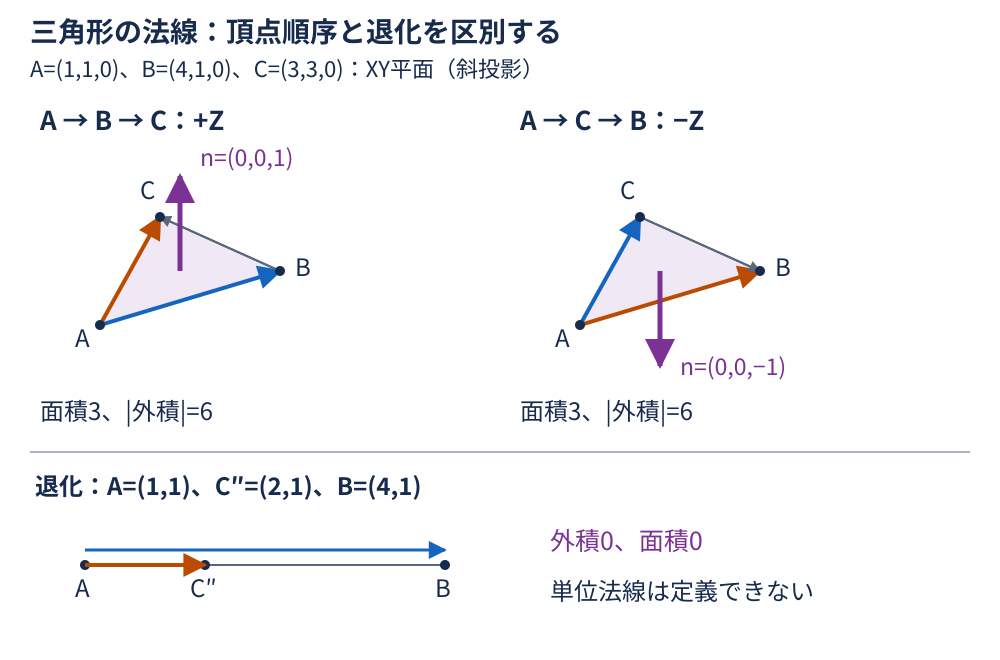

# 第2回：なぜ内積・外積で角度や方向がわかるのか？

本文と図の数値例を、宿題・C#実装例の共通基準にする。

## 学習の流れと表記

[第1回](../01-matrix/explanation.md) では、ベクトルを基底の組み合わせとして表し、行列でその行き先を求めた。  
今回は「2本のベクトルがどれだけ同じ向きを向くか」「2本が作る面の向きと広さは何か」を調べてみよう。

まず内積を成分と余弦定理から結び付け、射影を導く。  
続いて右手系の基底から3D外積を組み立て、2Dの符号と3Dの法線へ進む。  
最後に数値計算で必要な条件を整理する。

- ベクトルは同じ直交座標系で表す。  
  基底は互いに垂直で長さ1の標準基底。  
  斜めの基底の成分に、そのまま今回の内積公式を使わない。  
- 2DはX軸が右、Y軸が上。  
  3Dは右手系で、Z軸の正回転は+Z側から原点を見て反時計回り。  
- ベクトルの長さを $\|a\|$ と書く。  
  角度 $\theta$ は非ゼロの2本の間の小さい方の角で、 $0\leq\theta\leq\pi$ 。  
  向き付きの回転角とは区別する。  
- 本文のベクトルは列ベクトル。  
  短い座標の組を文章や図に書く場合は $(3,4)$ のように表記する。  
  内積はスカラー、3D外積はベクトルを返す。  
- $A,B,C$ は点、 $B-A$ はAからBへの変位ベクトル。  
  長さの単位をそろえ、角度の計算式はラジアンを使う。

## ① 導入：向きと面を数値で調べたい

線の角度や直交、部材に沿った方向成分、三角形の面の向きを調べたいとしよう。  
座標を個別に眺めるだけでは、こうした向きの関係を読み取りにくい。

内積は「一方の向きへ、もう一方がどれだけ伸びているか」を長さとともに数値化する。  
外積は「2本で作る平行四辺形の広さ」を、面に垂直な向きと組にして表す。  
どちらも、座標の成分計算と図形の意味を結び付ける道具である。

第1回の基底の考え方を使って、「どの成分の組が、どの量を作るか」を追ってみよう。  
公式の形だけでなく、その中身をつかむのが今回のねらいだ。

## ② 内積：成分の和が角度を表す理由

### 成分表示と長さ

2Dの内積を次の成分計算で定義する。

$$
a=\begin{bmatrix}
a_x \\
a_y
\end{bmatrix},\qquad
b=\begin{bmatrix}
b_x \\
b_y
\end{bmatrix}.
$$

$$
a\cdot b=a_xb_x+a_yb_y.
$$

3DではZ成分の積も加え、 $a\cdot b=a_xb_x+a_yb_y+a_zb_z$ とする。  
三平方の定理より、 $a\cdot a=\|a\|^2$ であり、自分自身との内積は長さの2乗になる。

成分の積の和なので、足し算に分配でき、順序を逆にしても値は変わらない。

### 差の長さを2通りに求めて、内積を長さと角度でも表してみよう

2本の始点を原点Oにそろえる。  
先端をそれぞれP、Qとすると、QからPへのベクトルが $a-b$ である。

成分で差の長さを展開すると、2Dでは次のようになる。

$$
\begin{aligned}
\|a-b\|^2
&=(a_x-b_x)^2+(a_y-b_y)^2 \\
&=(a_x^2+a_y^2)+(b_x^2+b_y^2)
  -2(a_xb_x+a_yb_y) \\
&=\|a\|^2+\|b\|^2-2(a\cdot b).
\end{aligned}
$$

一方、三角形OPQの余弦定理では、角度 $\theta$ の向かいの辺の長さが $\|a-b\|$ なので、

$$
\|a-b\|^2=\|a\|^2+\|b\|^2
-2\|a\|\|b\|\cos\theta.
$$

どちらも、同じ2点の間の距離を計算している！  
2つの式を比べ、共通する2つの長さの2乗を取り除くと、

$$
a\cdot b=\|a\|\|b\|\cos\theta.
$$

3Dでも、2本が張る平面の三角形に余弦定理を使える。  
成分展開にZの項を加えれば、同じ結論になる。

平行な場合も、同方向なら差の長さ、逆方向なら長さの和から同じ式が成立する。

### 符号と角度

非ゼロベクトル同士なら長さの積は正なので、内積の符号はcosの符号と一致する。

| 内積 | 角度 | 幾何的な意味 |
| --- | --- | --- |
| 正 | $0\leq\theta<\pi/2$ | 同じ向きへの成分がある（0°を含む） |
| 0 | $\theta=\pi/2$ | 垂直 |
| 負 | $\pi/2<\theta\leq\pi$ | 反対向きへの成分がある（180°を含む） |

角度を求めるには、両方の長さで割ってcosを取り出す。

$$
\cos\theta=\frac{a\cdot b}{\|a\|\|b\|},\qquad
\theta=\arccos\left(\frac{a\cdot b}{\|a\|\|b\|}\right).
$$

共有例 $a=(3,4)$ 、 $b=(2,0)$ なら、

$$
\begin{aligned}
a\cdot b&=3\times2+4\times0=6, \\
\|a\|&=\sqrt{3^2+4^2}=5, \\
\|b\|&=\sqrt{2^2+0^2}=2.
\end{aligned}
$$

上の3行で、内積6と、2本の長さ5・2がそろった。  
それぞれ独立した計算で得た値を、角度の式へ入れてみよう。

$$
\cos\theta=\frac{6}{5\times2}=\frac35,\qquad
\theta\approx0.927295218\ \mathrm{rad}
\approx53.130102^\circ.
$$

角度への変換は、得たラジアンに $180/\pi$ を掛ける。  
内積6だけでは角度は決まらず、長さの積で割ることが必要になる。

## ③ 射影：内積から方向成分を取り出そう

### 長さ1でないベクトルへの射影を考えたい

ベクトル $a$ の先端から、 $b$ が張る直線へ垂線を下ろす。  
その足までのベクトルを**正射影**と呼ぼう。  
射影先は有限の線分ではなく、原点を通り $b$ に平行な直線である。

射影は $b$ と同じ直線上にあるので、射影ベクトルを $q=tb$ と置ける。  
ここでtは、射影先のベクトルを何倍するかという係数である。  
元のベクトルから射影を引いた残り $r=a-q$ は $b$ と垂直になる。  
この「残りが垂直」という条件から係数を求めよう。  
$b\ne0$ として、

$$
\begin{aligned}
(a-tb)\cdot b&=0, \\
a\cdot b-t(b\cdot b)&=0, \\
t&=\frac{a\cdot b}{b\cdot b}.
\end{aligned}
$$

よって、求める射影ベクトルは、

$$
\mathrm{proj}_b a
=\frac{a\cdot b}{b\cdot b} b.
$$

分母は $\|b\|^2$ である。  
内積 $a\cdot b$ をそのまま $b$ に掛けると、その大きさを補正できない。

単位ベクトル $\hat b=b/\|b\|$ を使う場合は、次のように読む。

- 向き付きの射影長は $a\cdot\hat b=\|a\|\cos\theta$ 。  
- 射影ベクトルは、その長さに $\hat b$ を掛けたもの。

内積が負なら、射影は $b$ と逆向きになる。

### 共有例で確認する

$a=(3,4)$ 、 $b=(2,0)$ では、 $b\cdot b=4$ なので、

$$
\begin{aligned}
\mathrm{proj}_b a
&=\frac64\begin{bmatrix}
2 \\
0
\end{bmatrix} \\
&=\begin{bmatrix}
3 \\
0
\end{bmatrix}.
\end{aligned}
$$

ここは意味を取り違えやすいので注意！  
係数は $3/2$ でも、射影の長さは3である。  
係数は長さ2のベクトルを何倍するかを表している。  
またベクトル $r=(0,4)$ と $b$ との内積は0になる。(直交していることからも明らか)

### (発展)ゼロベクトルを区別する

ゼロベクトルとの内積は常に0だが、向きがないため、なす角は定義できない。  
射影と正規化では、次の条件を分ける。

- $b=0$ のとき射影先の方向が決まらず、射影式の分母も0になってしまう。  
- 正規化 $a/\|a\|$ については $a=0$ には使えない。  
- $a=0$ から非ゼロ $b$ への射影はゼロベクトルとして定義できる。  
(3つ目の補足：射影先の方向は決まっており、射影結果はゼロベクトルになる。  
分母も0にならないため、射影式をそのまま使える。)

## ④ 3D外積：基底から垂直なベクトルを作る

### 右手系の基底と順序

内積が1つの数を返すのに対して、3Dの外積 $a\times b$ はベクトルを返す。  
まず長さ1の基底の組について、右手系の向きに合わせて次のように定める。

$$
e_x\times e_y=e_z,\qquad
e_y\times e_z=e_x,\qquad
e_z\times e_x=e_y.
$$

右手の指を第1のベクトルから第2のベクトルへ曲げると、親指が外積の向きを指す。  
さらに、次の規則を使う。

- 順序を逆にすると符号が反転する。  
- 同じ基底同士の外積はゼロとする。(2つのベクトルが成す平行四辺形の面積はゼロ！)  
- 各引数について、分配法則と実数倍との両立を要求する。(身近な掛け算と同じ法則)

これらの規則から、任意の成分の公式が決まる。

### 基底の式を分配して、成分を導こう

3D空間のベクトル $a,b$ を用意して、  
$a=a_xe_x+a_ye_y+a_ze_z$ 、 $b=b_xe_x+b_ye_y+b_ze_z$ と分解する。

同じ基底同士の3項は0なので、残る6項を展開すると、

$$
\begin{aligned}
a\times b
&=a_xb_y e_z-a_xb_z e_y \\
&\quad-a_yb_x e_z+a_yb_z e_x \\
&\quad+a_zb_x e_y-a_zb_y e_x.
\end{aligned}
$$

同じ出力方向の係数を集めると、

$$
a\times b=\begin{bmatrix}
a_yb_z-a_zb_y \\
a_zb_x-a_xb_z \\
a_xb_y-a_yb_x
\end{bmatrix}.
$$

符号を暗記する代わりに、例えばX成分は $e_y\times e_z=e_x$ と $e_z\times e_y=-e_x$ の2項から生じる、と読み取れる。

### (発展) 本当に両方に垂直か、式で確かめてみよう

$c=a\times b$ として、元のベクトルと外積の内積を成分で確認する。  
ここでcは、直前に求めた外積ベクトルを指す。  
以下の式は、元の2本のそれぞれと外積が垂直になることを確かめている。

$$
\begin{aligned}
a\cdot c
&=a_xa_yb_z-a_xa_zb_y \\
&\quad+a_ya_zb_x-a_ya_xb_z \\
&\quad+a_za_xb_y-a_za_yb_x \\
&=0.
\end{aligned}
$$

同じ積が正負で打ち消し合う。  
同様に、

$$
\begin{aligned}
b\cdot c
&=b_xa_yb_z-b_xa_zb_y \\
&\quad+b_ya_zb_x-b_ya_xb_z \\
&\quad+b_za_xb_y-b_za_yb_x \\
&=0.
\end{aligned}
$$

したがって $c\ne0$ なら、 $c$ は両方に垂直である。  
$c=0$ の場合には垂直な向きが得られたわけではない。

一般の共有例 $a=(1,2,3)$ 、 $b=(4,5,6)$ では、

$$
\begin{aligned}
a\times b
&=\begin{bmatrix}
2\times6-3\times5 \\
3\times4-1\times6 \\
1\times5-2\times4
\end{bmatrix} \\
&=\begin{bmatrix}
-3 \\
6 \\
-3
\end{bmatrix}.
\end{aligned}
$$

直交の確認も別に行う。

$$
\begin{aligned}
a\cdot(a\times b)&=-3+12-9=0, \\
b\cdot(a\times b)&=-12+30-18=0.
\end{aligned}
$$

### 外積の大きさは平行四辺形の面積になる！

成分公式の長さの2乗は、次の形にまとめられる。  
途中の展開は末尾の補足で確認する。

$$
\|a\times b\|^2
=\|a\|^2\|b\|^2-(a\cdot b)^2.
$$

非ゼロベクトルについて内積とcosの関係を代入すると、

$$
\begin{aligned}
\|a\times b\|^2
&=\|a\|^2\|b\|^2(1-\cos^2\theta) \\
&=\|a\|^2\|b\|^2\sin^2\theta.
\end{aligned}
$$

$0\leq\theta\leq\pi$ ではsinは非負なので、平方根を取って、

$$
\|a\times b\|=\|a\|\|b\|\sin\theta.
$$

一方、平行四辺形は底辺 $\|a\|$ 、高さ $\|b\|\sin\theta$ だから、面積は同じ積になる。  
三角形はその半分である。  
平行なときやどちらかがゼロのときは外積も面積も0となる。

共有例 $u=(2,0,0)$ 、 $v=(0,3,0)$ を使うと、

$$
u\times v=\begin{bmatrix}
0 \\
0 \\
2\times3
\end{bmatrix}=\begin{bmatrix}
0 \\
0 \\
6
\end{bmatrix}.
$$

平行四辺形の面積は6、三角形の面積は3。  
座標の長さの単位がmなら、面積の単位は $\mathrm{m}^2$ になる。

### 順序を逆にすると、向きが反転する！

成分公式の各差は、 $a$ と $b$ を入れ替えると正負が逆になる。  
したがって、

$$
b\times a=-(a\times b).
$$

大きさは同じでも向きが逆になる。  
$v\times u=(0,0,-6)$ は同じ面積を持つが、法線の向きは−Zである。  
内積の交換法則と異なることに注意しよう。

## ⑤ 2Dの向き判定：外積のZ成分だけを使う

2DのベクトルをZ成分0として3Dに埋め込むと、

$$
\begin{bmatrix}
u_x \\
u_y \\
0
\end{bmatrix}\times
\begin{bmatrix}
v_x \\
v_y \\
0
\end{bmatrix}
=\begin{bmatrix}
0 \\
0 \\
u_xv_y-u_yv_x
\end{bmatrix}.
$$

このZ成分を、2Dのスカラー外積（行列式） $\mathrm{cross2}(u,v)=u_xv_y-u_yv_x$ と呼ぶ。  
結果は2Dベクトルではなく、1つの数である。

- 絶対値は平行四辺形の面積を表す。  
- 符号は回る向きを表す。

### AからBを見て、Cはどちら側か

$u=B-A$ 、 $v=C-A$ とする。  
$A\ne B$ で、X右・Y上の座標なら、

| cross2(u,v) | AからBへ進む向きに対するCの位置 |
| --- | --- |
| 正 | 左側（uからvへの小さい回転が反時計回り） |
| 負 | 右側（同じ回転が時計回り） |
| 0 | 直線AB上。線分ABの内側かどうかは別の判定が必要 |

共有例 $A=(1,1)$ 、 $B=(4,1)$ 、 $C=(3,3)$ なら、

$$
\begin{aligned}
u&=B-A=(3,0), \\
v&=C-A=(2,2), \\
\mathrm{cross2}(u,v)&=3\times2-0\times2=6.
\end{aligned}
$$

したがってCは左側。  
符号付き三角形面積は $\mathrm{cross2}(u,v)/2=3$ 、通常の面積は絶対値を取った3になる。  
基準のAから引くことで、原点の場所に依存しない判定になる。

$C'=(3,-1)$ なら $C'-A=(2,-2)$ なので値は−6で右側になる。  
$C''=(2,1)$ なら $C''-A=(1,0)$ なので0で直線上にある。  
$A=B$ では基準方向がなく、値が0でも左右を定義できない。

### (発展) Y軸が下向きの場合

画面座標でYが下へ増えると、見た目に対する符号の解釈は反転する。  
例えば上に見えるCはY値が小さくなり、水平に右向きのABとのスカラー外積は負になる。

変わったのは式ではなく座標系の向きである。  
軸を明記してから符号を読む。

## ⑥ (発展) 3Dの法線：頂点の順序で面の向きを決める

三角形ABCの面上の2辺を $u=B-A$ 、 $v=C-A$ とする。  
外積 $c=u\times v$ は両辺に垂直なので、非ゼロなら面の法線として使える。  
長さ1の単位法線は、

$$
n=\frac{(B-A)\times(C-A)}{\|(B-A)\times(C-A)\|}.
$$

三角形の面積は $\|(B-A)\times(C-A)\|/2$ 。  
面積と向きは同じ外積から読み取れるが、単位法線の長さは1にそろえているため、法線だけから面積はわからない。

先ほどの三角形の頂点A=(1,1)、B=(4,1)、C=(3,3)を、Z成分0の3D座標として使ってみよう。  
AからBへの辺は(3,0,0)、AからCへの辺は(2,2,0)なので、

$$
u=\begin{bmatrix}
3 \\
0 \\
0
\end{bmatrix},\qquad
v=\begin{bmatrix}
2 \\
2 \\
0
\end{bmatrix},\qquad
u\times v=\begin{bmatrix}
0 \\
0 \\
6
\end{bmatrix}.
$$

単位法線は $(0,0,1)$ 、三角形面積は3である。  
BとCを入れ替えると、外積は $(0,0,-6)$ 、単位法線は $(0,0,-1)$ になる。

**ポイント：+Z側から見ると、頂点順序A→B→Cは反時計回り、逆順は時計回りである。**

CADモデルの面の表裏を一貫させたい場合は、隣り合う三角形の頂点順序をそろえる必要がある。  
「常に上向き」のような絶対的な法線が自動で決まるわけではなく、向きの規約を選んでいる。

3点が一直線上、または同じ点を含む場合、辺が平行になるかゼロになる。  
そのため外積も三角形面積も0で、割り算による単位法線は作れない。

ほぼ一直線の三角形では、計算誤差の影響が大きくなる。

## (発展) atan2で2つのベクトル間の角度を読む

非ゼロの3Dベクトルについて、内積がcos側、外積の大きさがsin側の量なので、角度は次の式で求められる。

$$
\theta=\mathrm{atan2}\bigl(\|a\times b\|,a\cdot b\bigr).
$$

両方に共通する長さの積が比の中で相殺され、 $[0,\pi]$ の角度を返す。  
2Dでは、外積の大きさを $|\mathrm{cross2}(a,b)|$ に置き換えられる。

絶対値を外すと向き付き角になるため、今回は区別する。  
なおゼロベクトルの角度は定義できず、有限性や桁の扱いの検査は必要である。

## ⑦ まとめ

内積は差の長さを成分展開し、余弦定理と比較することで角度につながった。  
射影は「残りが垂直」という条件から係数を決めた。  
外積は右手系の基底の規則から展開でき、両方に垂直で、大きさは面積を表した。

2Dでは外積のZ成分だけで左右と符号付き面積を読み、3Dでは頂点順序に応じた法線を作れる。  
ゼロや平行という退化を確認してから、角度・正規化・左右の意味を判断する。

復習では「なぜ射影に長さの2乗で割るのか」「なぜ外積の順序で符号が反転するのか」「法線が作れない三角形とは何か」を自分の言葉で説明してみよう。

## (発展) 補足：外積の長さの恒等式を成分で確かめる

外積の各成分の2乗を足すと、

$$
\begin{aligned}
\|a\times b\|^2
&=(a_yb_z-a_zb_y)^2 \\
&\quad+(a_zb_x-a_xb_z)^2 \\
&\quad+(a_xb_y-a_yb_x)^2 \\
&=a_y^2b_z^2+a_z^2b_y^2
  +a_z^2b_x^2+a_x^2b_z^2 \\
&\quad+a_x^2b_y^2+a_y^2b_x^2 \\
&\quad-2(a_ya_zb_yb_z+a_za_xb_zb_x+a_xa_yb_xb_y).
\end{aligned}
$$

一方、長さの2乗の積は、

$$
\begin{aligned}
\|a\|^2\|b\|^2
&=(a_x^2+a_y^2+a_z^2)(b_x^2+b_y^2+b_z^2) \\
&=a_x^2b_x^2+a_y^2b_y^2+a_z^2b_z^2 \\
&\quad+a_x^2b_y^2+a_x^2b_z^2 \\
&\quad+a_y^2b_x^2+a_y^2b_z^2 \\
&\quad+a_z^2b_x^2+a_z^2b_y^2.
\end{aligned}
$$

内積の2乗は、

$$
\begin{aligned}
(a\cdot b)^2
&=(a_xb_x+a_yb_y+a_zb_z)^2 \\
&=a_x^2b_x^2+a_y^2b_y^2+a_z^2b_z^2 \\
&\quad+2(a_xa_yb_xb_y+a_ya_zb_yb_z+a_za_xb_zb_x).
\end{aligned}
$$

上の2式の差を取ると、同じ軸同士の3つの2乗項が消える。  
残った6つの2乗項と3つの交差項が、最初の外積の長さの展開と一致する。  
これで面積の導出に使った恒等式が成分計算から確かめられる。

[この回のトップへ戻る](README.md)
