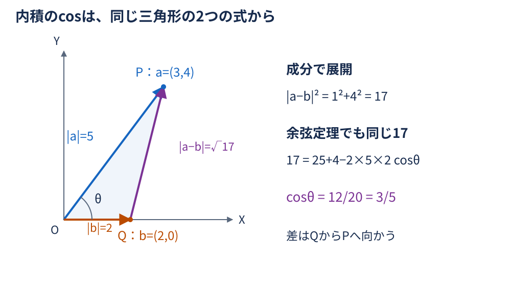
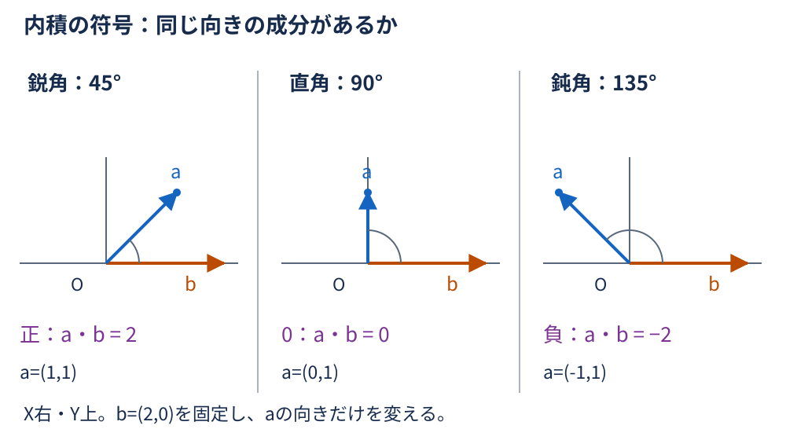
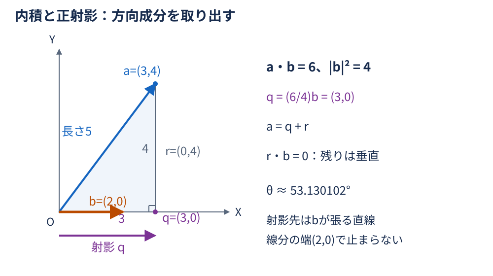
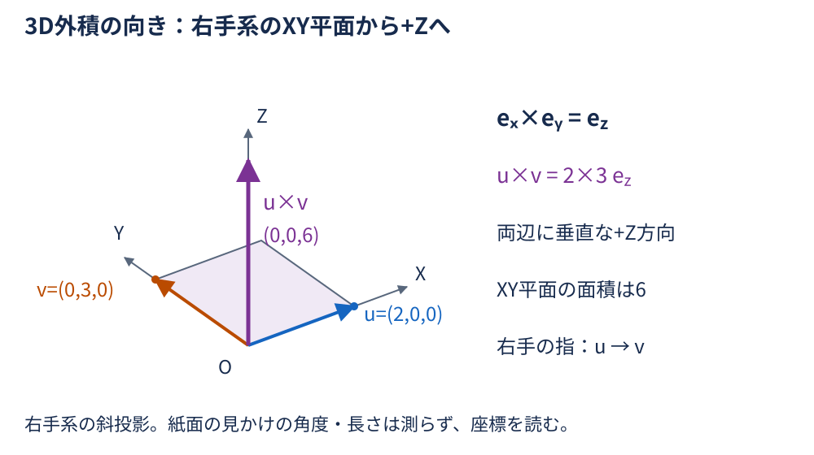
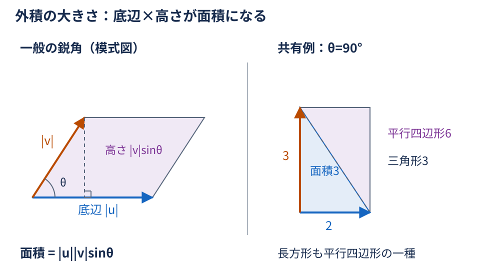
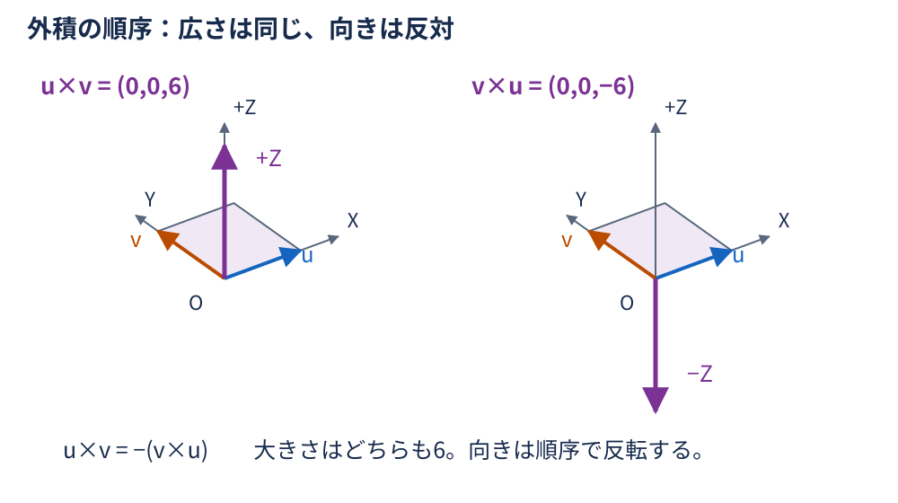
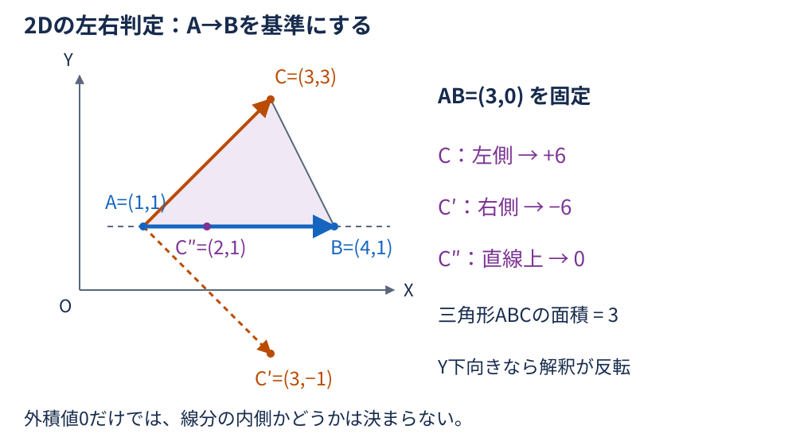
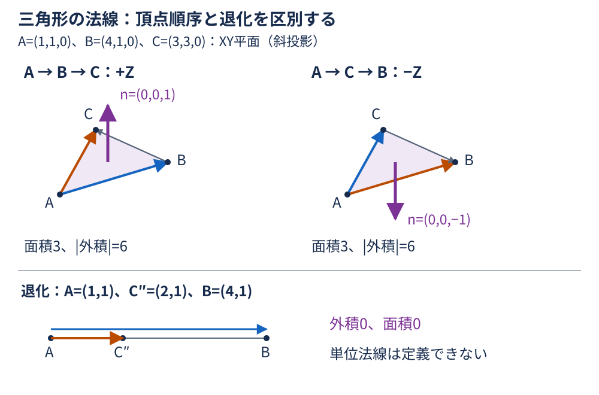

# 第2回：なぜ内積・外積で角度や方向がわかるのか？ — 詳細解説

**準備中／レビュー待ちの下書き。** 本文と図の数値例を宿題・C#実装例の共通基準にする。レビュー用PDFは手動で生成・同期し、内容の承認と公開判断は別途行う。

## 学習の流れと表記

[第1回](../01-matrix/explanation.md) では、ベクトルを基底の組み合わせとして表し、行列でその行き先を求めた。今回は「2本のベクトルがどれだけ同じ向きを向くか」「2本が作る面の向きと広さは何か」を調べる。

まず内積を成分と余弦定理から結び付け、射影を導く。続いて右手系の基底から3D外積を組み立て、2Dの符号と3Dの法線へ進む。最後に数値計算で必要な条件を整理する。

- ベクトルは同じ直交座標系で表す。基底は互いに垂直で長さ1の標準基底。斜めの基底の成分に、そのまま今回の内積公式を使わない。
- 2DはX軸が右、Y軸が上。3Dは右手系で、Z軸の正回転は+Z側から原点を見て反時計回り。
- ベクトルの長さを $\|a\|$ と書く。角度 $\theta$ は非ゼロの2本の間の小さい方の角で、 $0\leq\theta\leq\pi$ 。向き付きの回転角とは区別する。
- 本文のベクトルは列ベクトル。短い座標の組を文章や図に書く場合は $(3,4)$ のように表記する。内積はスカラー、3D外積はベクトルを返す。
- $A,B,C$ は点、 $B-A$ はAからBへの変位ベクトル。長さの単位をそろえ、角度の計算式はラジアンを使う。

## ① 導入：向きと面を数値で調べたい

CADで2本の線の角度や直交を確認したい、橋梁の部材に沿った方向成分を知りたい、三角形の面がどちらを向くか決めたい、といった場面を考える。座標を個別に眺めるだけでは、向きの関係を読み取りにくい。

内積は「一方の向きへ、もう一方がどれだけ伸びているか」を長さとともに数値化する。外積は「2本で作る平行四辺形の広さ」を、面に垂直な向きと組にして表す。どちらも、座標の成分計算と図形の意味を結び付ける道具である。

第1回の基底の考え方を使えば、公式を丸暗記する代わりに「どの成分の組が、どの量を作るか」を追える。

## ② 内積：成分の和が角度を表す理由

### 成分表示と長さ

2Dの内積を次の成分計算で定義する。

$$
a=\begin{bmatrix}
a_x \\
a_y
\end{bmatrix},\qquad
b=\begin{bmatrix}
b_x \\
b_y
\end{bmatrix}.
$$

$$
a\cdot b=a_xb_x+a_yb_y.
$$

3DではZ成分の積も加え、 $a\cdot b=a_xb_x+a_yb_y+a_zb_z$ とする。三平方の定理から、 $a\cdot a=\|a\|^2$ 。つまり自分自身との内積は長さの2乗である。成分の積の和なので、足し算に分配でき、順序を逆にしても値は変わらない。

### 差の長さを2通りに求める

2本の始点を原点Oにそろえる。先端をそれぞれP、Qとすると、QからPへのベクトルが $a-b$ である。

成分で差の長さを展開すると、2Dでは次のようになる。

$$
\begin{aligned}
\|a-b\|^2
&=(a_x-b_x)^2+(a_y-b_y)^2 \\
&=(a_x^2+a_y^2)+(b_x^2+b_y^2)
  -2(a_xb_x+a_yb_y) \\
&=\|a\|^2+\|b\|^2-2(a\cdot b).
\end{aligned}
$$

一方、三角形OPQの余弦定理では、角度 $\theta$ の向かいの辺の長さが $\|a-b\|$ なので、

$$
\|a-b\|^2=\|a\|^2+\|b\|^2
-2\|a\|\|b\|\cos\theta.
$$

同じ長さの式を比較し、共通する2つの長さの2乗を取り除くと、

$$
a\cdot b=\|a\|\|b\|\cos\theta.
$$

3Dでも成分展開にZの項を加えるだけで同じ結論になる。2本が張る平面の三角形に余弦定理を使えるためである。平行な場合も、同方向なら差の長さ、逆方向なら長さの和から同じ式が成立する。

### 符号と角度

非ゼロベクトル同士なら長さの積は正なので、内積の符号はcosの符号と一致する。

| 内積 | 角度 | 幾何的な意味 |
| --- | --- | --- |
| 正 | $0\leq\theta<\pi/2$ | 同じ向きへの成分がある（0°を含む） |
| 0 | $\theta=\pi/2$ | 垂直 |
| 負 | $\pi/2<\theta\leq\pi$ | 反対向きへの成分がある（180°を含む） |

角度を求めるには、両方の長さで割ってcosを取り出す。

$$
\cos\theta=\frac{a\cdot b}{\|a\|\|b\|},\qquad
\theta=\arccos\left(\frac{a\cdot b}{\|a\|\|b\|}\right).
$$

共有例 $a=(3,4)$ 、 $b=(2,0)$ なら、

$$
\begin{aligned}
a\cdot b&=3\times2+4\times0=6, \\
\|a\|&=\sqrt{3^2+4^2}=5, \\
\|b\|&=\sqrt{2^2+0^2}=2.
\end{aligned}
$$

ここでは上の3行は独立した計算である。得られた値から、

$$
\cos\theta=\frac{6}{5\times2}=\frac35,\qquad
\theta\approx0.927295218\ \mathrm{rad}
\approx53.130102^\circ.
$$

角度への変換は、得たラジアンに $180/\pi$ を掛ける。内積6だけでは角度は決まらず、長さの積で割ることが必要になる。

## ③ 射影：内積から方向成分を取り出す

### 非単位ベクトルへの射影を導く

ベクトル $a$ の先端から、 $b$ が張る直線へ垂線を下ろす。その足までのベクトルを正射影と呼ぶ。射影先は有限の線分ではなく、原点を通り $b$ に平行な直線である。

射影は $b$ の実数倍なので $q=tb$ と置ける。残りの $r=a-q$ は $b$ と垂直である。 $b\ne0$ として、

$$
\begin{aligned}
(a-tb)\cdot b&=0, \\
a\cdot b-t(b\cdot b)&=0, \\
t&=\frac{a\cdot b}{b\cdot b}.
\end{aligned}
$$

よって、求める射影ベクトルは、

$$
\mathrm{proj}_b a
=\frac{a\cdot b}{b\cdot b} b.
$$

分母は $\|b\|^2$ であり、単に $a\cdot b$ を $b$ に掛けるのではない。単位ベクトル $\hat b=b/\|b\|$ を使うなら、向き付きの射影長は $a\cdot\hat b=\|a\|\cos\theta$ 、射影ベクトルはその長さに $\hat b$ を掛けたものになる。内積が負なら、射影は $b$ と逆向きになる。

### 共有例で確認する

$a=(3,4)$ 、 $b=(2,0)$ では、 $b\cdot b=4$ なので、

$$
\begin{aligned}
\mathrm{proj}_b a
&=\frac64\begin{bmatrix}
2 \\
0
\end{bmatrix} \\
&=\begin{bmatrix}
3 \\
0
\end{bmatrix}.
\end{aligned}
$$

係数は $3/2$ でも、射影の長さは3である。残りは $(0,4)$ で、 $b$ との内積は0になる。また、

$$
\begin{aligned}
\begin{bmatrix}
3 \\
4
\end{bmatrix}\cdot
\begin{bmatrix}
4 \\
-3
\end{bmatrix}
&=3\times4+4\times(-3) \\
&=0.
\end{aligned}
$$

この2本も非ゼロなので垂直である。内積0を見たときは、どちらもゼロでないかという前提を忘れない。

### ゼロベクトルを区別する

ゼロベクトルとの内積は常に0だが、ゼロベクトルには向きがなく、なす角は定義できない。 $b=0$ では射影先の方向が決まらず、射影式の分母も0になる。正規化 $a/\|a\|$ も $a=0$ には使えない。なお $a=0$ から非ゼロの $b$ への射影はゼロであり、定義できる。

## ④ 3D外積：基底から垂直なベクトルを作る

### 右手系の基底と順序

内積が1つの数を返すのに対して、3Dの外積 $a\times b$ はベクトルを返す。まず長さ1の基底の組について、右手系の向きに合わせて、

$$
e_x\times e_y=e_z,\qquad
e_y\times e_z=e_x,\qquad
e_z\times e_x=e_y.
$$

と定める。右手の指を第1のベクトルから第2のベクトルへ曲げると親指が外積の向きを指す。順序を逆にすれば符号を反転し、同じ基底同士の外積はゼロとする。さらに各引数について分配法則と実数倍との両立を要求する。この規則から、任意の成分の公式が決まる。

### 分配して成分を導く

$a=a_xe_x+a_ye_y+a_ze_z$ 、 $b=b_xe_x+b_ye_y+b_ze_z$ と分解する。同じ基底同士の3項は0なので、残る6項を展開すると、

$$
\begin{aligned}
a\times b
&=a_xb_y e_z-a_xb_z e_y \\
&\quad-a_yb_x e_z+a_yb_z e_x \\
&\quad+a_zb_x e_y-a_zb_y e_x.
\end{aligned}
$$

同じ出力方向の係数を集めると、

$$
a\times b=\begin{bmatrix}
a_yb_z-a_zb_y \\
a_zb_x-a_xb_z \\
a_xb_y-a_yb_x
\end{bmatrix}.
$$

符号を暗記する代わりに、例えばX成分は $e_y\times e_z=e_x$ と $e_z\times e_y=-e_x$ の2項から生じる、と読み取れる。

### 本当に両方に垂直か

$c=a\times b$ として、内積を成分で確認する。

$$
\begin{aligned}
a\cdot c
&=a_xa_yb_z-a_xa_zb_y \\
&\quad+a_ya_zb_x-a_ya_xb_z \\
&\quad+a_za_xb_y-a_za_yb_x \\
&=0.
\end{aligned}
$$

同じ積が正負で打ち消し合う。同様に、

$$
\begin{aligned}
b\cdot c
&=b_xa_yb_z-b_xa_zb_y \\
&\quad+b_ya_zb_x-b_ya_xb_z \\
&\quad+b_za_xb_y-b_za_yb_x \\
&=0.
\end{aligned}
$$

したがって $c\ne0$ なら、 $c$ は両方に垂直である。 $c=0$ の場合には垂直な向きが得られたわけではない。

一般の共有例 $a=(1,2,3)$ 、 $b=(4,5,6)$ では、

$$
\begin{aligned}
a\times b
&=\begin{bmatrix}
2\times6-3\times5 \\
3\times4-1\times6 \\
1\times5-2\times4
\end{bmatrix} \\
&=\begin{bmatrix}
-3 \\
6 \\
-3
\end{bmatrix}.
\end{aligned}
$$

直交の確認も別に行う。

$$
\begin{aligned}
a\cdot(a\times b)&=-3+12-9=0, \\
b\cdot(a\times b)&=-12+30-18=0.
\end{aligned}
$$

### 大きさが面積になる理由

成分公式の長さの2乗は、次の形にまとめられる。途中の展開は末尾の補足で確認する。

$$
\|a\times b\|^2
=\|a\|^2\|b\|^2-(a\cdot b)^2.
$$

非ゼロベクトルについて内積とcosの関係を代入すると、

$$
\begin{aligned}
\|a\times b\|^2
&=\|a\|^2\|b\|^2(1-\cos^2\theta) \\
&=\|a\|^2\|b\|^2\sin^2\theta.
\end{aligned}
$$

$0\leq\theta\leq\pi$ ではsinは非負なので、平方根を取って、

$$
\|a\times b\|=\|a\|\|b\|\sin\theta.
$$

一方、平行四辺形は底辺 $\|a\|$ 、高さ $\|b\|\sin\theta$ だから、面積は同じ積になる。三角形はその半分である。平行なときやどちらかがゼロのときは外積も面積も0となる。

共有例 $u=(2,0,0)$ 、 $v=(0,3,0)$ を使うと、

$$
u\times v=\begin{bmatrix}
0 \\
0 \\
2\times3
\end{bmatrix}=\begin{bmatrix}
0 \\
0 \\
6
\end{bmatrix}.
$$

平行四辺形の面積は6、三角形の面積は3。座標の長さの単位がmなら、面積の単位は $\mathrm{m}^2$ になる。

### 順序を逆にするとどうなるか

成分公式の各差は、 $a$ と $b$ を入れ替えると正負が逆になる。したがって、

$$
b\times a=-(a\times b).
$$

大きさは同じでも向きが逆になる。 $v\times u=(0,0,-6)$ は同じ面積を持つが、法線の向きは−Zである。内積の交換法則と取り違えない。

## ⑤ 2Dの向き判定：外積のZ成分だけを使う

2DのベクトルをZ成分0として3Dに埋め込むと、

$$
\begin{bmatrix}
u_x \\
u_y \\
0
\end{bmatrix}\times
\begin{bmatrix}
v_x \\
v_y \\
0
\end{bmatrix}
=\begin{bmatrix}
0 \\
0 \\
u_xv_y-u_yv_x
\end{bmatrix}.
$$

そこで2Dのスカラー外積（行列式）を $\mathrm{cross2}(u,v)=u_xv_y-u_yv_x$ と呼ぶ。この値は2Dベクトルではなくスカラーで、3D外積のZ成分に当たる。絶対値は平行四辺形の面積、符号は回る向きを表す。

### AからBを見て、Cはどちら側か

$u=B-A$ 、 $v=C-A$ とする。 $A\ne B$ で、X右・Y上の座標なら、

| cross2(u,v) | AからBへ進む向きに対するCの位置 |
| --- | --- |
| 正 | 左側（uからvへの小さい回転が反時計回り） |
| 負 | 右側（同じ回転が時計回り） |
| 0 | 直線AB上。線分ABの内側かどうかは別の判定が必要 |

共有例 $A=(1,1)$ 、 $B=(4,1)$ 、 $C=(3,3)$ なら、

$$
\begin{aligned}
u&=B-A=(3,0), \\
v&=C-A=(2,2), \\
\mathrm{cross2}(u,v)&=3\times2-0\times2=6.
\end{aligned}
$$

したがってCは左側。符号付き三角形面積は $\mathrm{cross2}(u,v)/2=3$ 、通常の面積は絶対値を取った3になる。基準のAから引くことで、原点の場所に依存しない判定になる。

$C'=(3,-1)$ なら $C'-A=(2,-2)$ なので値は−6で右側、 $C''=(2,1)$ なら $C''-A=(1,0)$ なので0で直線上。 $A=B$ では基準方向がなく、値が0でも左右を定義できない。

### Y軸が下向きの場合

画面座標でYが下へ増えると、図の見た目に対する符号の解釈は反転する。例えば見た目で上にあるCはY値が小さくなり、水平に右向きのABとのスカラー外積は負になる。式が変わったのではなく、座標系の向きが変わったためである。軸を明記してから符号を読む。

## ⑥ 3Dの法線：頂点の順序で面の向きを決める

三角形ABCの面上の2辺を $u=B-A$ 、 $v=C-A$ とする。外積 $c=u\times v$ は両辺に垂直なので、非ゼロなら面の法線として使える。長さ1の単位法線は、

$$
n=\frac{(B-A)\times(C-A)}{\|(B-A)\times(C-A)\|}.
$$

三角形の面積は $\|(B-A)\times(C-A)\|/2$ 。面積と向きは同じ外積から読み取れるが、単位法線の長さは1にそろえているため、法線だけから面積はわからない。

先ほどの共有例をZ成分0として使うと、

$$
u=\begin{bmatrix}
3 \\
0 \\
0
\end{bmatrix},\qquad
v=\begin{bmatrix}
2 \\
2 \\
0
\end{bmatrix},\qquad
u\times v=\begin{bmatrix}
0 \\
0 \\
6
\end{bmatrix}.
$$

単位法線は $(0,0,1)$ 、三角形面積は3。BとCを入れ替えると外積は $(0,0,-6)$ 、単位法線は $(0,0,-1)$ となる。+Z側から見た頂点順序A→B→Cは反時計回りで、逆順は時計回りになる。

CADの面の表裏を一貫させるには、隣り合う三角形の頂点順序をそろえる必要がある。「常に上向き」のような絶対的な法線が自動で決まるわけではなく、向きの規約を選んでいる。

3点が一直線上、または同じ点を含む場合は辺が平行になるかゼロになり、外積は0になる。三角形面積も0で、割り算による単位法線は作れない。ほぼ一直線の三角形では計算誤差の影響が大きくなる。

ここで求めたのは頂点座標からの法線である。第1回で方向に使った `TransformNormal` や、非一様スケール後の一般の法線変換とは区別する。後者では逆転置などの別の考慮が必要になり、今回の範囲には含めない。

## ⑦ C#／.NETで扱う際の注意

### 数式とAPIの対応

この回も.NET 10を想定する。実行可能なC#教材は [実装例](examples/README.md) にまとめ、ここでは数式とAPIの対応だけを整理する。

| 求める量 | API・成分式 | 戻り値 |
| --- | --- | --- |
| 2D内積 | Vector2.Dot(a, b) | floatのスカラー |
| 3D内積 | Vector3.Dot(a, b) | floatのスカラー |
| 3D外積 | Vector3.Cross(a, b) | Vector3 |
| 2Dスカラー外積 | u_x v_y − u_y v_x | スカラー。成分式を自分で組み立てて意味を確かめる |

`Vector2` から3Dベクトルを返す外積APIはない。一方、.NET 10にはZ成分だけを `float` で返す [Vector2.Cross](https://learn.microsoft.com/en-us/dotnet/api/system.numerics.vector2.cross?view=net-10.0) がある。同じ名前でも [Vector3.Cross](https://learn.microsoft.com/en-us/dotnet/api/system.numerics.vector3.cross?view=net-10.0) のベクトル結果とは型も意味も区別する。

[Vector2](https://learn.microsoft.com/en-us/dotnet/api/system.numerics.vector2?view=net-10.0) と `Vector3` の各成分は `float` 。手計算をコード化するときは `double` を使ってよいが、もともと `float` に丸められた入力を後から `double` にしても失われた精度は戻らない。

### 角度・正規化の前に検査する

1. 入力にNaNやInfinityがなく、計算した長さも有限かを確認する。
2. どちらかの長さが0、または目的上ゼロと扱うほど小さい場合は、角度や単位方向を返さず退化として扱う。除算してから検査しない。
3. 長さの積で内積を割る。丸め誤差でcosの値が1をわずかに超えたり−1を下回ったりすることがあるため、有限な値を $[-1,1]$ にクランプしてからacosへ渡す。
4. 得た角度はラジアン。表示で度にする場合だけ $180/\pi$ を掛ける。

クランプは丸めのはみ出しを抑えるもので、ゼロ除算・非有限値・大きな計算誤りを修復するものではない。大きすぎる座標では積や長さの2乗がオーバーフローし、小さすぎる場合はアンダーフローする。対象スケールの確認と、必要に応じた成分のスケーリングも別に必要になる。

### 許容誤差には単位とスケールがある

計算上ほぼ垂直かを判定するとき、非ゼロ長さを確認したうえで次の比を使えば、長さの単位に依存しない角度の尺度になる。

$$
\frac{|a\cdot b|}{\|a\|\|b\|}\leq\varepsilon_{\mathrm{angle}}.
$$

ほぼ平行かも、外積の長さを同じ長さの積で割れば $|\sin\theta|$ と比較できる。ただし、長さの下限や面積の下限が必要な業務上の条件は別に持つ。

内積と外積の成分は長さの2乗の単位を持つ。mmとmでは同じ図形でも数値が変わるので、固定の小さな定数をすべての判定に流用しない。2Dの符号が誤差の範囲なら、無理に左・右を断定せず「ほぼ直線上／判定が不確か」と扱う方針を決める。厳密な位相判定が必要な用途では、さらに頑健な述語が必要になる。

### 補足：atan2で角度を読む

非ゼロの3Dベクトルについて、内積がcos側、外積の大きさがsin側の量なので、

$$
\theta=\mathrm{atan2}\bigl(\|a\times b\|,a\cdot b\bigr).
$$

と書ける。両方に共通する長さの積が比の中で相殺され、 $[0,\pi]$ の角度を返す。2Dでも外積の大きさを $|\mathrm{cross2}(a,b)|$ に置き換えられる。絶対値を外すと向き付き角の話になるため、今回は区別しておく。この式でもゼロベクトルの角度は定義できず、有限性や桁の扱いの検査は必要である。

## ⑧ まとめ・復習と次回への接続

内積は差の長さを成分展開し、余弦定理と比較することで角度につながった。射影は「残りが垂直」という条件から係数を決めた。外積は右手系の基底の規則から展開でき、両方に垂直で、大きさは面積を表した。

2Dでは外積のZ成分だけで左右と符号付き面積を読み、3Dでは頂点順序に応じた法線を作れる。ゼロや平行という退化を確認してから、角度・正規化・左右の意味を判断する。

復習では「なぜ射影に長さの2乗で割るのか」「なぜ外積の順序で符号が反転するのか」「法線が作れない三角形とは何か」を自分の言葉で説明してみる。

[宿題の問題・解答](homework/README.md) と [C#実装例](examples/README.md) は下書き作成・レビュー待ち。以下の数値例を教材間の照合に使う。

| 用途 | 入力 | 照合する結果 |
| --- | --- | --- |
| 内積・角度・射影 | a=(3,4), b=(2,0) | 内積6、長さ5と2、cosθ=3/5、約53.130102°、射影(3,0) |
| 直交 | (3,4), (4,−3) | 内積0 |
| 外積・面積 | u=(2,0,0), v=(0,3,0) | 外積(0,0,6)、平行四辺形6、三角形3、逆順(0,0,−6) |
| 一般の3D外積 | a=(1,2,3), b=(4,5,6) | 外積(−3,6,−3)、両入力との内積0 |
| 左右・法線 | A=(1,1), B=(4,1), C=(3,3) | AB=(3,0), AC=(2,2)、外積値+6、面積3。Z=0なら単位法線+Z、B/C交換で−Z |
| 右側・直線上 | C′=(3,−1), C″=(2,1)、同じA/B | 外積値−6と0 |
| 退化 | ゼロベクトル、平行な辺、同一点 | 角度・正規化・単位法線を作れる条件を先に確認 |

第3回の [直線や平面の交点](../03-intersection/README.md) では、内積で「平面に対する方向や垂直成分」を、外積で「平面の向きや平行」を考える。今回は交点の計算手順には進まず、その判定に使う量の意味を土台にする。

## 補足：外積の長さの恒等式を成分で確かめる

外積の各成分の2乗を足すと、

$$
\begin{aligned}
\|a\times b\|^2
&=(a_yb_z-a_zb_y)^2 \\
&\quad+(a_zb_x-a_xb_z)^2 \\
&\quad+(a_xb_y-a_yb_x)^2 \\
&=a_y^2b_z^2+a_z^2b_y^2
  +a_z^2b_x^2+a_x^2b_z^2 \\
&\quad+a_x^2b_y^2+a_y^2b_x^2 \\
&\quad-2(a_ya_zb_yb_z+a_za_xb_zb_x+a_xa_yb_xb_y).
\end{aligned}
$$

一方、長さの2乗の積は、

$$
\begin{aligned}
\|a\|^2\|b\|^2
&=(a_x^2+a_y^2+a_z^2)(b_x^2+b_y^2+b_z^2) \\
&=a_x^2b_x^2+a_y^2b_y^2+a_z^2b_z^2 \\
&\quad+a_x^2b_y^2+a_x^2b_z^2 \\
&\quad+a_y^2b_x^2+a_y^2b_z^2 \\
&\quad+a_z^2b_x^2+a_z^2b_y^2.
\end{aligned}
$$

内積の2乗は、

$$
\begin{aligned}
(a\cdot b)^2
&=(a_xb_x+a_yb_y+a_zb_z)^2 \\
&=a_x^2b_x^2+a_y^2b_y^2+a_z^2b_z^2 \\
&\quad+2(a_xa_yb_xb_y+a_ya_zb_yb_z+a_za_xb_zb_x).
\end{aligned}
$$

上の2式の差を取ると、同じ軸同士の3つの2乗項が消える。残った6つの2乗項と3つの交差項が、最初の外積の長さの展開と一致する。これで面積の導出に使った恒等式が成分計算から確かめられる。

[この回のトップへ戻る](README.md)
