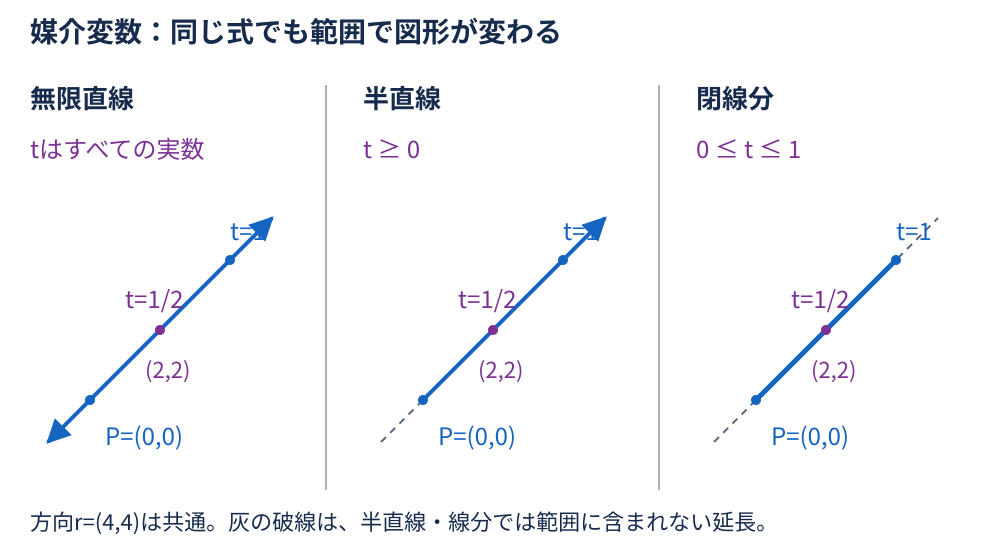
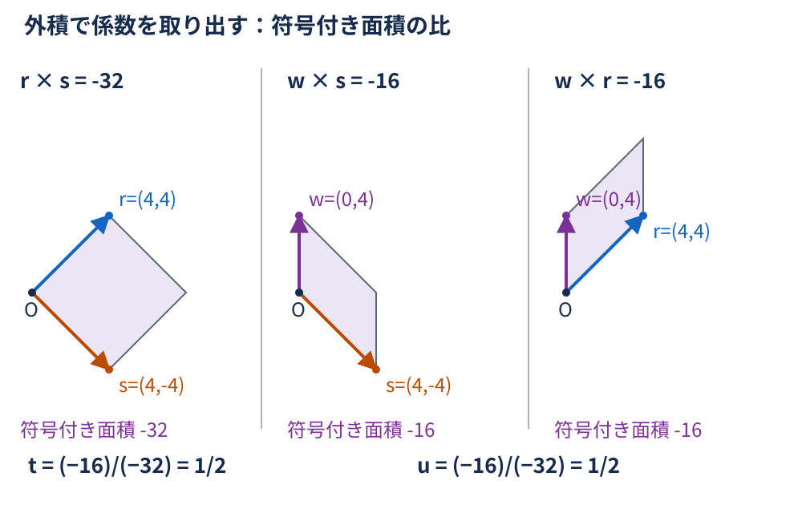
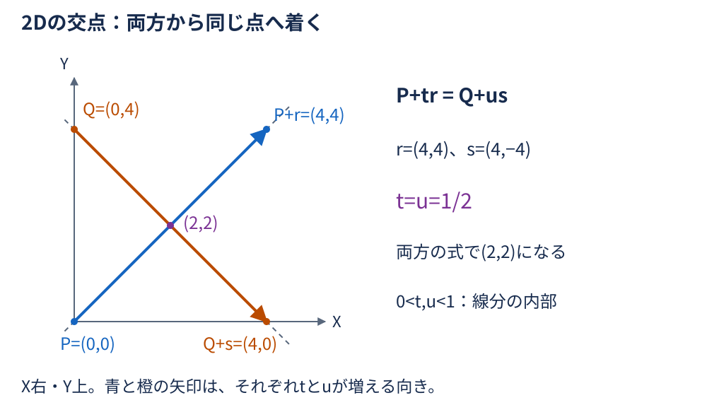
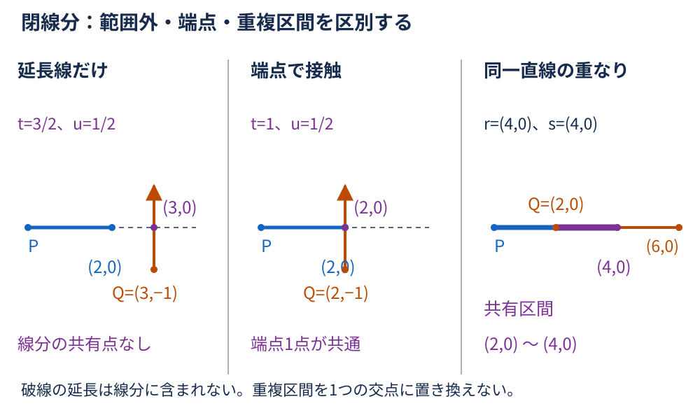
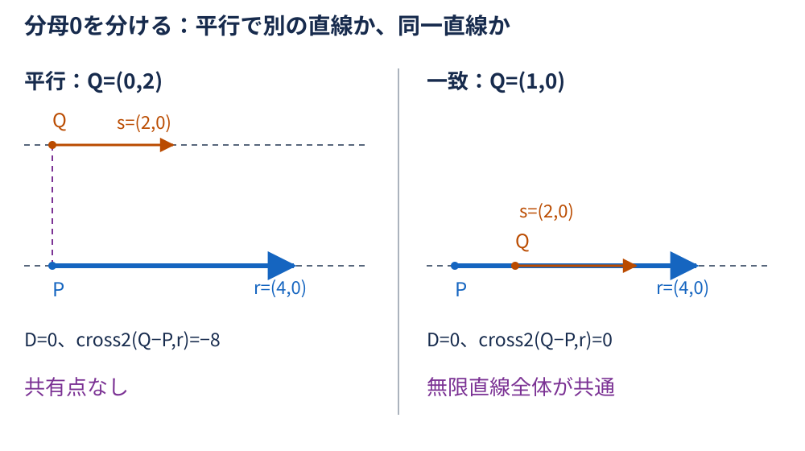
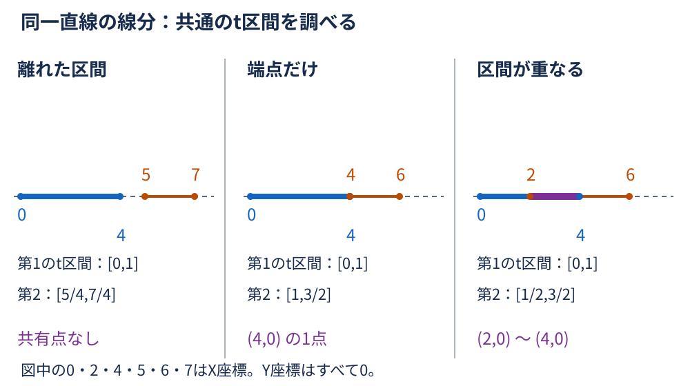
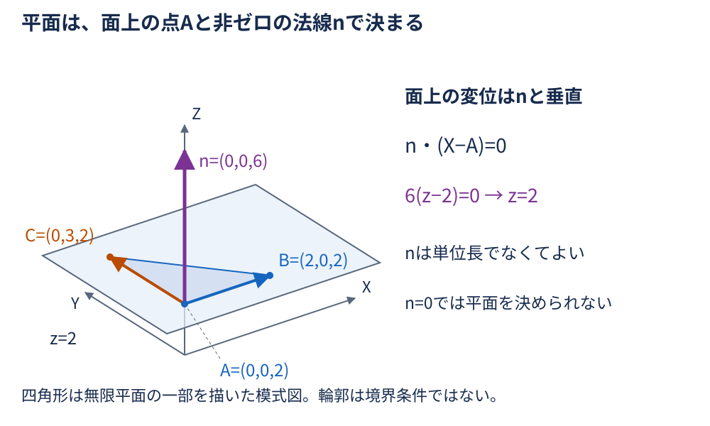
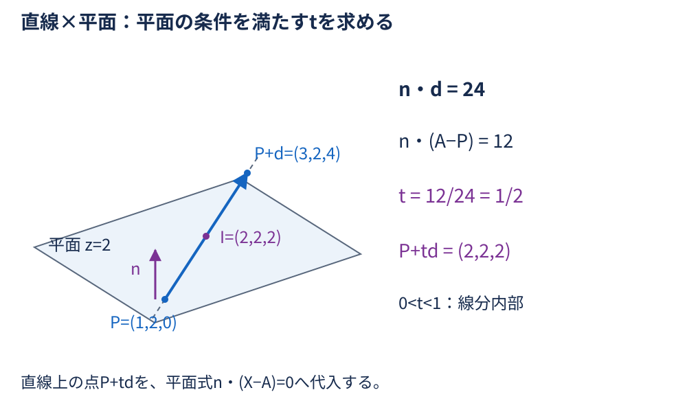
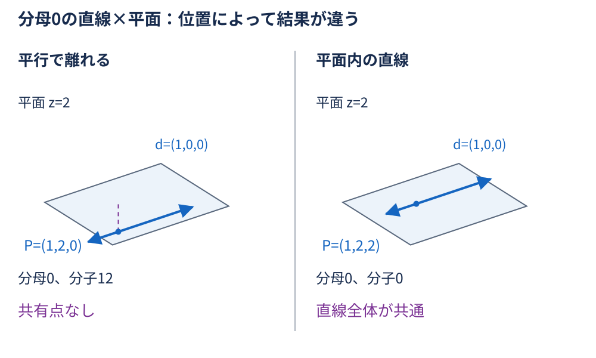
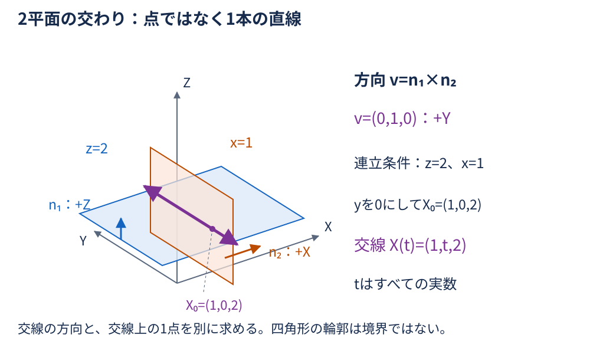

# 第3回：なぜ直線や平面の交点を計算できるのか？ — 詳細解説

**準備中／レビュー待ちの下書き。** 宿題・C#・CI・PDFは後続作業。本文と図の固定数値例を、今後の教材間の照合基準にする。

## 学習の流れと表記

[第1回](../01-matrix/explanation.md) では座標と方向をベクトルで表し、[第2回](../02-vector/explanation.md) では内積・外積から角度や面の向きを求めた。今回は、点の位置を変数で表して「両方に属する」という条件を解く。

最初に直線上の位置を媒介変数で表す。2Dの直線どうしでは外積、3Dの直線と平面では内積を使って変数を取り出す。その後で、線分の範囲や退化を確認する。最後に2平面の交線と数値計算の注意へ進む。

- 同じ直交座標系の標準基底を使う。2DはX右・Y上、3Dは右手系。外積の順序と符号は第2回と同じ。
- $P,Q,A,B,C,X$ は点、 $r,s,d,n$ はベクトル。点の差は変位ベクトルであり、点に変位を足すと別の点になる。
- ベクトルは列ベクトルを基本とし、短い座標は $(2,2)$ のようにも書く。内積は $a\cdot b$ 、3D外積は $a\times b$ 。
- 2Dスカラー外積は $\mathrm{cross2}(a,b)=a_xb_y-a_yb_x$ 。結果は1つの数で、3D外積のZ成分に当たる。
- $t,u$ は媒介変数。今回の方向ベクトルは変位として長さの単位を持ち、 $t,u$ は無次元とする。座標の単位はそろえる。
- 式の導出はまず厳密な実数計算として行う。「ゼロ」と数値計算での「ほぼゼロ」は⑧で区別する。

## ① 導入：交点は「両方の条件」を満たす点

CADの2D図面で線の交差位置を求める、部材の中心線が基準面を貫く位置を求める、2つの面の境目を求める、といった場面を考える。

交点を当てずっぽうに探す代わりに、1本の線上を動く点を式で表す。その点がもう一方の線や面にも属する条件を加えると、位置を決める方程式になる。交点公式の分母は、その方程式から変数を解く途中に現れる。

条件を満たす点が1つとは限らない。延長線上にしか交点がないことも、線分が区間として重なることも、直線全体が平面内に入ることもある。計算前から「必ず1つの点を返す」と決めないことが大切である。

## ② 直線・半直線・線分を媒介変数で表す

### 始点と方向を分ける

点Pから変位ベクトル $r\ne0$ の方向へ進む点を、

$$
L(t)=P+tr
$$

と書く。 $t=0$ でP、 $t=1$ で $P+r$ 、 $t=1/2$ でその中間に来る。 $t$ を負にすると反対側へ進む。これが媒介変数表示である。

固定例Aでは、

$$
P=\begin{bmatrix}
0 \\
0
\end{bmatrix},\qquad
r=\begin{bmatrix}
4 \\
4
\end{bmatrix},\qquad
L(t)=\begin{bmatrix}
4t \\
4t
\end{bmatrix}.
$$

したがって $L(1/2)=(2,2)$ 。方向は $(4,4)$ だが、点Pの場所は別に指定している。

| 図形 | tの範囲 | 点の集合 |
| --- | --- | --- |
| 無限直線 | すべての実数 | Pの両側へ無限に続く |
| 半直線 | $t\geq0$ | Pからrの向きへ続く。Pも含む |
| 閉線分 | $0\leq t\leq1$ | PからP+rまで。両端を含む |

式だけでなく、変数の範囲が図形を決めている。rを勝手に単位長へ正規化して範囲を同じにすると、線分の終点が変わってしまう。

### ゼロ方向は普通の直線ではない

$r=0$ なら $P+t0=P$ で、どのtでも同じ1点になる。変数の値が無数にあっても、異なる点が無数にあるわけではない。零長線分は点として扱い、通常の直線の平行・一致の式へ流さない。

## ③ 2Dの2直線：外積で変数を取り出す

### 共通の点という条件を書く

2本を $P+tr$ と $Q+us$ とし、 $r,s\ne0$ とする。同じ位置になる条件は、

$$
P+tr=Q+us.
$$

位置のずれ $w=Q-P$ を使って移項すると、

$$
w=tr-us.
$$

これをX成分・Y成分の2本の方程式として解いてもよい。ここでは第2回の外積の分配法則と、同じ方向同士の外積が0になる性質を使う。

### sとの外積でuを消す

両辺を第1引数、sを第2引数にして2Dスカラー外積を取る。

$$
\begin{aligned}
\mathrm{cross2}(w,s)
&=t \mathrm{cross2}(r,s)-u \mathrm{cross2}(s,s) \\
&=t \mathrm{cross2}(r,s).
\end{aligned}
$$

分母を $D=\mathrm{cross2}(r,s)$ と呼ぶ。 $D\ne0$ なら、

$$
t=\frac{\mathrm{cross2}(Q-P,s)}{\mathrm{cross2}(r,s)}.
$$

### rとの外積でtを消す

同じ元の式に対し、今度はrを第2引数にする。

$$
\begin{aligned}
\mathrm{cross2}(w,r)
&=t \mathrm{cross2}(r,r)-u \mathrm{cross2}(s,r) \\
&=-u \mathrm{cross2}(s,r) \\
&=u \mathrm{cross2}(r,s).
\end{aligned}
$$

最後の行は $\mathrm{cross2}(s,r)=-\mathrm{cross2}(r,s)$ を使った。移項の負号と、外積の順序反転の負号が打ち消し合うため、

$$
u=\frac{\mathrm{cross2}(Q-P,r)}{\mathrm{cross2}(r,s)}.
$$

となる。分子の順序だけを逆にすると符号が変わるので、元の条件式から順序を追う。

### 分母は符号付きの面積

Dはrとsが張る平行四辺形の符号付き面積である。 $D\ne0$ は2方向が独立で、2本の位置条件からtとuが1つずつ決まることを表す。Dが0になる場合は、割り算の前に別の分類が必要になる。

### 固定例A：両方から同じ交点へ着く

$P=(0,0)$ 、 $r=(4,4)$ 、 $Q=(0,4)$ 、 $s=(4,-4)$ とする。 $w=(0,4)$ なので、

$$
\begin{aligned}
D&=4\times(-4)-4\times4=-32, \\
\mathrm{cross2}(w,s)&=0\times(-4)-4\times4=-16, \\
\mathrm{cross2}(w,r)&=0\times4-4\times4=-16.
\end{aligned}
$$

したがって、

$$
t=\frac{-16}{-32}=\frac12,\qquad
u=\frac{-16}{-32}=\frac12.
$$

それぞれに代入して検算する。

$$
P+\frac12r=\begin{bmatrix}
2 \\
2
\end{bmatrix},\qquad
Q+\frac12s=\begin{bmatrix}
0 \\
4
\end{bmatrix}+\begin{bmatrix}
2 \\
-2
\end{bmatrix}=\begin{bmatrix}
2 \\
2
\end{bmatrix}.
$$

両方とも $(2,2)$ へ着く。 $t,u$ はどちらも0と1の間なので、この例は無限直線だけでなく、同じ始点・方向で表す2本の半直線や線分の内部でも交わる。

## ④ 線分の範囲・平行・重なりを区別する

### 無限直線の交点だけでは足りない

線分はPからP+r、QからQ+sまでなので、交点式を解いた後に、

$$
0\leq t\leq1,\qquad 0\leq u\leq1
$$

の両方を確認する。半直線どうしなら両方が0以上かを確認する。片方だけ範囲に入っても共有点にはならない。

固定例Cの $P=(0,0)$ 、 $r=(2,0)$ 、 $Q=(3,-1)$ 、 $s=(0,2)$ では、

$$
\begin{aligned}
D&=2\times2-0\times0=4, \\
\mathrm{cross2}(Q-P,s)&=3\times2-(-1)\times0=6, \\
\mathrm{cross2}(Q-P,r)&=3\times0-(-1)\times2=2.
\end{aligned}
$$

よって $t=3/2$ 、 $u=1/2$ 、無限直線の交点は $(3,0)$ 。しかしtが1を越えるので、2線分は交差しない。Qを $(2,-1)$ に変えると分子は4と2になり、 $t=1$ 、 $u=1/2$ 。今度は第1線分の端点 $(2,0)$ に接触する。

### 分母0を平行と一致に分ける

$D=0$ で $r,s\ne0$ なら2方向は平行である。ただし、同じ直線上にあるかは方向だけでは分からない。ずれ $w=Q-P$ もrと平行かを調べる。

| 条件（r,sは非ゼロ） | 無限直線の共有部分 |
| --- | --- |
| $D\ne0$ | ただ1つの点。tとuの式で求める |
| $D=0$ かつ cross2(w,r)≠0 | 異なる平行線なので、共有点なし |
| $D=0$ かつ cross2(w,r)=0 | 同一直線なので、直線全体が共通 |

固定例Bでは $P=(0,0)$ 、 $r=(4,0)$ 、 $Q=(0,2)$ 、 $s=(2,0)$ 。 $D=0$ だが、

$$
\mathrm{cross2}(Q-P,r)=0\times0-2\times4=-8
$$

なので、平行で交点はない。Qを $(1,0)$ にするとこの値は0になり、無限直線としては同一直線全体が共通になる。

### 同一直線の線分は区間を比べる

無限直線が一致しても、有限線分が必ず重なるわけではない。rが非ゼロであることを確認したうえで、第1線分上のtに座標をそろえる。QとQ+sの位置は、内積によって、

$$
t_0=\frac{(Q-P)\cdot r}{r\cdot r},\qquad
t_1=\frac{(Q+s-P)\cdot r}{r\cdot r}.
$$

と表せる。同一直線上なので、第2回の射影で方向成分を取り出す計算が、そのまま位置の係数になる。sがrと逆向きなら $t_1<t_0$ になるので、両端を小さい順に並べる。

2つの閉区間の共通範囲を、

$$
\ell=\max\bigl(0,\min(t_0,t_1)\bigr),\qquad
h=\min\bigl(1,\max(t_0,t_1)\bigr)
$$

とすれば、次の3種類に分かれる。

| 区間の条件 | 線分の共有部分 |
| --- | --- |
| $\ell>h$ | 共有点なし |
| $\ell=h$ | 点P+ℓrの1点だけ（端点接触） |
| $\ell<h$ | P+ℓrからP+hrまでの重複区間 |

固定例Cの重なりは $P=(0,0)$ 、 $r=(4,0)$ 、 $Q=(2,0)$ 、 $s=(4,0)$ なので、

$$
\begin{aligned}
t_0&=\frac{2\times4}{16}=\frac12, \\
t_1&=\frac{6\times4}{16}=\frac32.
\end{aligned}
$$

共通範囲は $[1/2,1]$ 。したがって共有部分は $(2,0)$ から $(4,0)$ までであり、1つの交点ではない。

同じ第1線分に対し、Qを $(5,0)$ 、sを $(2,0)$ にすると範囲は $[5/4,7/4]$ で重ならない。Qを $(4,0)$ 、sを $(2,0)$ にすると $[1,3/2]$ で、 $(4,0)$ の1点だけが共通になる。

### 零長線分を先に処理する

両方が零長なら、点PとQが同じかを調べる。片方だけ零長なら、その点がもう一方の線分に乗るかを調べる。例えばPが点、もう一方が $Q+us$ で $s\ne0$ なら、

$$
\mathrm{cross2}(P-Q,s)=0,\qquad
u=\frac{(P-Q)\cdot s}{s\cdot s}
$$

を使い、 $0\leq u\leq1$ も確認する。零長の方向との外積は常に0になるので、それを根拠に普通の直線どうしの一致と判定しない。

### 3Dの2直線へ2D式を流用しない

2Dでは非平行な2直線は交わる。一方3Dでは、非平行でも同じ平面内にない「ねじれの位置」がある。2Dへ投影した線が交わっても、元の3D座標が一致するとは限らない。3Dの直線どうしは別の条件を立てて検証する必要があり、今回の2Dの比の式をそのまま使わない。

## ⑤ 3D平面を点と法線で表す

### 面上の変位は法線に垂直

面上の点Aと非ゼロの法線nを考える。別の点Xがこの平面にある条件は、変位 $X-A$ がnと垂直になることである。第2回の内積の意味から、

$$
n\cdot(X-A)=0.
$$

nは単位ベクトルでなくてもよい。非ゼロの実数倍をしても同じ式の両辺を定数倍するだけなので、同じ平面を表す。ただし $n=0$ は平面の向きを決めない。式がどのXでも0になるからといって、有効な平面として使わない。

### 固定例D：三角形から平面z=2を作る

$A=(0,0,2)$ 、 $B=(2,0,2)$ 、 $C=(0,3,2)$ とする。2辺とその外積は、

$$
B-A=\begin{bmatrix}
2 \\
0 \\
0
\end{bmatrix},\qquad
C-A=\begin{bmatrix}
0 \\
3 \\
0
\end{bmatrix},\qquad
n=(B-A)\times(C-A)=\begin{bmatrix}
0 \\
0 \\
6
\end{bmatrix}.
$$

このnと2辺の内積は両方0で、平面に垂直な向きが得られる。 $X=(x,y,z)$ を平面式に代入すると、

$$
n\cdot(X-A)=6(z-2)=0.
$$

よって $z=2$ が平面の条件になる。3点が同一直線上、または重複している場合は外積が0になり、この方法では平面の法線を定義できない。

## ⑥ 直線と平面：内積から位置の係数を解く

### 直線上の点を平面式へ代入する

直線を $L(t)=P+td$ とし、 $d\ne0$ 、平面の $n\ne0$ とする。交点では、

$$
n\cdot(P+td-A)=0.
$$

内積を分配して移項する。

$$
\begin{aligned}
n\cdot(P-A)+t(n\cdot d)&=0, \\
t(n\cdot d)&=n\cdot(A-P).
\end{aligned}
$$

$n\cdot d\ne0$ なら、

$$
t=\frac{n\cdot(A-P)}{n\cdot d},\qquad X=P+td.
$$

分母は「dに沿って進むと、法線方向の条件がどれだけ変わるか」を表す。分子は、Pから平面上のAまでに必要な法線方向の変化である。両方を同じnで測った比が、必要な進み方tになる。

### 固定例Dを代入・検算する

平面は $z=2$ 、 $n=(0,0,6)$ 、直線は $P=(1,2,0)$ 、 $d=(2,0,4)$ 。

$$
\begin{aligned}
n\cdot d&=6\times4=24, \\
n\cdot(A-P)&=6\times(2-0)=12.
\end{aligned}
$$

したがって、

$$
t=\frac{12}{24}=\frac12.
$$

$$
\begin{aligned}
X&=\begin{bmatrix}
1 \\
2 \\
0
\end{bmatrix}+\frac12\begin{bmatrix}
2 \\
0 \\
4
\end{bmatrix} \\
&=\begin{bmatrix}
2 \\
2 \\
2
\end{bmatrix}.
\end{aligned}
$$

Z成分が2なので平面条件も満たす。 $0<t<1$ のため、Pから $P+d=(3,2,4)$ までの線分の内部でもある。

### 分母0は「平面内」と「平行で離れる」を分ける

$n\cdot d=0$ なら、d方向に進んでも平面条件の値は変わらない。代入した式は $n\cdot(P-A)=0$ を満たすかどうかだけになる。

| 条件（n,dは非ゼロ） | 無限直線と平面の共有部分 |
| --- | --- |
| n・d≠0 | ただ1つの交点 |
| n・d=0、n・(A−P)≠0 | 平行で離れ、共有点なし |
| n・d=0、n・(A−P)=0 | 直線が平面内にあり、直線全体が共通 |

同じ平面で $P=(1,2,0)$ 、 $d=(1,0,0)$ なら、分母0、分子12なので交点なし。Pを $(1,2,2)$ に変えると分母も分子も0で、直線上のどの点も平面内になる。

線分と平面の場合は、唯一の交点のtが0から1に入るかを追加確認する。平面内の非零長線分なら、共有部分はその線分全体になる。 $d=0$ なら通常の直線ではなく点Pとして、平面式を満たすかを調べる。満たしても「異なる交点が無数」とは扱わない。

## ⑦ 平面と平面：交わりが直線になる理由（発展）

### 交線の方向を外積で求める

2平面の非ゼロ法線を $n_1,n_2$ とする。両平面に沿う交線方向vは、両法線に垂直でなければならない。非平行なら、

$$
v=n_1\times n_2\ne0
$$

を使える。ただしvは方向であり、交線上の1点を与えるものではない。

### 交線上の1点は連立方程式で決める

各平面上の既知の点を $A_1,A_2$ とすれば、交線上の点は、

$$
n_1\cdot X=n_1\cdot A_1,\qquad
n_2\cdot X=n_2\cdot A_2
$$

の両方を満たす。非平行な法線なら独立した2本の一次方程式で、3つの座標のうち1つが自由に残る。例えばvのY成分が非ゼロなら、Yを0に置いたX・Zの連立方程式は解ける。その係数の行列式はvのY成分の符号を変えたもので、0でないためである。

こうして得た1点を $X_0$ とすると、交線は $X_0+tv$ 。代入すれば、どのtでも両方の平面式を満たす。

$$
\begin{aligned}
n_i\cdot(X_0+tv-A_i)
&=n_i\cdot(X_0-A_i)+t(n_i\cdot v) \\
&=0\qquad(i=1,2).
\end{aligned}
$$

両平面の任意の共有点と $X_0$ の差も、両法線に垂直である。その方向はvの実数倍なので、共有点全体がこの1本の直線になる。独立した条件が2本で自由度が1つ残ることと対応している。

### 固定例E：z=2とx=1

法線とその外積は、

$$
n_1=\begin{bmatrix}
0 \\
0 \\
1
\end{bmatrix},\qquad
n_2=\begin{bmatrix}
1 \\
0 \\
0
\end{bmatrix},\qquad
n_1\times n_2=\begin{bmatrix}
0 \\
1 \\
0
\end{bmatrix}.
$$

連立条件はZが2、Xが1で、Yは自由。Yを0に選べば $X_0=(1,0,2)$ となるから、

$$
X(t)=\begin{bmatrix}
1 \\
0 \\
2
\end{bmatrix}+t\begin{bmatrix}
0 \\
1 \\
0
\end{bmatrix}=\begin{bmatrix}
1 \\
t \\
2
\end{bmatrix}.
$$

交わりは $(1,t,2)$ という直線であり、「一意の交点」ではない。法線の順序を逆にしても、交線を進む向きが逆になるだけで、直線という点の集合は同じである。

### 平行な法線と、境界のある面

$n_1\times n_2=0$ で両法線が非ゼロなら、平面は平行か同一である。 $n_1\cdot(A_2-A_1)=0$ なら同一平面、それ以外は離れた平行平面になる。法線の長さや符号が異なっても、点の集合が同じなら平面は一致する。

$z=2$ と $z=5$ は共有点なし。同じ $z=2$ 同士は平面全体が共通になる。どちらかの法線が0なら、平面自体が未定義なので、平行・一致へ分類しない。

CADの有限な面には境界がある。無限平面の交線を求めても、そのまま有限ポリゴンの交差線分になるわけではない。各面の境界内にある区間をさらに調べる必要がある。

## ⑧ C#と数値計算：結果の種類と判定の尺度

### 返すものは点だけではない

後続のC#教材では、点の座標に加え、共有部分の種類も扱う。例えば次のように区別する。

| 対象 | 幾何的な条件 | 結果の種類 |
| --- | --- | --- |
| 2D無限直線どうし | 非平行／平行で別／同一直線 | 一点／なし／直線全体 |
| 2D閉線分どうし | 内部交差・端点／非交差／同一直線で区間重複 | 一点／なし／重複線分 |
| 3D直線と平面 | 横切る／平行で別／平面内 | 一点／なし／直線全体 |
| 非零長線分と平面 | tが範囲内／範囲外・平行で別／平面内 | 一点／なし／線分全体 |
| 2平面 | 非平行／平行で別／同一 | 交線／なし／平面全体 |
| ゼロ方向・ゼロ法線 | 点に退化した対象／平面を定義できない | 点として別処理／未定義 |

数値的に分類を確定できない場合には「判定保留」も必要になる。交点なしと未定義・不安定を、同じゼロ座標や同じ失敗値へ押し込めない。

### .NETの演算と手計算

手実装は $a_xb_x+a_yb_y$ や $a_xb_y-a_yb_x$ を `double` で追えるようにする。[Vector2](https://learn.microsoft.com/en-us/dotnet/api/system.numerics.vector2?view=net-10.0) と [Vector3](https://learn.microsoft.com/en-us/dotnet/api/system.numerics.vector3?view=net-10.0) の各成分は `float` である。`Vector2.Dot`・`Vector3.Dot`・`Vector3.Cross` は内積・外積の比較に使えるが、交差結果の分類や媒介変数の範囲確認まで代行するものではない。

第2回と同じく、2Dスカラー外積と3Dベクトル外積を区別する。floatに丸めた座標をdoubleへ変換しても、すでに失われた差は戻らない。行列の格納順序の話とは分け、今回は交差条件をどう立てるかに集中する。

### ゼロ・非有限値を除算前に検査する

最初に座標・方向・法線の有限性を確認する。次にゼロ方向・ゼロ法線を区別し、分母に応じた分岐を選ぶ。分母が0の式を計算してからInfinityやNaNで交差を推測しない。入力が有限でも、大きな積や小さな差で桁あふれ・桁落ちが起こりうるため、中間結果も確認する。

2DのDが非常に小さい場合、分子や分母のわずかな誤差がtとuに大きく増幅される。交点が遠方に動きやすくなり、ほぼ平行な2本の交点計算は不安定になる。小さいDを自動的に「厳密に平行」と読み替えることも避ける。

### 角度・距離・変数範囲を別の尺度で扱う

無限直線の方向ベクトルを実数倍しても、直線自体は変わらない。しかしDの数値は変わる。したがって、根拠のない固定epsilonでDだけを比較すると、同じ直線の組でも結論が変わってしまう。

非ゼロの方向に対する角度の尺度としては、

$$
\frac{|\mathrm{cross2}(r,s)|}{\|r\|\|s\|}=|\sin\theta|
$$

を使える。直線と平面では、

$$
\frac{|n\cdot d|}{\|n\|\|d\|}
$$

が小さいと、方向がほぼ平面に沿っている。これらは無次元の角度の尺度である。

一方、2Dの点Qと直線P+trの距離は、

$$
\frac{|\mathrm{cross2}(Q-P,r)|}{\|r\|}
$$

で、長さの単位を持つ。点Pと平面の距離は $|n\cdot(P-A)|/\|n\|$ 。ほぼ一致かを判断する距離の許容値は、角度の許容値とは別に決める。

tやuの端点範囲に許容値を設ける場合も、変数が無次元であることと、位置の変化が方向ベクトルの長さに依存することを考える。mmとm、図形全体の大きさ、入力精度、用途に応じて条件を定める。大きな共通座標を引くと差の精度が失われることがあるので、座標原点の取り方も確認する。

これらの比も、長さが小さすぎる入力や極端なスケールでは安全とは限らない。有限性・長さの下限・必要なスケーリングを先に検討する。厳密な接触・共有点の分類が必要な用途では、頑健な述語や誤差評価も必要になる。今回の固定例の厳密な0と、任意入力の数値的な判定を混同しない。

## ⑨ まとめ・復習と次回への接続

交点の式は、「線上を進む点がもう一方にも属する」という条件から生まれた。2Dでは外積で片方の変数を消し、直線と平面では内積で法線方向の条件を取り出した。分母が0なら、割れないだけでなく、位置を1つに決める条件が失われている。

線分の範囲、平行と同一直線、区間重複、零長やゼロ法線を区別して初めて、結果を正しく読める。2平面は一般に1本の直線で交わり、交線の方向と交線上の点は別に求めた。

| 固定例 | 条件・数値 | 照合する結果 |
| --- | --- | --- |
| A：2D交差 | P=(0,0), r=(4,4), Q=(0,4), s=(4,−4)。D=−32、分子−16/−16 | t=u=1/2、交点(2,2)。線分の内部でも交差 |
| B：平行／一致 | P=(0,0), r=(4,0), s=(2,0)。Q=(0,2)または(1,0) | D=0。ずれとの外積−8ならなし、0なら同一直線 |
| C：範囲外／端点 | P=(0,0), r=(2,0), s=(0,2)。Q=(3,−1)または(2,−1) | t=3/2または1、u=1/2。線分の交点なし／端点(2,0) |
| C：重複区間 | P=(0,0), r=(4,0), Q=(2,0), s=(4,0) | tの共通範囲[1/2,1]、共有部分(2,0)〜(4,0) |
| D：直線と平面 | A=(0,0,2), B=(2,0,2), C=(0,3,2)。n=(0,0,6)、P=(1,2,0), d=(2,0,4) | 平面z=2、分母24・分子12、t=1/2、交点(2,2,2) |
| D：平行／平面内 | 同じ平面、d=(1,0,0)。P=(1,2,0)または(1,2,2) | 分母0。分子12ならなし、0なら直線全体 |
| E：2平面 | z=2とx=1、n1=(0,0,1), n2=(1,0,0) | 方向(0,1,0)、交線(1,t,2)。z=2とz=5はなし、同じz=2は平面一致 |

復習では「uの分子に負号が残らない理由」「延長線の交点だけでは線分を判定できない理由」「外積だけでは交線の場所が分からない理由」を、自分の言葉と元の条件式で説明してみる。

[宿題](homework/README.md) と [C#実装例](examples/README.md) は現在ひな形で、問題・解答・実装は未作成。後続作業では上の固定例を共有する。[第4回の2Dから3Dへのモデリング](../04-modeling/README.md) では、境界を持つ図形や面を組み立てる際に、交わりの種類と位置という今回の土台を使う。

## 補足：第1回の行列と連立方程式を結ぶ

2Dの条件 $tr-us=Q-P$ を成分で書けば、

$$
\begin{bmatrix}
r_x & -s_x \\
r_y & -s_y
\end{bmatrix}\begin{bmatrix}
t \\
u
\end{bmatrix}=\begin{bmatrix}
Q_x-P_x \\
Q_y-P_y
\end{bmatrix}.
$$

左の係数行列をMと呼ぶ。これは「tとuを、rと−sの組み合わせとして位置のずれへ変換する」もの。行列式は、

$$
\det M= r_x(-s_y)-(-s_x)r_y
=-\mathrm{cross2}(r,s)=-D.
$$

Dが0でなければ2方向は独立で、位置のずれに対応するtとuを一意に決められる。Dが0なら、この行列だけから一意に逆算できない。ずれが同じ方向に乗るなら無数の解、乗らなければ解なしとなる。零長の列がある場合は、先に点への退化として扱う。この連立方程式と外積の導出は、同じ条件を別の形で読んでいる。

[この回のトップへ戻る](README.md)
