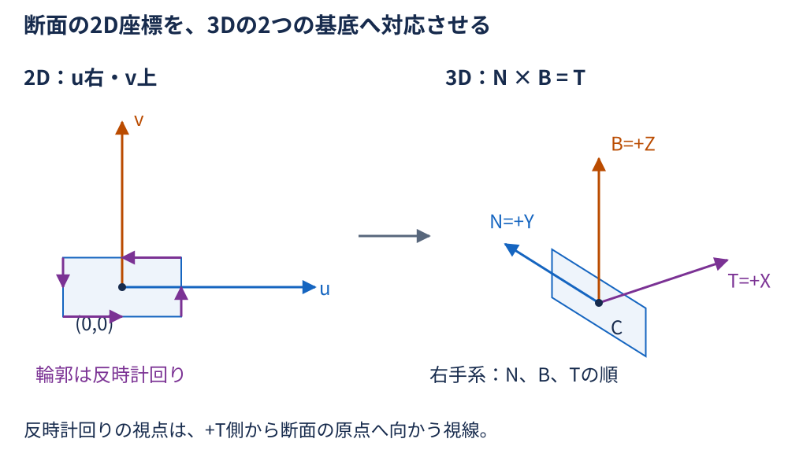
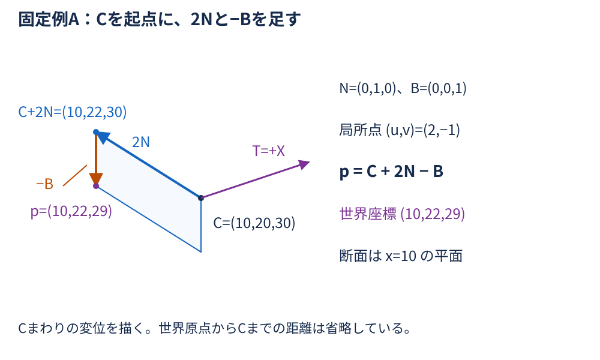
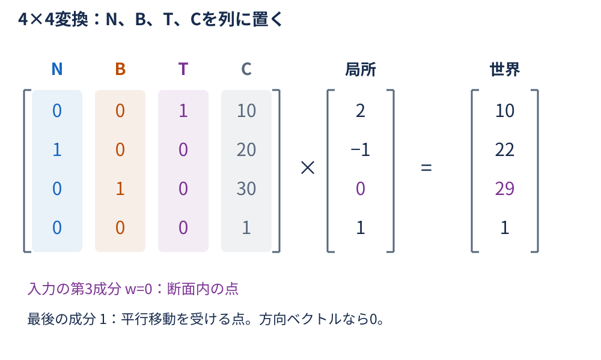
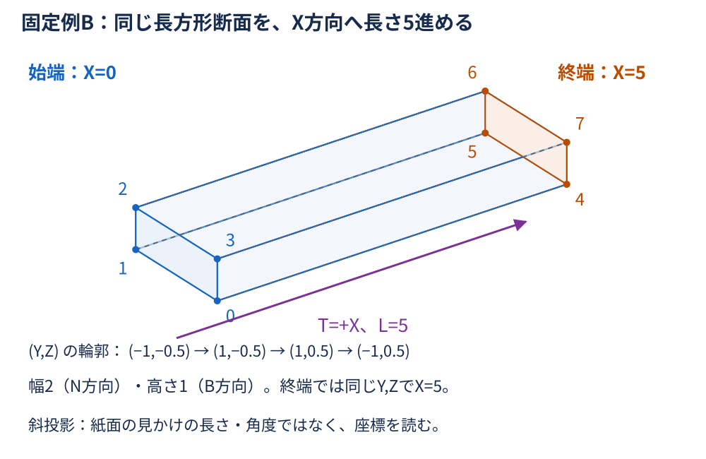
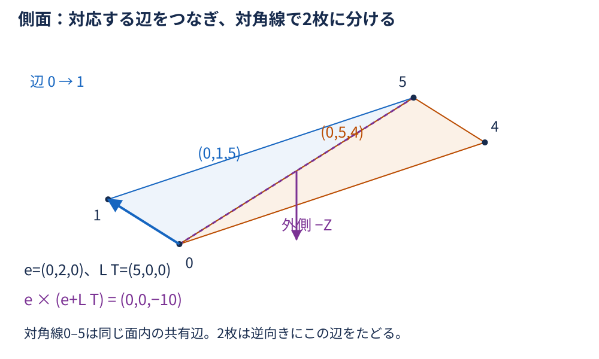
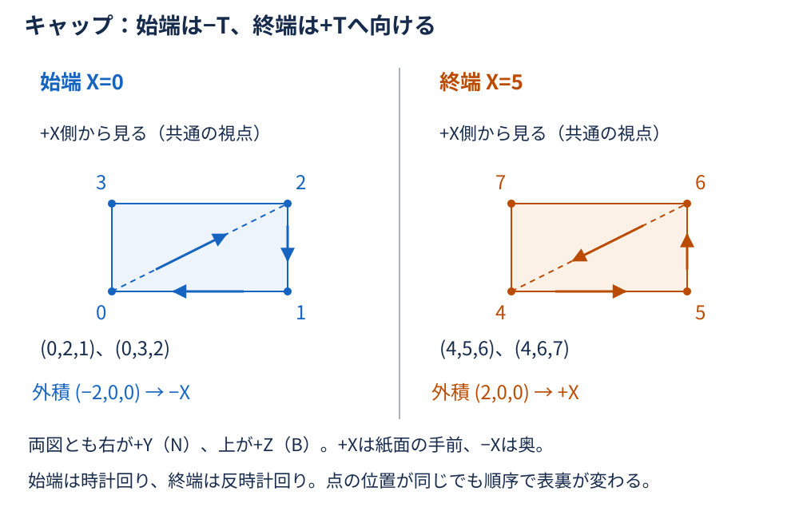
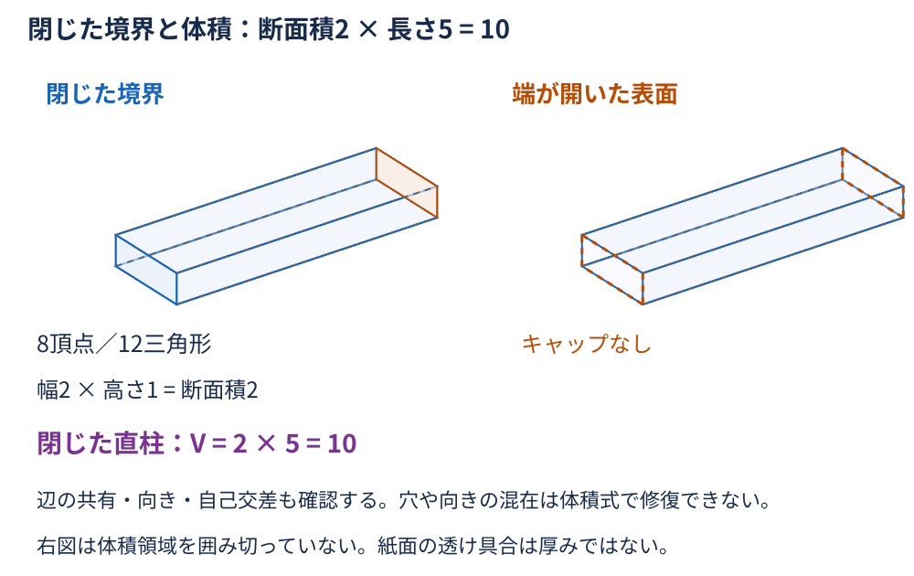
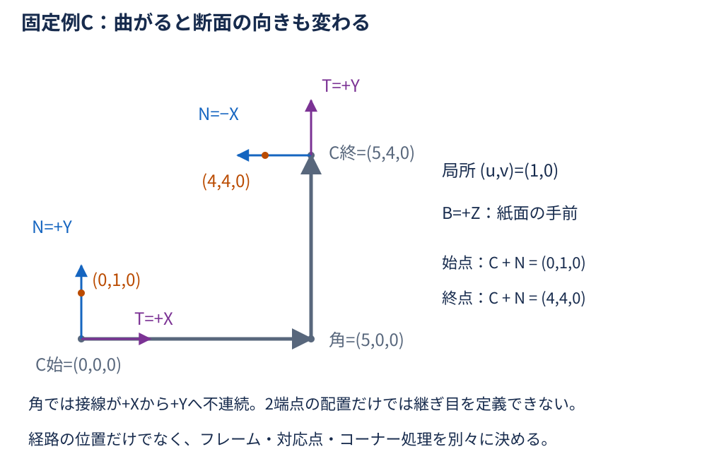
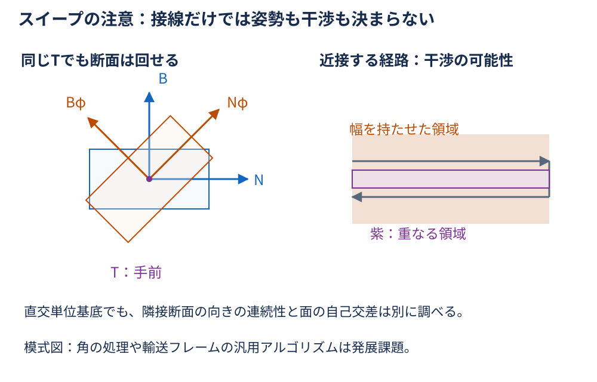
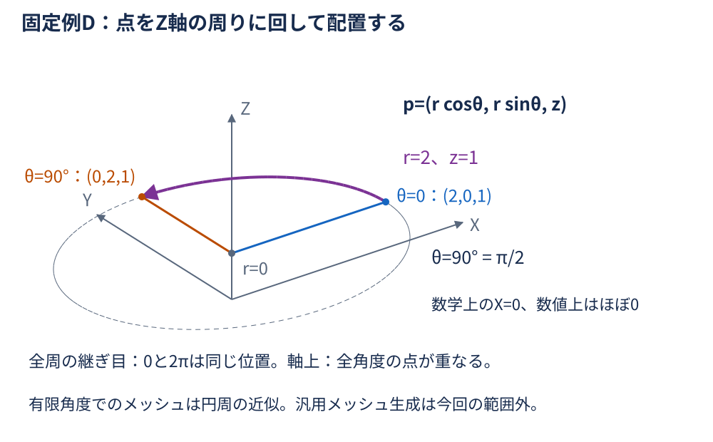

# 第4回：なぜ2Dの図形から3Dモデルを作れるのか？ — 詳細解説

**準備中／レビュー待ちの下書き。** 本文とSVG図解を用意した段階で、宿題・C#実装例・レビュー用PDFは後続Issueで作成する。ここに示す固定例A〜Dを、今後の教材間の照合基準とする。

## 学習の流れと表記

[第1回](../01-matrix/explanation.md) のローカル座標・4×4変換行列、[第2回](../02-vector/explanation.md) の内積・外積・法線、[第3回](../03-intersection/explanation.md) の直線・平面・交差をつなぐ。点を断面に配置し、複数の断面を面で結び、その面が立体の境界になる条件を調べる。

- 世界座標は右手系の直交XYZ座標。断面の2D座標を $(u,v)$ 、厚み方向の第3局所座標を $w$ とする。
- $C$ は断面の原点（ここでは中心と呼ぶが、常に図心とは限らない）。 $N,B$ は断面内の単位基底、 $T=N\times B$ は断面の向きを定める単位法線である。断面法線Tと、後で求める側面の法線を区別する。
- 点・ベクトルは列方式で記述する。短い座標の組以外の行列・列ベクトルは数式ブロックに置く。
- 座標・ $u,v,w,s,L$ は共通の長さ単位、基底の成分と角度の三角関数は無次元。面積・体積の単位はそれぞれ長さの2乗・3乗となる。固定例は単位系をそろえた抽象的な数値で、実製品の寸法や施工仕様ではない。
- $v_i^0,v_i^1$ は始端・終端の頂点名。断面座標の $v$ とは別の記号で、上付き0・1はべき乗ではなく断面の区別である。

## ① 導入：輪郭だけでは立体にならない

橋梁CIMで部材の断面や検査路の部品を配置したい場面を考える。図面の2D輪郭には幅と高さがある。しかし、それだけでは3D空間のどこに、どちらを向け、どこまで延ばすかが決まらない。

必要な情報を分けると、断面の輪郭、断面の配置、延ばす経路、面の接続、端を閉じる方法となる。同じ8個の点でも、結び方を間違えると面がねじれたり穴が開いたりする。点の一覧と、どの点が隣接するかという接続情報は別の役割を持つ。

まず断面内の1点を3Dへ写す。その操作を輪郭全体に行い、別の位置にも断面を置く。対応する辺をつなぐと側面になり、端面を足すと閉じた境界になる。この順に考えると、2Dから3Dへの変換は必要な位置と接続条件を加える操作だと分かる。

## ② 2D断面を3Dへ配置する

### 原点と2つの基底で位置を決める

断面内では、原点からu方向にu、v方向にvだけ進んで点を表す。その2方向を世界座標のNとBに置き換えると、変位は $uN+vB$ になる。最後に配置先のCを足せばよい。

$$
p(u,v)=C+uN+vB.
$$

NとBには次の条件を課す。

$$
N\cdot N=B\cdot B=1,\qquad N\cdot B=0,\qquad T=N\times B.
$$

第2回の外積の長さの性質からTも長さ1で、N、Bの両方に垂直になる。N、B、Tの順が右手系を作る。これは長さと直角を保つ配置である。基底の長さや直交性を変えると、拡大縮小やせん断も含む別の変換になる。

断面の頂点を反時計回りと呼ぶときは、**+T側にいる観察者が断面の原点へ向かって見る**向きを基準にする。これはNを右、Bを上に描いた2D座標の反時計回りに一致する。「Tへ向かって見る」とは逆なので、視線も指定する。

### 固定例A：局所座標から世界座標へ

$$
N=\begin{bmatrix}
0 \\
1 \\
0
\end{bmatrix},\qquad
B=\begin{bmatrix}
0 \\
0 \\
1
\end{bmatrix},\qquad
T=\begin{bmatrix}
1 \\
0 \\
0
\end{bmatrix},\qquad
C=\begin{bmatrix}
10 \\
20 \\
30
\end{bmatrix}.
$$

実際に $N\cdot B=0$ 、各基底長1、 $N\times B=(1,0,0)=T$ である。断面点 $(u,v)=(2,-1)$ は、

$$
\begin{aligned}
p(2,-1)
&=C+2N-B \\
&=\begin{bmatrix}
10 \\
20 \\
30
\end{bmatrix}
+\begin{bmatrix}
0 \\
2 \\
0
\end{bmatrix}
+\begin{bmatrix}
0 \\
0 \\
-1
\end{bmatrix} \\
&=\begin{bmatrix}
10 \\
22 \\
29
\end{bmatrix}.
\end{aligned}
$$

局所uが世界Xになるとは限らない。今回はuがY、vがZに対応し、断面全体が $x=10$ の平面に乗る。

### 4×4行列では基底を列に並べる

第1回の列ベクトル方式では、3本の基底を左からN、B、T、最後の列をCにする。

$$
M=\begin{bmatrix}
N_x & B_x & T_x & C_x \\
N_y & B_y & T_y & C_y \\
N_z & B_z & T_z & C_z \\
0 & 0 & 0 & 1
\end{bmatrix}.
$$

$$
M\begin{bmatrix}
u \\
v \\
w \\
1
\end{bmatrix}
=\begin{bmatrix}
C_x+uN_x+vB_x+wT_x \\
C_y+uN_y+vB_y+wT_y \\
C_z+uN_z+vB_z+wT_z \\
1
\end{bmatrix}.
$$

断面上は $w=0$ 。これは**3つ目の局所座標**が0という意味で、最後の同次成分は点を表す1のままである。同次成分を0にするとCによる平行移動を受けない方向ベクトルになり、断面点の配置とは異なる。

固定例Aを行列でも確かめる。

$$
\begin{bmatrix}
0 & 0 & 1 & 10 \\
1 & 0 & 0 & 20 \\
0 & 1 & 0 & 30 \\
0 & 0 & 0 & 1
\end{bmatrix}
\begin{bmatrix}
2 \\
-1 \\
0 \\
1
\end{bmatrix}
=\begin{bmatrix}
10 \\
22 \\
29 \\
1
\end{bmatrix}.
$$

## ③ 真っ直ぐな押し出し：同じ断面を位置だけ変えて置く

ここでは断面に垂直な単位方向Tへ、長さLだけ進める**直線の垂直押し出し**を扱う。 $L>0$ とし、断面の向きN、B、Tは途中で変えない。

$$
C(s)=C_0+sT,\qquad 0\leq s\leq L.
$$

$$
\begin{aligned}
p(u,v,s)
&=C(s)+uN+vB \\
&=C_0+uN+vB+sT.
\end{aligned}
$$

Tが単位ベクトルなのでsは進んだ長さそのものである。無次元の割合 $\lambda$ を使うなら $s=\lambda L$ とし、 $0\leq\lambda\leq1$ にする。sの範囲を0から1に変えただけでは、長さLを押し出したことにはならない。

断面の**輪郭上の点**を動かすと側面ができる。輪郭に囲まれた**内部も含む2D領域**を動かすと体積のある連続立体ができる。輪郭だけの移動と内部の充填を区別する。

### 固定例B：幅2・高さ1・長さ5

断面の4頂点を次の順に置き、最後の頂点から最初へ戻る辺も含める。

$$
q_0=(-1,-0.5),\quad q_1=(1,-0.5),\quad
q_2=(1,0.5),\quad q_3=(-1,0.5).
$$

N、B、Tは固定例Aと同じで、 $C_0=(0,0,0)$ 、 $C_1=(5,0,0)$ 、 $L=5$ とする。これは原点を変えた別の例で、AのCを使い回さない。

| 輪郭番号 | 局所(u,v) | 始端の頂点 | 終端の頂点 |
| --- | --- | --- | --- |
| 0 | (−1,−0.5) | (0,−1,−0.5) | (5,−1,−0.5) |
| 1 | (1,−0.5) | (0,1,−0.5) | (5,1,−0.5) |
| 2 | (1,0.5) | (0,1,0.5) | (5,1,0.5) |
| 3 | (−1,0.5) | (0,−1,0.5) | (5,−1,0.5) |

幅はu方向に2、高さはv方向に1。各頂点はXだけが0から5へ変わる。直方体の境界はXが0〜5、Yが−1〜1、Zが−0.5〜0.5である。

方向を断面に垂直でないベクトルへ変えれば斜め押し出しになるが、これは別の設定である。その方向の移動長をそのまま「高さ」として断面積に掛けることはできない。以降の体積10の検算は、単位法線T方向の長さ5に対して行う。

## ④ 断面同士をつないで三角形メッシュにする

### 点の番号と面の番号を分ける

固定例Bの始端の頂点を0〜3、終端を4〜7とする。すなわち $v_i^0$ の番号がi、 $v_i^1$ の番号が $i+4$ 。頂点一覧は8点を保存し、各三角形はその頂点番号3つを**順序付き**で保存する。同じ位置の点を面ごとに別々の番号で複製する方式とは区別する。

各輪郭辺の次の番号を $j=(i+1)\bmod4$ とする。対応する辺を結んだ四角形は、

$$
(v_i^0,\ v_j^0,\ v_j^1,\ v_i^1)
$$

という巡回順を持つ。対角線で分けると、側面の2枚の三角形になる。

$$
(v_i^0,\ v_j^0,\ v_j^1),\qquad
(v_i^0,\ v_j^1,\ v_i^1).
$$

固定例の四角形は平面上の凸四角形なので、この分割で面を過不足なく覆える。別断面同士の頂点対応や順序を変えると、対角線が意図せずねじれる。一般のスイープでは四角形が非平面にもなり、どちらの対角線を選ぶかで近似面が変わる。

### なぜその順序で外向きになるのか

三角形 $(a,b,c)$ の面法線の向きは、

$$
n_f=(b-a)\times(c-a)
$$

で決まる。この外積の長さは三角形面積の2倍であり、通常は単位法線ではない。bとcを交換すれば外積は負になり、表裏が逆転する。

輪郭辺の変位を $e=\Delta uN+\Delta vB$ とすると、最初の側面三角形では、

$$
\begin{aligned}
n_f
&=e\times(e+LT) \\
&=L(e\times T) \\
&=L(\Delta vN-\Delta uB).
\end{aligned}
$$

最後の等号は $N\times T=-B$ 、 $B\times T=N$ から得られる。+T側から見た反時計回りの輪郭では、内部は進行方向の左側。外積が示す $(\Delta v,-\Delta u)$ は右側なので外向きになる。もう1枚も $L(e\times T)$ となる。

例えば辺0→1は $e=(0,2,0)$ 。側面三角形(0,1,5)では、

$$
\begin{bmatrix}
0 \\
2 \\
0
\end{bmatrix}
\times
\begin{bmatrix}
5 \\
2 \\
0
\end{bmatrix}
=\begin{bmatrix}
0 \\
0 \\
-10
\end{bmatrix}.
$$

この面は $z=-0.5$ にあり、立体の外側は−Zなので一致する。

### キャップは始端と終端で逆向きにする

終端の外側は+T、始端の外側は−Tである。同じ輪郭順のまま両端を塞ぐと、始端が内向きになる。固定例Bの全12枚を次のようにする。

| 部位 | 三角形の頂点番号 | 各三角形の外積 | 外側 |
| --- | --- | --- | --- |
| 側面0→1 | (0,1,5)、(0,5,4) | (0,0,−10) | −Z |
| 側面1→2 | (1,2,6)、(1,6,5) | (0,5,0) | +Y |
| 側面2→3 | (2,3,7)、(2,7,6) | (0,0,10) | +Z |
| 側面3→0 | (3,0,4)、(3,4,7) | (0,−5,0) | −Y |
| 始端キャップ | (0,2,1)、(0,3,2) | (−2,0,0) | −T（−X） |
| 終端キャップ | (4,5,6)、(4,6,7) | (2,0,0) | +T（+X） |

この表で、側面4組×2枚が8枚、両端2組×2枚が4枚、合計12枚となる。**頂点8個・三角形12枚は、この閉じた長方形直柱の共有頂点メッシュの値**である。任意の立体の一般則ではない。表示用に面ごとに法線を持たせて頂点を複製すれば、同じ形状でも配列上の頂点数は変わり得る。

凸四角形の端面は2枚でよいが、非凸多角形を無条件に1頂点から扇状に結ぶと輪郭の外にはみ出すことがある。穴のある断面も穴を塞がない三角形分割が必要で、内外の輪郭の向きも区別する。今回の長方形の接続表をそのまま流用しない。

## ⑤ 閉じたメッシュと立体の意味

### 面の集合が体積の境界になる条件

三角形は面積を持つが、それ自体に厚さや体積はない。側面だけを作って両端を開けたものは筒状の表面であり、体積領域の境界は完成していない。

水密（watertight）とは、表面の継ぎ目に穴や隙間がないことを指す。共有頂点メッシュでは各辺がちょうど2枚の三角形に属し、隣接三角形が共有辺を逆向きにたどるかを調べる。固定例では8頂点・18辺（面内の対角線6本を含む）・12三角形で、 $8-18+12=2$ にもなる。

ただし辺の枚数やこの等式だけで有効な立体を保証できない。頂点の周囲が1つの輪にならない接続、面同士の自己交差、重複面、ゼロ面積面なども調べる。ここで「閉じたメッシュが立体を表す」と言うときは、面が自己交差せず、局所的に通常の面としてつながり、表裏が一貫した境界を前提にする。空洞を持つ場合は内側の境界の向きも含めた扱いが必要になる。

### 体積を別の方法で確かめる

固定例Bでは直交単位基底を使うため、局所の幅と高さが世界座標でも保たれる。どのsでも断面積は2なので、薄い厚さを積み重ねた体積は、

$$
A=2\times1=2,
$$

$$
V=\int_0^5 A ds=2\times5=10.
$$

積分は、断面積と小さな厚さの積を全区間で足す意味である。断面積が一定なので、ここでは断面積×長さに戻る。

三角形メッシュからも、各三角形 $(a_f,b_f,c_f)$ と世界原点が作る**符号付き四面体**の体積を足して検算できる。

$$
V_{\mathrm{signed}}=\frac{1}{6}\sum_f a_f\cdot(b_f\times c_f).
$$

三重積は平行六面体の符号付き体積で、四面体はその1/6である。閉じて一貫して外向きの境界なら内部の分割に依存せず体積になる。原点が外にあっても符号付きで足すことで相殺する。固定例の表の順序なら和は60で、 $V_{\mathrm{signed}}=10$ 。全三角形の順序を反転すると−10になる。

**面ごとの絶対値を足してはいけない。** 相殺が失われ、原点の位置によって値が変わってしまう。また、最後に絶対値を取っても、穴や混在した向きが修復されるわけではない。三角形数・共有辺・法線・体積を別々に確認する。

## ⑥ 経路に沿って断面を配置する：スイープ

### 位置だけでは断面の向きが決まらない

曲がった中心線に沿って部品を配置するには、各位置の中心 $C(s)$ と、直交単位フレーム $T(s),N(s),B(s)$ を用意する。滑らかな区間ではsを弧長とすると $T(s)=C'(s)$ が単位接線であり、断面を接線に垂直に置くには $N(s)\times B(s)=T(s)$ とする。

$$
p(s,u,v)=C(s)+uN(s)+vB(s).
$$

直線押し出しは、Cだけが一定方向に進み、N、B、Tが一定となる特別な場合である。有限個のsに断面を置くメッシュでは、隣り合う断面の対応頂点を結ぶ。連続した曲面そのものではなく、ステーション間を三角形で近似している。

### 固定例C：曲がる前後で基底も回す

中心線を $(0,0,0)\to(5,0,0)\to(5,4,0)$ とする。始点と終点のフレームを次のように選ぶ。

| ステーション | C | T | N | B |
| --- | --- | --- | --- | --- |
| 始点 | (0,0,0) | (1,0,0) | (0,1,0) | (0,0,1) |
| 終点 | (5,4,0) | (0,1,0) | (−1,0,0) | (0,0,1) |

どちらも基底長1、相互の内積0、 $N\times B=T$ 。局所点 $(u,v)=(1,0)$ を配置すると、

$$
p_{\mathrm{start}}=\begin{bmatrix}
0 \\
0 \\
0
\end{bmatrix}
+\begin{bmatrix}
0 \\
1 \\
0
\end{bmatrix}
=\begin{bmatrix}
0 \\
1 \\
0
\end{bmatrix}.
$$

$$
p_{\mathrm{end}}=\begin{bmatrix}
5 \\
4 \\
0
\end{bmatrix}
+\begin{bmatrix}
-1 \\
0 \\
0
\end{bmatrix}
=\begin{bmatrix}
4 \\
4 \\
0
\end{bmatrix}.
$$

この2ステーションの変換行列は、

$$
M_{\mathrm{start}}=\begin{bmatrix}
0 & 0 & 1 & 0 \\
1 & 0 & 0 & 0 \\
0 & 1 & 0 & 0 \\
0 & 0 & 0 & 1
\end{bmatrix},\qquad
M_{\mathrm{end}}=\begin{bmatrix}
-1 & 0 & 0 & 5 \\
0 & 0 & 1 & 4 \\
0 & 1 & 0 & 0 \\
0 & 0 & 0 & 1
\end{bmatrix}.
$$

両方に局所の同次座標 $(1,0,0,1)$ を列として掛けると、上の点と一致する。終点で始点のNを使い続けると $(5,5,0)$ になり、選んだ終点断面とは異なる。位置の更新だけでは不十分なのである。

角 $(5,0,0)$ の左側の接線は+X、右側は+Yで、そこで接線は一意に決まらない。例えば角で左側フレームを使った同じ局所点は $(5,1,0)$ 、右側フレームでは $(4,0,0)$ になる。位置が同じでも断面は一致しない。

この2つの端点フレームは配置の数値例であり、間の面やコーナー形状を定義していない。そのまま1本の直線押し出しに適用すると、中心線の曲がり角を通る形状にはならない。留め継ぎ・丸め・曲がり部分の追加など、別の接続方針が必要である。

### 接線が決まっても、ねじれの自由度が残る

同じTに垂直なN、BをTの周りに角度φだけ回しても、断面を置く条件は満たす。

$$
\begin{aligned}
N_{\phi}&=\cos\phi N+\sin\phi B, \\
B_{\phi}&=-\sin\phi N+\cos\phi B.
\end{aligned}
$$

内積を計算すると直交・単位長が保たれ、外積も $N_{\phi}\times B_{\phi}=T$ となる。したがって接線だけから長方形の上向きは決まらない。ステーションごとにNを独立に選ぶと、符号が反転して不意にねじれることもある。法線候補を固定の上方向との外積で作る方法にも、接線がその上方向と平行になると外積が0になる制約がある。

連続的な向きの更新には初期姿勢と更新規則が必要になる。曲率が0の点での法線の定義、急カーブでの内側のつぶれ、閉経路の始終端の向き合わせ、離れた区間同士の自己交差にも注意する。輸送フレームやコーナー処理の汎用アルゴリズムは発展課題であり、「フレームを置けば常に有効なソリッドができる」とは言えない。

## ⑦ 発展：回転体も点の配置から考える

Z軸を含む半平面で半径 $r\geq0$ と高さzを指定し、角度θで回す。

$$
p(r,z,\theta)=\begin{bmatrix}
r\cos\theta \\
r\sin\theta \\
z
\end{bmatrix}.
$$

固定例Dでは $(r,z)=(2,1)$ 、 $\theta=90^\circ=\pi/2$ なので、

$$
p(2,1,\pi/2)=\begin{bmatrix}
0 \\
2 \\
1
\end{bmatrix}.
$$

浮動小数点のcosではXが厳密な0にならない場合がある。C#の三角関数へ渡す角度はラジアンにそろえる。輪郭上の点を回せば回転面、内部を含む適切な領域を回せば連続立体になる。

有限個の角度で頂点を作るメッシュは円周を多角形で近似する。全周では0と2πが同じ位置なので継ぎ目の頂点を共有するか対応付ける必要があり、軸上の $r=0$ では異なる角度の点が重なる。通常の四角形接続を続けるとゼロ面積の三角形ができる。これらを扱う汎用回転体メッシュ実装は今回の範囲外とする。

## ⑧ CAD/CIM・C#との対応と、入力の注意

### 3種類の表現を区別する

| 表現 | 何を持つか | 今回との対応 |
| --- | --- | --- |
| 数学上の連続立体 | 内部も含む点の集合と範囲 | 押し出しなら断面領域と0〜Lの全組合せ |
| 三角形メッシュ | 有限個の頂点と、順序付き三角形の接続 | 固定例Bの平面境界は正確に表せる。曲面は通常近似 |
| CADのソリッド（B-rep等） | 面・曲線などの幾何と、面・辺・頂点の接続、境界の向きや許容差 | 曲面・トリム境界・空洞などをCADカーネルの規約で管理 |

B-repは境界表現であり、B-repを持つだけで常に有効なソリッドとは限らない。開いたシェルもある。ここでの「正確なソリッド」は、解析的な面・曲線等を使うCADの形状表現をメッシュ近似と区別する意味で、数値誤差が皆無という意味ではない。ソリッドとしての閉じ方や許容差などの検証は別に必要である。

固定例の押し出しメッシュを作れることと、任意のCADソリッドを作れることは同じではない。AutoCAD等の連携は任意とし、製品固有のAPIがこの接続表や向きの規約をそのまま受け取るとも仮定しない。

### 今後のC#実装へ渡す情報

TODO：実装と実行時チェックは後続Issueで作成する。[実装例の案内](examples/README.md) は現在ひな形である。次の値と規約を引き継ぐ。

- `System.Numerics.Vector3` で点・方向を表し、加算・スカラー倍・`Dot`・`Cross` を用いて配置と法線を検算する。`Vector3` の成分は単精度なので、厳密な実数と同一視しない。
- `Vector3.Transform` と `Matrix4x4` は第1回の本文の列方式とは行ベクトル側の規約が異なる（[Microsoftの行方式の説明](https://learn.microsoft.com/ja-jp/dotnet/api/system.numerics.matrix4x4?view=net-10.0#remarks)）。上のMをそのまま各行に入れず、行方式へ転置し、平行移動の配置も確かめる。まずAの配置式と(10,22,29)を基準に照合する。
- 頂点8個と④の12個のインデックス組を別に持ち、三角形の外積・共有辺の向き・体積10をチェックする。境界の接続だけでなく幾何的な自己交差も別に調べる。
- 固定例Cは2ステーションの変換の確認とする。コーナー接続や一般スイープが完成した証拠にはしない。固定例Dも点の回転を扱い、汎用メッシュ生成とは分ける。

### 通常の式に流さない入力

| 入力・状態 | 起きる問題・必要な扱い |
| --- | --- |
| 閉じていない輪郭 | 最後から最初への辺が欠け、側面に隙間ができる。閉輪郭として扱うか明示する |
| 重複点・連続する同一点 | 長さ0の辺やゼロ面積三角形を作る。終点を始点と重複保存する方式も、剰余添字の方式と混同しない |
| ゼロ面積・一直線の断面 | 体積のある断面領域にならない。符号付き面積が0になる自己交差輪郭とも区別する |
| 長さ0の押し出し | 始端と終端が重なり、側面が退化する。通常の閉じた直柱にしない |
| 自己交差する輪郭・穴あり・非凸 | 内部の定義や三角形分割を別途決める。長方形用のキャップを流用しない |
| 頂点対応のずれ・逆順 | 断面間の面がねじれる、内向きになる、または交差する |
| 非単位・非直交・ゼロ基底 | 寸法や体積が変わる、または配置が退化する。規約を満たすか先に確認する |
| 急カーブ・離れた区間の接近 | 面のつぶれや自己交差が起こり得る。頂点の接続だけでは防げない |
| 単位・座標系の混在、NaN・無限大 | mmとm、右手系と左手系、局所と世界を混ぜない。非有限入力は幾何処理の前に分ける |

実数では外積0や内積0で表せる条件も、数値計算ではスケールに応じた許容差が必要である。長さ・面積・体積・無次元の角度判定に同じしきい値を流用しない。大きな世界座標では小さな差の精度や三重積の相殺にも注意し、必要なら近くの原点へ移して検算する。これは不正なメッシュを数値的に修復する方法ではない。

## ⑨ まとめ：点の配置に接続と境界条件を加える

2Dから3Dを作る仕組みは、断面の点を基底で配置し、その対応を使って面を作り、閉じた一貫した境界として組み立てることにある。

| 固定例 | 確認する条件 | 照合する結果 |
| --- | --- | --- |
| A：断面配置 | N=+Y、B=+Z、T=+X、C=(10,20,30)、(u,v)=(2,−1) | p=(10,22,29)。w=0、同次成分1 |
| B：垂直押し出し | 幅2、高さ1、X方向へ長さ5。④の順序で閉じる | 共有頂点8個、三角形12枚、断面積2、体積10 |
| C：フレーム変化 | 中心線は+Xから+Yへ。Nも+Yから−Xへ変える | (1,0)は始点(0,1,0)、終点(4,4,0)。角の接続は未定義 |
| D：回転 | Z軸周り、半径2、高さ1、90度 | (0,2,1)。浮動小数点ではXがほぼ0 |

TODO：[復習用の宿題](homework/README.md) では、配置式・外向き法線・面の接続を理由とともに確かめる問題を後続Issueで作成する。[レビュー用PDFの案内](output/README.md) は未生成の案内であり、この段階ではPDFを公開しない。

閉じた形状ができたら、点がその内側か、部材同士が干渉するかを調べたくなる。ここで整理した境界・法線・接続の条件が、[第5回の内外・干渉判定](../05-geometry-check/README.md) への前提になる。

[図解の目次](images/README.md) ／ [この回のトップへ戻る](README.md)
