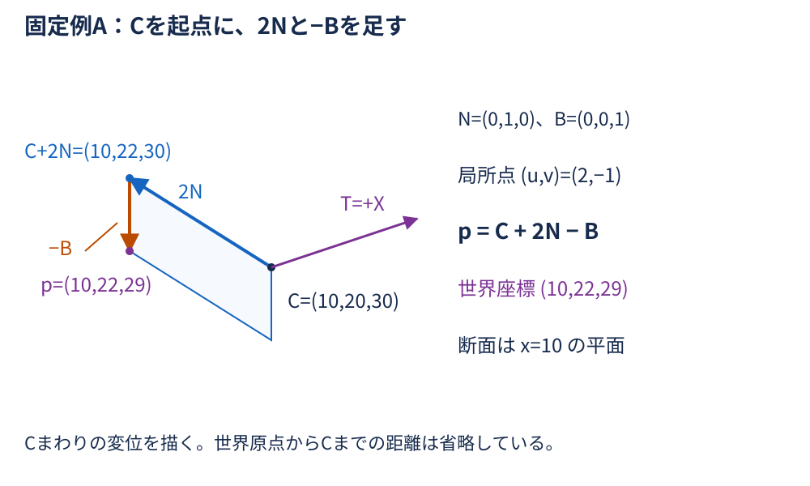
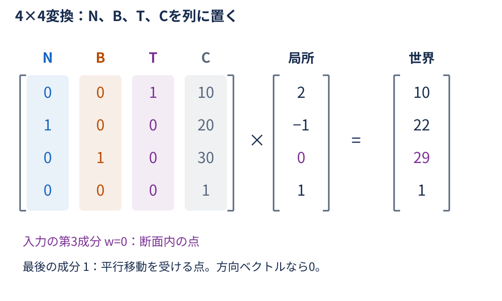
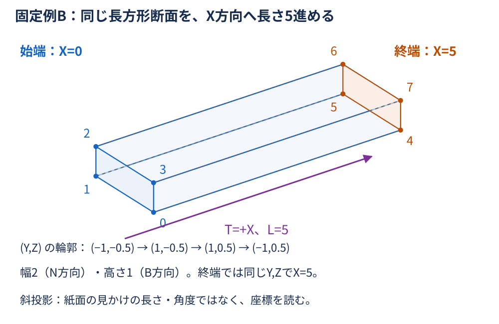
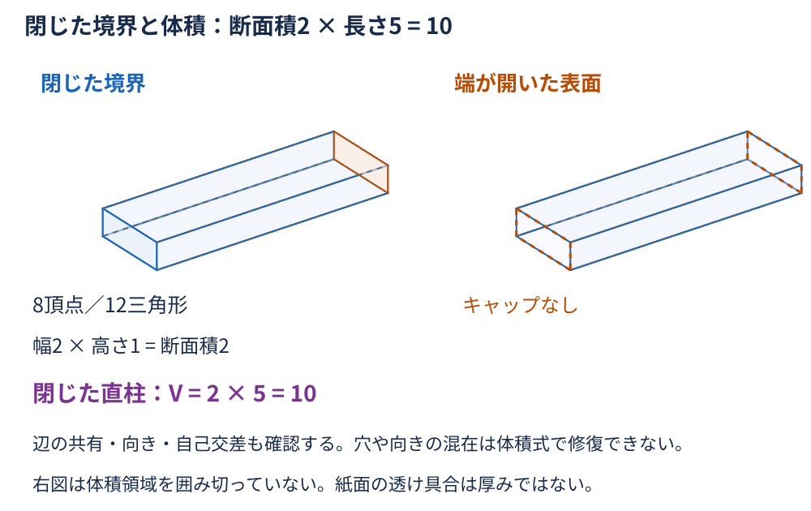
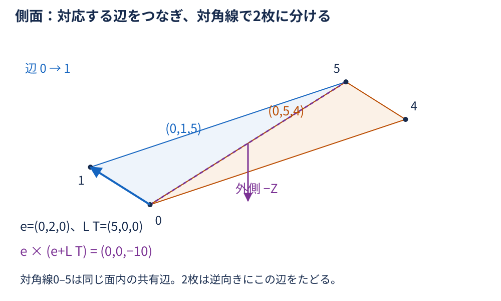
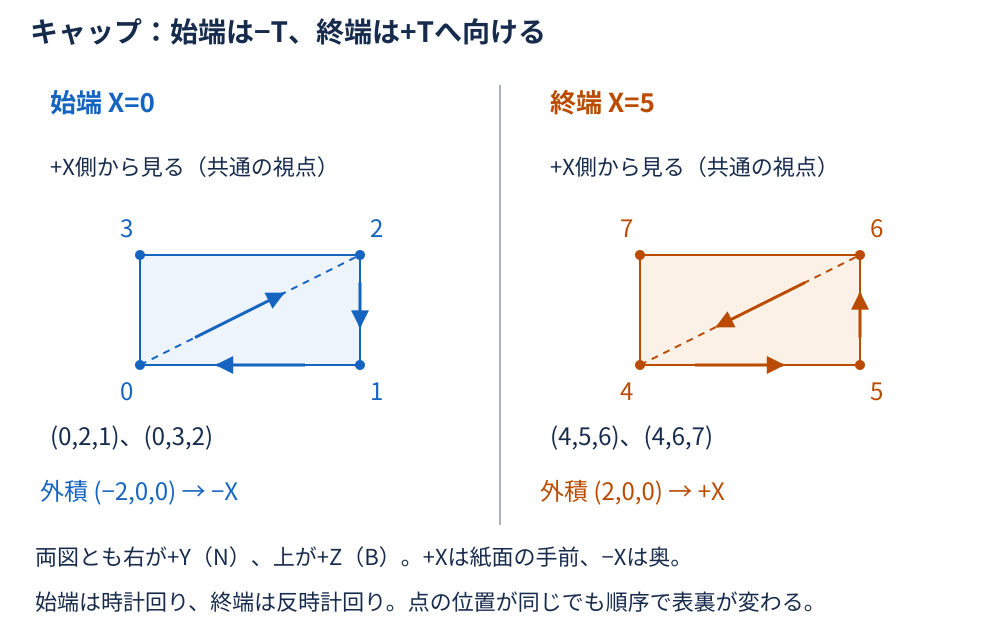
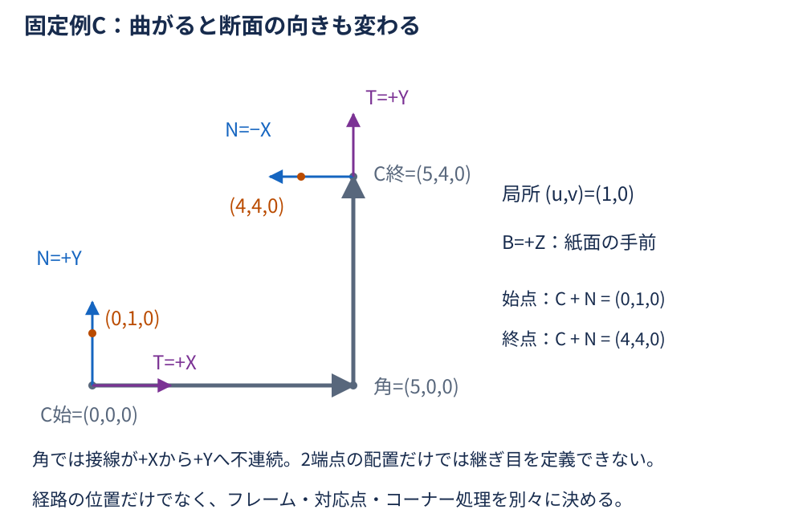
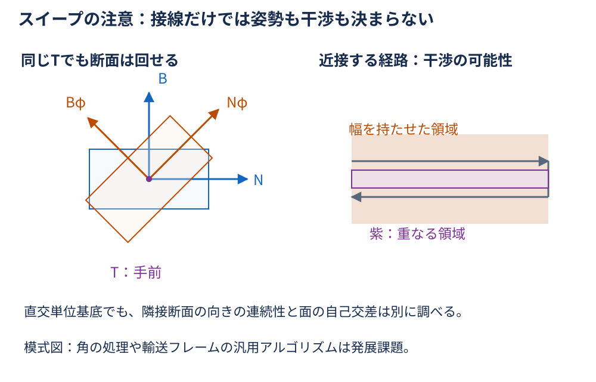
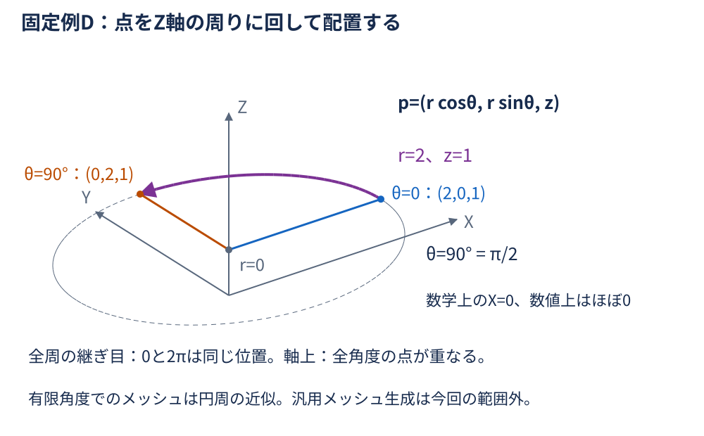

# 第4回：なぜ2Dの図形から3Dモデルを作れるのか？ — 宿題の解答・解説

[問題ページ](problems.md) の全17設問（任意補足を含む）に対応する。  
[詳細解説](../explanation.md) と同じ右手系・列ベクトル方式・固定例A〜Dを使う。  
断面の反時計回りは+T側から断面の原点へ見る向き。  
三角形の外積は面積の2倍の長さを持つベクトルで、単位法線とは区別する。

## 基本問題1：断面座標を世界座標に変える

### 1. 局所点の配置

**答え：** 世界座標は $(10,22,29)$ 。

**途中計算：** 局所u方向の変位が2N、v方向の変位が−Bになる。

$$
\begin{aligned}
p
&=C+2N-B \\
&=\begin{bmatrix}
10 \\
20 \\
30
\end{bmatrix}
+\begin{bmatrix}
0 \\
2 \\
0
\end{bmatrix}
+\begin{bmatrix}
0 \\
0 \\
-1
\end{bmatrix} \\
&=\begin{bmatrix}
10 \\
22 \\
29
\end{bmatrix}.
\end{aligned}
$$

**理由：** u・vは世界X・Yではなく、N・Bを基準にした距離である。  
2つの変位を足し、配置の原点Cを加えて世界座標にする。

**間違えやすい点：** $(2,-1)$ をそのまま世界X・Yへ足すと違う点になる。  
今回はuが世界Y、vが世界Zに対応する。

### 2. 直交・単位長と断面の向き

**答え：** $N\cdot B=0$ 、 $N\times B=T=(1,0,0)$ 。  
N・B・Tの長さはすべて1で、局所の長さと直角を保ち、Tに垂直な平面へ配置できる。

**途中計算：** 内積と外積を成分で確かめる。

$$
N\cdot B=0\times0+1\times0+0\times1=0.
$$

$$
N\times B=\begin{bmatrix}
1\times1-0\times0 \\
0\times0-0\times1 \\
0\times0-1\times0
\end{bmatrix}
=\begin{bmatrix}
1 \\
0 \\
0
\end{bmatrix}=T.
$$

$$
\lVert N\rVert=\sqrt{0^2+1^2+0^2}=1,\qquad
\lVert B\rVert=\sqrt{0^2+0^2+1^2}=1.
$$

$$
\lVert T\rVert=\sqrt{1^2+0^2+0^2}=1,\qquad
T\cdot N=T\cdot B=0.
$$

任意の局所変位 $(a,b)$ の世界変位についても、

$$
\begin{aligned}
\lVert aN+bB\rVert^2
&=a^2\lVert N\rVert^2+2ab(N\cdot B)+b^2\lVert B\rVert^2 \\
&=a^2+b^2.
\end{aligned}
$$

**理由：** 直交単位基底なので長さの式が2Dと一致し、軸間の直角も保たれる。  
N・Bのどの組合せもTに垂直だから、断面はCを通る法線Tの平面に乗る。  
今回は $x=10$ の平面である。

**間違えやすい点：** 「傾かず置く」は世界XY平面と同じ向きという意味ではない。  
断面の向きは基底で変わる。  
非単位基底なら寸法、非直交基底なら角度が変わることがある。

### 3. 4×4列方式でも同じ点になる

**答え：** N、B、T、Cを列にすると次のMになり、同次座標の出力は $(10,22,29,1)$ 。

$$
M=\begin{bmatrix}
0 & 0 & 1 & 10 \\
1 & 0 & 0 & 20 \\
0 & 1 & 0 & 30 \\
0 & 0 & 0 & 1
\end{bmatrix}.
$$

**途中計算：** $(u,v,w)=(2,-1,0)$ を代入して各行と入力列の積を取る。

$$
\begin{aligned}
M p_{\mathrm{local}}
&=M\begin{bmatrix}
2 \\
-1 \\
0 \\
1
\end{bmatrix} \\
&=\begin{bmatrix}
0\times2+0\times(-1)+1\times0+10\times1 \\
1\times2+0\times(-1)+0\times0+20\times1 \\
0\times2+1\times(-1)+0\times0+30\times1 \\
1
\end{bmatrix} \\
&=\begin{bmatrix}
10 \\
22 \\
29 \\
1
\end{bmatrix}.
\end{aligned}
$$

**理由：** 第1〜3列をu・v・wで重み付けし、第4列を1倍して足している。  
したがって空間部分は $uN+vB+wT+C$ であり、 $w=0$ なら設問1の配置式と同じになる。

**間違えやすい点：** 基底を行に並べると別の規約になる。  
列方式のMと、C#の行方式の行列配置を混ぜない。

### 4. w=0と末尾1の役割

**答え：** wはT方向の局所座標で、0なら断面内。  
最後の1は平行移動を受ける点を表す。  
末尾を0にしたものは方向・変位の扱いとなり、Cは加わらない。

**途中計算：** 末尾だけをhに置き換えると、出力は次の形になる。

$$
M\begin{bmatrix}
u \\
v \\
w \\
h
\end{bmatrix}
=\begin{bmatrix}
uN_x+vB_x+wT_x+hC_x \\
uN_y+vB_y+wT_y+hC_y \\
uN_z+vB_z+wT_z+hC_z \\
h
\end{bmatrix}.
$$

今回の入力で $h=0$ にすると、

$$
M\begin{bmatrix}
2 \\
-1 \\
0 \\
0
\end{bmatrix}
=\begin{bmatrix}
0 \\
2 \\
-1 \\
0
\end{bmatrix}.
$$

**理由：** 末尾が第4列Cの係数だから、hが1ならCを足し、0ならCを足さない。  
wは第3列Tの係数であり、別の役割を持つ。

**間違えやすい点：** 「2D断面だから0にする」のはwであり、点の同次成分ではない。  
$(0,2,-1)$ はCからの変位で、配置後の世界座標pではない。

## 基本問題2：長方形断面を5だけ押し出す

### 1. 始端と終端の8頂点

**答え：** 始端・終端の対応する頂点は次のとおり。

| i | 始端番号 | 始端の座標 | 終端番号 | 終端の座標 |
| --- | --- | --- | --- | --- |
| 0 | 0 | (0,−1,−0.5) | 4 | (5,−1,−0.5) |
| 1 | 1 | (0,1,−0.5) | 5 | (5,1,−0.5) |
| 2 | 2 | (0,1,0.5) | 6 | (5,1,0.5) |
| 3 | 3 | (0,−1,0.5) | 7 | (5,−1,0.5) |

**途中計算：** 各局所点 $(u_i,v_i)$ に対して、

$$
v_i^0=\begin{bmatrix}
0 \\
u_i \\
v_i
\end{bmatrix},\qquad
v_i^1=v_i^0+5T=\begin{bmatrix}
5 \\
u_i \\
v_i
\end{bmatrix}.
$$

例えば $q_0=(-1,-0.5)$ は始端 $(0,-1,-0.5)$ 、終端 $(5,-1,-0.5)$ 。  
他の3点も同じ式に代入したものが表である。

**理由：** 始端から終端までは単位方向Tに5だけ移動する。  
N・Bを変えないため、YとZは同じでXだけが変わる。

**間違えやすい点：** 固定例AのCはここでは使わない。  
終端も輪郭番号を同じ順で対応させ、勝手に逆順にしない。

### 2. 断面積と体積、単位

**答え：** 幅2、高さ1、断面積2、体積10。  
長さ単位がmなら面積は2 m²、体積は10 m³。

**途中計算：** 局所座標の最大値と最小値の差から寸法を読む。

$$
\mathrm{width}=1-(-1)=2,\qquad
\mathrm{height}=0.5-(-0.5)=1.
$$

$$
A=2\times1=2,\qquad V=A L=2\times5=10.
$$

単位も掛け合わせる。

$$
\mathrm{m}\times\mathrm{m}=\mathrm{m}^2,\qquad
\mathrm{m}^2\times\mathrm{m}=\mathrm{m}^3.
$$

**理由：** 直交単位基底の配置は断面の寸法を保つ。  
断面がTに垂直で、一定の断面積のまま法線方向へ長さLだけ続くため、断面積×長さが体積になる。

**間違えやすい点：** 面積と体積の単位を同じmにしない。  
断面に斜めの押し出しでは、移動長をそのまま法線方向の高さとして掛けられない。

### 3. 頂点・三角形・幾何学的な面を数える

**答え：** 共有頂点8個、三角形12枚、幾何学的な平面の面は6面。

**途中計算：** 始端4点＋終端4点で8頂点。  
側面は輪郭の4辺に対応する4四角形、端面は2四角形である。

$$
F_{\mathrm{side}}=4\times2=8,\qquad
F_{\mathrm{cap}}=2\times2=4.
$$

$$
F_{\mathrm{tri}}=8+4=12,\qquad
F_{\mathrm{plane}}=4+2=6.
$$

**理由：** 四角形1面を対角線で分けても、その2枚は同じ幾何学的な平面の面を表す。  
三角形数は接続データの数、6面は直方体としての面数であり、数えている対象が違う。

**間違えやすい点：** 8頂点・12三角形は、この共有頂点方式の長方形直柱の値である。  
任意の形状に一般化しない。  
面ごとに法線用の頂点を複製する表示用配列では頂点数が変わり得る。

### 4. sで断面を動かす

**答え：** 次の式で、sはT方向に進んだ長さとなる。

$$
p(u,v,s)=C_0+uN+vB+sT,\qquad 0\leq s\leq5.
$$

**途中計算：** 今回の基底を成分で書き、例えば輪郭の先頭点を追う。

$$
p(u,v,s)=\begin{bmatrix}
s \\
u \\
v
\end{bmatrix},\qquad
p(-1,-0.5,s)=\begin{bmatrix}
s \\
-1 \\
-0.5
\end{bmatrix}.
$$

$s=0$ で始端、 $s=5$ で終端となる。  
Tは無次元の単位ベクトルなので、sは座標と同じ長さ単位を持つ。

**理由：** N・Bは固定し、CだけがT方向へ動く。  
輪郭上の点を動かすと側面になる。  
2D断面の内部領域も含めて動かすと連続した体積領域になる。  
メッシュで境界を作る場合は、その側面に始端・終端のキャップを加える。

**間違えやすい点：** sを無次元の割合と混同しない。  
範囲を0〜1にするなら $s=5\lambda$ とし、 $0\leq\lambda\leq1$ とする。  
輪郭の移動だけで両端まで塞がるわけではない。

## 基本問題3：頂点順序・外向き法線・キャップ

### 1. 側面の2三角形と外積

**答え：** 一例は(0,1,5)と(0,5,4)。  
両方の外積は $(0,0,-10)$ で、外側の−Zを向く。

**途中計算：** 必要な頂点は、0が $(0,-1,-0.5)$ 、1が $(0,1,-0.5)$ 、5が $(5,1,-0.5)$ 、4が $(5,-1,-0.5)$ 。

三角形(0,1,5)では、0を基準にした2辺の外積を取る。

$$
(v_1^0-v_0^0)\times(v_1^1-v_0^0)
=\begin{bmatrix}
0 \\
2 \\
0
\end{bmatrix}
\times\begin{bmatrix}
5 \\
2 \\
0
\end{bmatrix}
=\begin{bmatrix}
0 \\
0 \\
-10
\end{bmatrix}.
$$

三角形(0,5,4)も同じ0から差を取る。

$$
(v_1^1-v_0^0)\times(v_0^1-v_0^0)
=\begin{bmatrix}
5 \\
2 \\
0
\end{bmatrix}
\times\begin{bmatrix}
5 \\
0 \\
0
\end{bmatrix}
=\begin{bmatrix}
0 \\
0 \\
-10
\end{bmatrix}.
$$

**理由：** 4頂点は $z=-0.5$ の底側の面にある。  
内部はそこから+Z側なので、外側は−Z。  
2枚は対角線0–5を逆向きにたどり、四角形を重ならず覆う。  
三角形の巡回置換など、同じ向きの別表記も正しい。

**間違えやすい点：** 2辺の基準点をそろえる。  
$(0,0,-10)$ は単位法線ではなく、単位化した向きは $(0,0,-1)$ 。  
外積の引数を逆にすると+Zになってしまう。

### 2. 両端のキャップと逆の順序

**答え：** 始端は(0,2,1)・(0,3,2)、終端は(4,5,6)・(4,6,7)。  
それぞれの2枚の外積は始端が $(-2,0,0)$ 、終端が $(2,0,0)$ 。

**途中計算：** 始端の(0,2,1)では、

$$
(v_2^0-v_0^0)\times(v_1^0-v_0^0)
=\begin{bmatrix}
0 \\
2 \\
1
\end{bmatrix}
\times\begin{bmatrix}
0 \\
2 \\
0
\end{bmatrix}
=\begin{bmatrix}
-2 \\
0 \\
0
\end{bmatrix}.
$$

始端のもう1枚(0,3,2)では、

$$
\begin{bmatrix}
0 \\
0 \\
1
\end{bmatrix}
\times\begin{bmatrix}
0 \\
2 \\
1
\end{bmatrix}
=\begin{bmatrix}
-2 \\
0 \\
0
\end{bmatrix}.
$$

終端の(4,5,6)では、

$$
(v_1^1-v_0^1)\times(v_2^1-v_0^1)
=\begin{bmatrix}
0 \\
2 \\
0
\end{bmatrix}
\times\begin{bmatrix}
0 \\
2 \\
1
\end{bmatrix}
=\begin{bmatrix}
2 \\
0 \\
0
\end{bmatrix}.
$$

もう1枚(4,6,7)も、

$$
\begin{bmatrix}
0 \\
2 \\
1
\end{bmatrix}
\times\begin{bmatrix}
0 \\
0 \\
1
\end{bmatrix}
=\begin{bmatrix}
2 \\
0 \\
0
\end{bmatrix}.
$$

**理由：** 内部は始端から見て+X側、終端から見て−X側にある。  
外側は始端が−X、終端が+Xになるので、輪郭に対する三角形の順序を逆にする。  
+X側から見ると始端は時計回り、終端は反時計回りである。

**間違えやすい点：** 対応頂点の保存順を逆転する必要はない。  
変えるのはキャップのインデックス順序である。  
両端とも同じ輪郭順で面を作ると、片方が内向きになる。

### 3. 片方のキャップがない場合

**答え：** 残った三角形はサーフェスを表すが、体積領域を囲み切る閉じたメッシュではない。

**途中計算：** 一方のキャップ全体、すなわち2三角形を除くと、残るのは $12-2=10$ 三角形。  
欠けた端の輪郭4辺は側面の三角形1枚だけに属し、相手になるキャップの三角形を持たない。

**理由：** 面は残っていても開口がある。  
閉じた境界には各辺を逆向きに共有する2面が必要であり、この開いた表面では境界条件が満たされない。  
元の閉じた直柱の体積が10という事実と、欠けたメッシュ自身が有効な体積の境界かどうかは別である。

**間違えやすい点：** 「端面がないから体積0」とは結論しない。  
見た目で端が隠れていても閉じた証拠にはならない。  
三角形数だけでなく辺の接続と開口を確認する。

### 4. 順序の誤りが表示と体積へ及ぼす影響

**答え：** 2頂点を入れ替えると法線と表裏が逆転する。  
全三角形を反転すれば一貫して内向き、一部だけなら向きが混在する。  
裏面を描かない表示では面が見えなくなる場合があり、符号付き体積の検算にも影響する。

**途中計算：** 外積の反交換性から、

$$
(c-a)\times(b-a)=-\bigl((b-a)\times(c-a)\bigr).
$$

詳細解説の符号付き体積は、

$$
V_{\mathrm{signed}}=\frac16\sum_f a_f\cdot(b_f\times c_f).
$$

全三角形でbとcを入れ替えると各項の符号が反転し、正しい外向きの10は−10になる。  
一部だけを反転すると、その項だけ符号が変わり、正しい境界の相殺関係を使えなくなる。

**理由：** 頂点座標の集合が同じでも、順序付きの接続情報が面の向きを決める。  
陰影や裏面判定は法線・表裏に依存し、体積式は一貫した向きの閉じた境界を前提にする。

**間違えやすい点：** 両面表示では誤りが見えにくい場合がある。  
最後に体積の絶対値を取っても、一部の反転・穴・自己交差が直るわけではない。  
元の世界原点で体積式の寄与が0の面は、反転しても数値に現れないことがあるため、体積だけで向きの正しさを判定しない。

## (発展) 折れた中心線に断面を配置する

### 1. 両ステーションのフレーム

**答え：** 両方とも $N\times B=T$ で右手系を作り、3本は互いに直交する長さ1の基底である。

**途中計算：** 始点の外積は基本問題1と同じ $(1,0,0)$ 。  
終点では、

$$
N\times B=\begin{bmatrix}
-1 \\
0 \\
0
\end{bmatrix}
\times\begin{bmatrix}
0 \\
0 \\
1
\end{bmatrix}
=\begin{bmatrix}
0 \\
1 \\
0
\end{bmatrix}=T.
$$

各内積と長さの計算をまとめる。

| 確認 | 始点 | 終点 |
| --- | --- | --- |
| N・Bの内積 | 0×0+1×0+0×1=0 | (−1)×0+0×0+0×1=0 |
| N・Tの内積 | 0×1+1×0+0×0=0 | (−1)×0+0×1+0×0=0 |
| B・Tの内積 | 0×1+0×0+1×0=0 | 0×0+0×1+1×0=0 |
| N・B・Tの各長さの2乗 | 0²+1²+0²、0²+0²+1²、1²+0²+0²（すべて1） | (−1)²+0²+0²、0²+0²+1²、0²+1²+0²（すべて1） |

長さは長さの2乗の正の平方根で、すべて1になる。

**理由：** 経路の方向は変わっているが、N・Bは新しいTに垂直な直交単位基底として選ばれている。  
同じ局所寸法を各ステーションに保って配置できる。

**間違えやすい点：** 終点でNを+Xにすると $N\times B=-Y$ になり、指定されたTと逆になる。

### 2. 同じ局所点を両端へ置く

**答え：** 始点は $(0,1,0)$ 、終点は $(4,4,0)$ 。

**途中計算：** $(u,v)=(1,0)$ なので、各点はその位置のCにNを足す。

$$
p_{\mathrm{start}}=\begin{bmatrix}
0 \\
0 \\
0
\end{bmatrix}
+\begin{bmatrix}
0 \\
1 \\
0
\end{bmatrix}
=\begin{bmatrix}
0 \\
1 \\
0
\end{bmatrix}.
$$

$$
p_{\mathrm{end}}=\begin{bmatrix}
5 \\
4 \\
0
\end{bmatrix}
+\begin{bmatrix}
-1 \\
0 \\
0
\end{bmatrix}
=\begin{bmatrix}
4 \\
4 \\
0
\end{bmatrix}.
$$

**理由：** 同じ局所u=1でも、その1だけ進む世界方向が始点は+Y、終点は−Xとなる。  
局所座標はフレームと組み合わせて初めて世界位置を決める。

**間違えやすい点：** 局所点の値を変えて曲がりを表すのではない。  
ここでは局所点は同じで、中心と基底が変わる。

### 3. 中心だけを移すとどうなるか

**答え：** Nを始点のままにすると終点で $(5,5,0)$ となり、指定の $(4,4,0)$ と異なる。  
断面は終点の接線に垂直ではなくなる。

**途中計算：** 始点のNを使ってCだけを終点へ置き換える。

$$
p_{\mathrm{fixed}}=\begin{bmatrix}
5 \\
4 \\
0
\end{bmatrix}
+\begin{bmatrix}
0 \\
1 \\
0
\end{bmatrix}
=\begin{bmatrix}
5 \\
5 \\
0
\end{bmatrix}.
$$

更新しない断面の法線は+Xのまま、終点の接線は+Y。  
更新しないN自体が+Yなので、断面内の方向と終点の接線が平行になってしまう。

**理由：** 中心は断面の位置を、N・Bは姿勢を決める別の情報である。  
中心を曲線上へ置いただけでは、断面の向きが経路を追従するとは限らない。

**間違えやすい点：** 姿勢を固定する配置自体が常に誤りなのではない。  
この問題の「接線に垂直な断面」という指定とは合わない、という意味である。

### 4. 角の接続は別の設計条件

**答え：** 角の直前はT=+X、直後はT=+Yで一意の接線を持たない。  
同じ局所点は片側のフレームで $(5,1,0)$ と $(4,0,0)$ になるため、角でのフレームと面の接続方針を別に決める必要がある。

**途中計算：** 経路の進行方向に沿う2線分の変位をそれぞれ単位化する。

$$
T_{\mathrm{left}}=\frac15\begin{bmatrix}
5 \\
0 \\
0
\end{bmatrix}=\begin{bmatrix}
1 \\
0 \\
0
\end{bmatrix},\qquad
T_{\mathrm{right}}=\frac14\begin{bmatrix}
0 \\
4 \\
0
\end{bmatrix}=\begin{bmatrix}
0 \\
1 \\
0
\end{bmatrix}.
$$

角の中心 $C_k=(5,0,0)$ に、それぞれのNを足す。

$$
p_{\mathrm{left}}=\begin{bmatrix}
5 \\
0 \\
0
\end{bmatrix}
+\begin{bmatrix}
0 \\
1 \\
0
\end{bmatrix}
=\begin{bmatrix}
5 \\
1 \\
0
\end{bmatrix}.
$$

$$
p_{\mathrm{right}}=\begin{bmatrix}
5 \\
0 \\
0
\end{bmatrix}
+\begin{bmatrix}
-1 \\
0 \\
0
\end{bmatrix}
=\begin{bmatrix}
4 \\
0 \\
0
\end{bmatrix}.
$$

**理由：** 両端のフレームは断面の配置しか指定していない。  
角を留め継ぎにする、丸める、曲がり部分を追加するなどの条件がないので、正しいメッシュ形状は一意に定まらない。  
接線が決まる区間にもTの周りの回転の自由度があり、フレーム更新規則が必要になる。

**間違えやすい点：** 2つの端点フレームを直接つなぐだけで元の折れ線を通る滑らかな形状ができたとは言えない。  
フレームが直交単位でも、急カーブでの面のつぶれや自己交差が防げるわけではない。

### (発展) 5. 任意補足：回転点と押し出しの違い

**答え：** 数学上は $(0,2,1)$ 。  
押し出しは一定方向への平行移動、回転は軸の周りで方向を変えながら半径を保つ配置である。

**途中計算：** $90^\circ=\pi/2$ を使う。

$$
p(r,z,\theta)=\begin{bmatrix}
r\cos\theta \\
r\sin\theta \\
z
\end{bmatrix}.
$$

$$
p(2,1,\pi/2)=\begin{bmatrix}
2\times0 \\
2\times1 \\
1
\end{bmatrix}
=\begin{bmatrix}
0 \\
2 \\
1
\end{bmatrix}.
$$

**理由：** XY平面の半径方向を角度で変え、Z座標は一定にする。  
押し出しの直線軌跡に対し、この点の軌跡は半径2・高さ1の円になる。

**間違えやすい点：** 数値計算ではcosの結果からXが小さな非ゼロになることがある。  
度とラジアンを混ぜず、必要ならほぼ0として照合する。  
点の配置が求まっても、軸上の退化や全周の継ぎ目を扱う汎用メッシュ生成まで完成したことにはならない。

[問題ページへ](problems.md) ／ [宿題トップへ戻る](README.md) ／ [セッションのトップへ戻る](../README.md)
