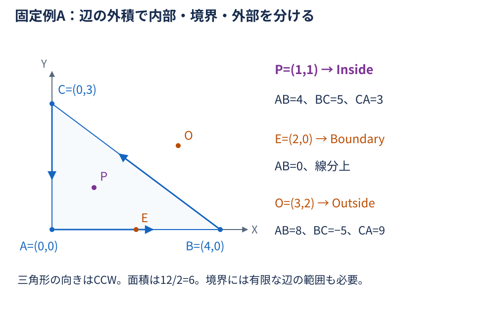
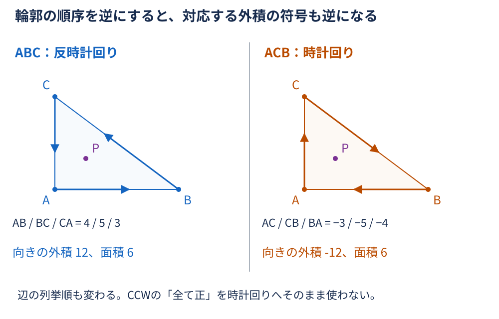
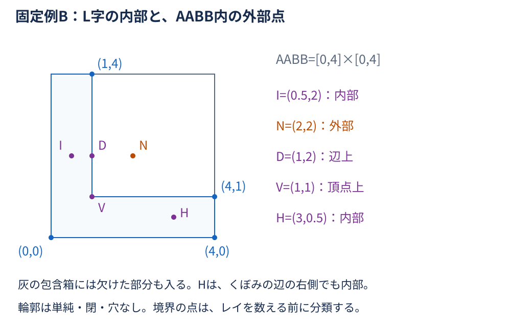
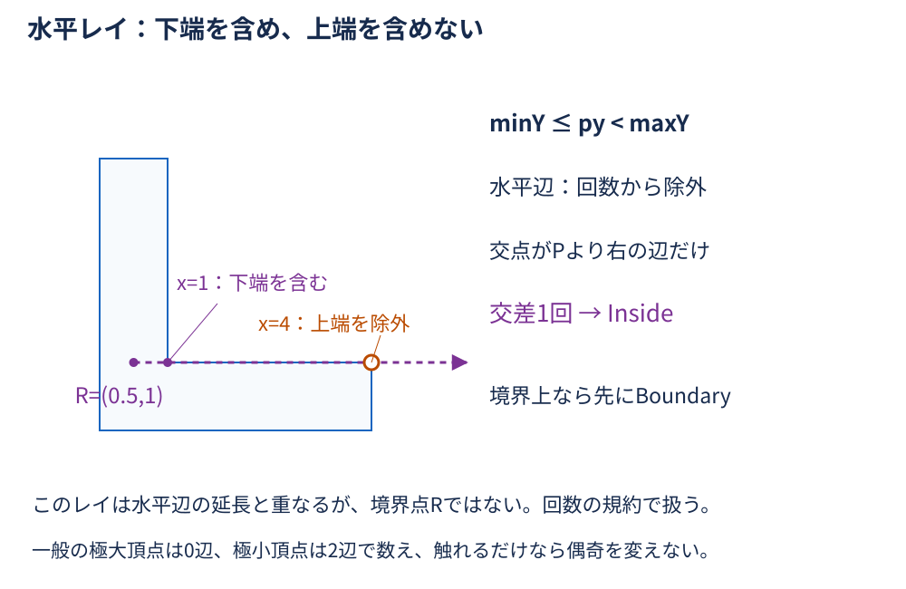
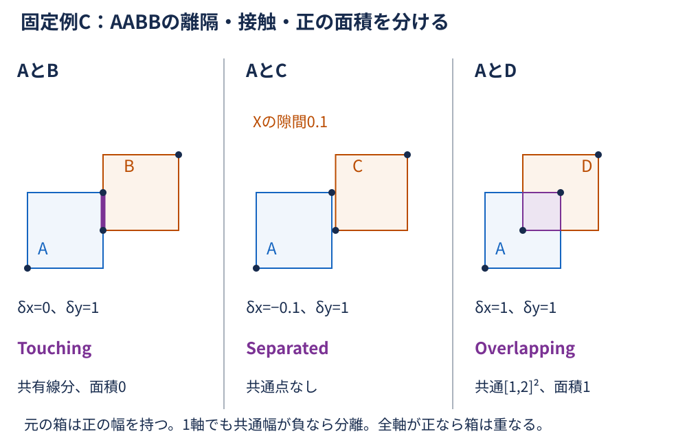
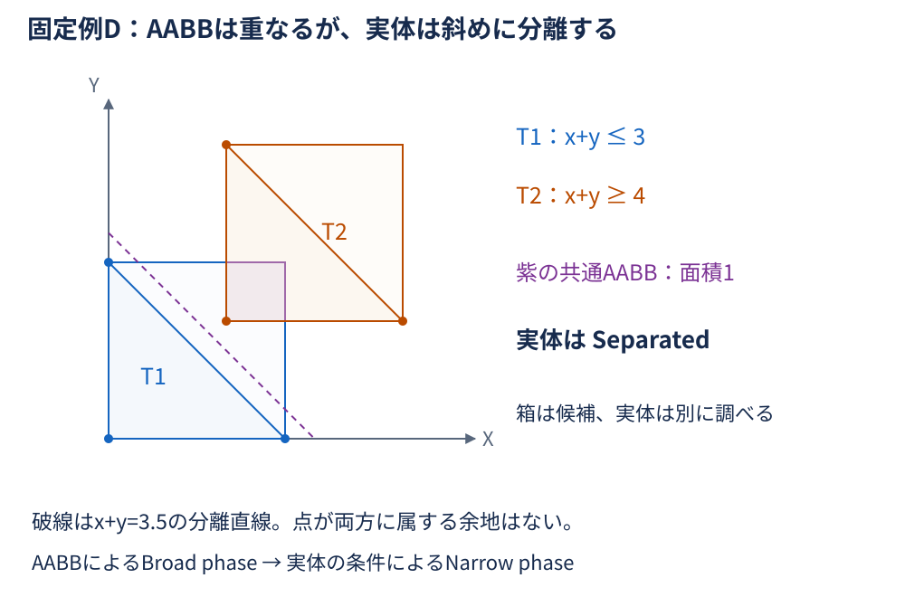
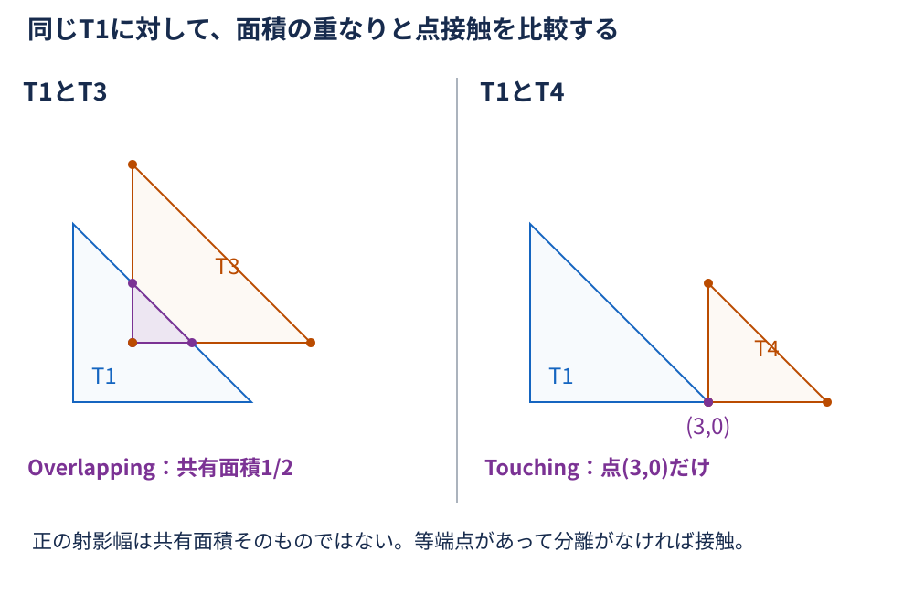
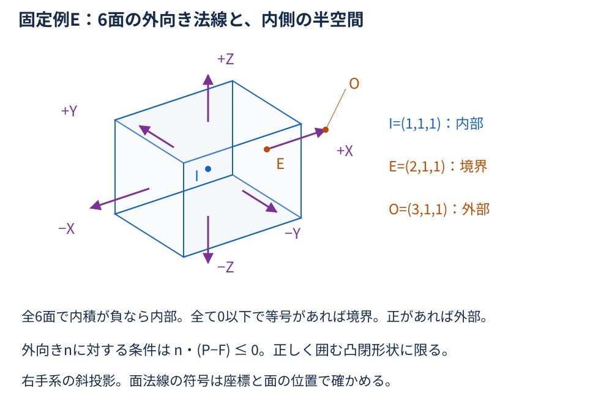
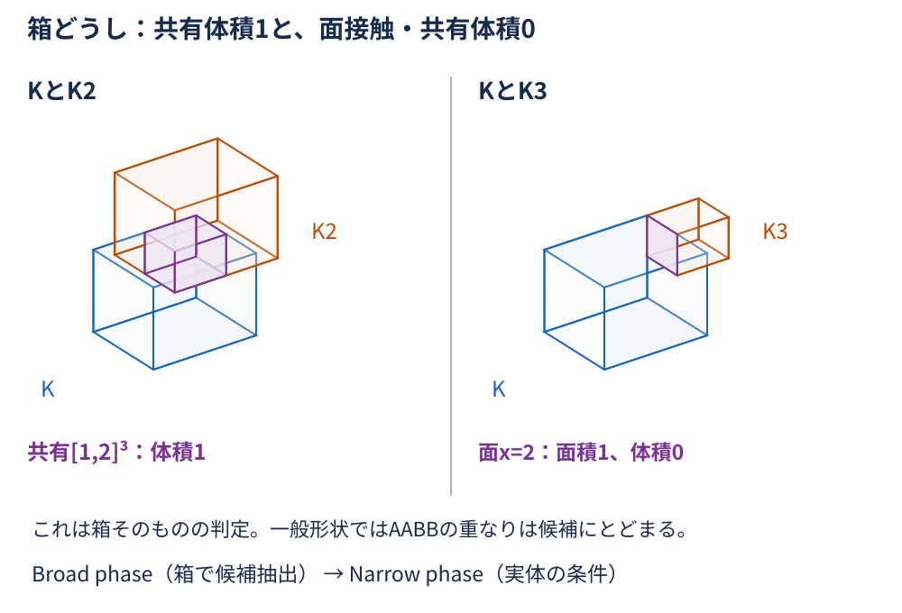

# 第5回：なぜ図形の内外や干渉を判定できるのか？ — 詳細解説

詳細解説・SVG図解・宿題・C#実装例は、固定例A〜Eを共通して使う。

## 学習の流れと表記

[第2回](../02-vector/explanation.md) の内積・外積、[第3回](../03-intersection/explanation.md) の線分の範囲と交差、[第4回](../04-modeling/explanation.md) の面の向きと閉じた境界を使う。[第1回](../01-matrix/explanation.md) と同じ座標系・列方式を引き継ぐ。

- 2DはX右・Y上、3Dは右手系の直交XYZ座標。短い点・ベクトルは $(1,1)$ のような座標の組でも書く。
- 2Dスカラー外積は $\mathrm{cross2}(a,b)=a_xb_y-a_yb_x$ 。3D外積ベクトルそのものとは区別する。
- 多角形は輪郭線だけでなく、その内部と境界を含む2D領域とする。箱は内部と境界を含む3D領域とする。線分・薄い面・殻と同じ次元の対象とは限らない。
- 輪郭は有限な頂点を順に結び、最後から最初にも辺を置く。通常は同じ始点を末尾に重複保存しない。凹多角形では穴・自己交差のない単純な閉輪郭を扱う。
- 計算はまず厳密な実数として説明する。小数2.1なども固定された値として扱い、浮動小数点の誤差と境界の扱いは⑧で分ける。
- 座標の単位はそろえる。外積の値は長さの2乗、面積は長さの2乗、体積は長さの3乗の尺度を持つ。

## ① 導入：何と何の関係を調べたいか

CAD/CIMで、検査点が部材の内側にあるか、部材同士が触れているか、配置した部品が別の領域へ入り込んでいるかを考える。最初に「点と領域」なのか「領域どうし」なのか、2Dなのか3Dなのかを決める。

点は面積を持たないため、点が図形内にあることと、2図形が正の面積で重なることは別の問いである。3Dでも、表面の交差と、ソリッドが正の体積を共有することを区別する。

一方が他方に完全に含まれると、境界同士が交わらなくても内部は重なる。

外積なら辺のどちら側か、内積ならある方向のどの位置かを数値にできる。その数値に、有限な辺の範囲・輪郭のつながり・内部の定義を組み合わせて判定を作る。

## ② 状態と前提を先に決める

### 点の内外は3状態

| 状態 | 意味 |
| --- | --- |
| Inside（内部） | 境界から離れ、領域の内部にある |
| Boundary（境界） | 輪郭の線分や頂点、3D形状の境界面・辺・頂点上にある |
| Outside（外部） | 領域に含まれない |

数学的には、内部の点はその周囲に十分小さい円や球を置いても領域に含まれる。境界の点は、どれだけ近くを見ても領域の外が現れる。辺の無限延長線上にあるだけでは境界ではない。

### 領域どうしの関係も3状態

ここでは、2Dの正の面積を持つ多角形と3Dの正の体積を持つ箱について、次の規約を使う。

| 状態 | 意味 |
| --- | --- |
| Separated（離隔） | 共通点がない |
| Touching（境界接触） | 共通点はあるが、共有部分の面積／体積は0 |
| Overlapping（重なり） | 正の面積／体積を共有する。完全な包含・一致も含む |

2Dの共有線分も、3Dの共有面も接触に分類する。用途によって、数える状態を分ける。

- 「共通点があれば干渉」とする用途では、Touchingも数える。
- 「体積の食い込み」を調べる用途では、Overlappingだけを数える。

隙間の基準があれば、距離条件を別に定義する。今回の分類から、実製品の判定基準や施工上の許容値を決めない。

非有限座標、ゼロ長辺、面積0の三角形、閉じていない輪郭、minとmaxが逆転した箱などは、**入力不正／未定義**として3状態から分ける。

数値的に境界を決めきれない場合は「判定保留」を考え、入力不正や厳密な接触とも区別する。

## ③ CCW三角形：辺の左側という条件を重ねる

### 2D外積の符号はどちら側を表すか

辺A→Bと点Pに対し、 $e=B-A$ 、 $w=P-A$ とする。

$$
\mathrm{cross2}(e,w)=e_xw_y-e_yw_x.
$$

ABが右へ向く場合、Pが上なら正、下なら負になる。座標を回しても「辺の左側なら正」という向きの関係は同じである。外積0は辺の無限直線上を意味するが、辺の有限範囲までは表していない。

非ゼロの辺上かどうかは、外積0に加えて射影の範囲も調べる。

$$
\mathrm{cross2}(B-A,P-A)=0,
$$

$$
0\leq(P-A)\cdot(B-A)\leq\lVert B-A\rVert^2.
$$

内積を辺の長さの2乗で割った値が、第3回の線分の媒介変数に当たる。両端を含めるため等号を含む。A=Bでは通常の辺として使わず、入力の退化を先に分ける。

### 固定例A：三角形ABC

$$
A=(0,0),\qquad B=(4,0),\qquad C=(0,3).
$$

$$
\mathrm{cross2}(B-A,C-A)=4\times3-0\times0=12.
$$

正なのでABCは反時計回り（CCW）、面積は $12/2=6$ 。3本の辺の進行方向から見ると、内部はすべて左側にある。P=(x,y)の3つの値を成分へ展開する。

$$
c_{AB}=\mathrm{cross2}(B-A,P-A)=4y,
$$

$$
\begin{aligned}
c_{BC}
&=\mathrm{cross2}((-4,3),(x-4,y)) \\
&=-4y-3(x-4) \\
&=12-3x-4y,
\end{aligned}
$$

$$
c_{CA}=\mathrm{cross2}(A-C,P-C)=3x.
$$

| 点 | ABの値 | BCの値 | CAの値 | 分類 |
| --- | --- | --- | --- | --- |
| P=(1,1) | 4 | 5 | 3 | 全て正なのでInside |
| E=(2,0) | 0 | 6 | 6 | 線分AB上なのでBoundary |
| O=(3,2) | 8 | −5 | 9 | 負があるのでOutside |

この非退化CCW三角形では、次の条件で分類する。

- 全て正なら内部。
- 全て0以上で、少なくとも1つ0なら境界。
- 1つでも負があれば外部。

まず負を調べず「0があるから境界」とすると、延長線上の外部点を間違える。例えばF=(5,0)はABの値0だが、BCの値−3、CAの値15で、ABの線分範囲からも外れる。

### 向きと退化を省略しない

ABCをACBへ逆順にすると、対応する各辺の向きと外積の符号が逆になる。辺の列挙順も変わり、Pの値はAC・CB・BAの順で−3・−5・−4となる。

時計回りでは「全て負」が内部の条件なので、CCWの正の条件をそのまま使わない。

3点が一直線なら向きの外積も面積も0で、ここでいう2Dの内部はない。重複点も含めて入力不正／未定義に分ける。線分や点として扱いたければ、その次元に応じた別の問題として定義する。

## ④ 凹多角形：境界を先に調べ、レイの交差を数える

### 凸図形の左側判定を凹図形へ流用しない

凸なCCW多角形では全ての辺の左側の共通部分が内部を表す。凹形状では、ある辺の延長線が別の内部領域を切ってしまう。したがって「全辺の左側」を要求すると、本来の内部まで除いてしまう。

固定例Bは、次の順の閉じたL字輪郭とする。

$$
(0,0)\to(4,0)\to(4,1)\to(1,1)\to(1,4)\to(0,4)\to(0,0).
$$

最後の(0,0)は閉じる辺の説明であり、頂点配列に重複保存する指示ではない。輪郭はCCWで、横の長方形の面積4と、重複しない縦の上部の面積3を足して面積7。AABB（軸に平行な最小包含箱）は $[0,4]\times[0,4]$ になる。

例えば内部のH=(3,0.5)は、くぼみの辺(1,1)→(1,4)の右側にある。その辺の左側だけを採用するとHまで外部になる。またN=(2,2)はAABBには入るが、Lの欠けた部分にある。

### なぜ奇数と偶数で区別できるのか

**全ての有限な辺上を先に検査し、辺上ならBoundaryを返す。** 残った点から+X向きの水平半直線（レイ）を出し、境界を横切る回数を数える。

単純で閉じた有界な輪郭では、十分右へ進むと外部にいる。境界を横断するたびに内側と外側が入れ替わるので、出発点から右端まで奇数回ならInside、偶数回ならOutsideとなる。輪郭上を走る場合や頂点に当たる場合は、そのまま「見えた交点」を数えず次の規則で扱う。

### 半開区間で頂点の計数を統一する

辺の端点をa、b、調べる点をPとする。交差回数に使う辺は、

$$
\min(a_y,b_y)\leq p_y<\max(a_y,b_y)
$$

を満たすものだけとする。**下端を含め、上端を含めない。**

水平辺は下端と上端が同じため、この条件を満たさず、回数計算から除外される。境界上の水平辺は、先行する辺上判定で既に扱っている。

採用した非水平辺の媒介変数を解く。

$$
t=\frac{p_y-a_y}{b_y-a_y},
$$

$$
x_{\mathrm{hit}}=a_x+t(b_x-a_x).
$$

さらに $x_{\mathrm{hit}}>p_x$ のときだけ右向きレイの1回として数える。境界判定が済んでいるため、等号を交差回数へ混ぜない。辺を逆向きに保存しても、min／maxと交点位置は同じになる。

| 固定例Bの点 | 境界の先行判定 | 右向きレイの交差 | 分類 |
| --- | --- | --- | --- |
| I=(0.5,2) | 辺上ではない | x=1で1回 | Inside |
| N=(2,2) | 辺上ではない | 0回 | Outside |
| D=(1,2) | 辺上 | 回数判定を行わない | Boundary |
| V=(1,1) | 頂点上 | 回数判定を行わない | Boundary |
| H=(3,0.5) | 辺上ではない | x=4で1回 | Inside |

頂点の高さを通る追加点R=(0.5,1)では、x=4の辺の上端は除外し、x=1の辺の下端を採用する。水平辺も除外され、右向きの交差はx=1で1回となる。

半開区間は「全ての頂点を必ず1回数える」という規則ではない。水平でない2辺が接続する頂点では、次のように分かれる。

- 通常の通過頂点：一方だけを採用する。
- 局所的なYの極大：0辺を採用する。
- 局所的なYの極小：2辺を採用する。

レイが触れるだけの頂点では、偶奇を変えない。境界上の点そのものの判定とも区別する。

ここでは穴・自己交差・複数輪郭を扱わない。そうした入力には、どの領域を内部とするか、輪郭の組合せや偶奇／巻き数などの規則を追加で定義する必要がある。

## ⑤ AABB：各軸の区間から候補を絞る

### 1本の軸の共通区間を導く

区間 $[a_{\min},a_{\max}]$ と $[b_{\min},b_{\max}]$ の共通部分では、下端は両方の下端以上、上端は両方の上端以下でなければならない。

$$
\ell=\max(a_{\min},b_{\min}),\qquad
h=\min(a_{\max},b_{\max}),\qquad
\delta=h-\ell.
$$

δが負なら共通点なし、0なら端点だけ、正なら正の幅の共通区間がある。中心間の距離だけでなく、範囲の端を比較する。

ここでは全軸の元の幅が正であるAABBを前提とする。幅0の線・面・点は、別の次元の入力として扱う。

2DならXとY、3DならX・Y・Zで同じ条件を調べる。

- 1軸でもδが負ならSeparated。
- 全軸でδが0以上、かつ少なくとも1軸で0ならTouching。
- 全軸でδが正なら、**箱どうしは**Overlapping。

### 固定例C：接触と正の面積を分ける

AABBのAを $[0,2]\times[0,2]$ とする。

| 相手 | Xのδ | Yのδ | Aとの共通部分と分類 |
| --- | --- | --- | --- |
| B=[2,4]×[1,3] | 0 | 1 | x=2、yが1〜2の線分。Touching |
| C=[2.1,4]×[1,3] | −0.1 | 1 | 共通点なし。Separated |
| D=[1,3]×[1,3] | 1 | 1 | [1,2]×[1,2]、面積1。Overlapping |

共通点があるという境界を含む条件は全軸でδが0以上。正の面積の条件は両方が正で、面積はその積になる。負のδ同士を掛けて正の面積だと解釈しない。共通区間が存在することを先に確認する。

### 包含箱の重なりは実体の重なりを保証しない

実体の全ての点がそのAABB内にあるため、AABBが離れていれば実体も離れている。逆にAABBが重なる場合は、空いている部分だけが重なる可能性が残る。箱の接触でさえ、実体の接触を保証しない。

この軽い候補抽出をBroad phase、その候補について実体の形を使う詳細判定をNarrow phaseと呼ぶ。凹輪郭の欠けた部分にあるNも、AABBだけでは外部と分からなかった。次は凸三角形どうしで同じ問題を見る。

## ⑥ 2D凸図形のSAT：内積の区間に分離を探す

### 固定例D：重なるAABB、離れた三角形

$$
T_1:(0,0),(3,0),(0,3),
$$

$$
T_2:(2,2),(5,2),(2,5).
$$

両方ともCCWで、AABBはそれぞれ $[0,3]\times[0,3]$ と $[2,5]\times[2,5]$ 。共通AABBは $[2,3]\times[2,3]$ で面積1だが、三角形T1は $x+y\leq3$ 、T2は $x+y\geq4$ にあり、実体の共通点はない。

### 射影は内積の最小値と最大値

非ゼロの候補軸nへ各頂点pを内積 $q=n\cdot p$ で写す。単位軸なら軸方向の距離になり、単位でなければ一定倍率の座標となる。極値を並べた区間が、凸図形全体の射影区間になる。

$$
q_{\min}=\min_i(n\cdot p_i),\qquad
q_{\max}=\max_i(n\cdot p_i).
$$

なぜ頂点だけでよいのか。辺上の点は端点の重み付き平均であり、内積も同じ重み付き平均になる。さらに凸多角形内の点も頂点の凸結合で表されるので、内積が頂点の最小値と最大値を飛び越えることはない。

固定例の斜め軸 $n=(1,1)$ では $q=x+y$ 。各頂点の値を計算すると、

| 三角形 | 頂点順の内積 | 射影区間 |
| --- | --- | --- |
| T1 | 0、3、3 | [0,3] |
| T2 | 4、7、7 | [4,7] |

最大3と最小4の間に隙間がある。同じ点なら内積も同じはずなので、この区間に共通値がなければ実体に共通点はない。

![斜め軸n=(1,1)に対するT1の射影区間[0,3]とT2の[4,7]が離れる図](images/07-sat-projection.svg)

nは単位軸ではない。実際の距離座標はqを√2で割ったもので、区間の離隔・接触・重なりの符号は変わらない。

- 軸を正の倍率で伸ばしても、結果は同じになる。
- 負の倍率では、両区間の順序を反転してmin／maxを取り直せば同じ結果になる。

### 両方の図形の辺に垂直な軸を調べる

1本の軸で区間が重なるだけでは十分ではない。XとYでは上のT1・T2も区間が重なっていた。**2Dの非退化な凸多角形どうしでは、両方の多角形の各辺に垂直な軸を全て調べればよい**、というのが分離軸定理（SAT）である。

直感として、凸図形を外側から支える直線を考える。辺どうし・頂点と辺・頂点どうしの間に分離があるとき、その接触を支える辺の向きに対応する分離が候補軸に現れる。凸形状は支える直線の内側に全体が収まるため、この有限個の方向で分離を探せる。

片方の辺だけを調べて十分とは限らない。[EberlyのSAT解説](https://www.geometrictools.com/Documentation/MethodOfSeparatingAxes.pdf) の2D凸多角形の節も参照できる。

辺 $e=(e_x,e_y)$ に垂直な候補は $n=(-e_y,e_x)$ でよい。向きと倍率は分離の有無を変えないので、CCWの内向き／外向きに統一していなくてもmin／maxの比較はできる。ただしゼロ長辺からゼロ軸を作ってはいけない。距離の許容差を使うなら単位化するなど、軸の尺度を合わせる。

各候補軸で⑤と同じ区間のδを計算する。対象を正の面積の閉じた凸多角形に限り、厳密な実数では次のように分類できる。

1. 1軸でもδが負ならSeparated。
2. 分離軸がなく、少なくとも1軸でδが0ならTouching。
3. 全候補軸でδが正ならOverlapping。

### 正の重なりと点接触の比較

追加の三角形を、

$$
T_3:(1,1),(4,1),(1,4),
$$

$$
T_4:(3,0),(5,0),(3,2)
$$

とする。これらの三角形では全辺の法線方向は、X・Y・斜め(1,1)の3方向にまとめられる。

| 比較 | Xの区間 | Yの区間 | (1,1)の区間 | 分類 |
| --- | --- | --- | --- | --- |
| T1 | [0,3] | [0,3] | [0,3] | 比較の基準 |
| T2 | [2,5] | [2,5] | [4,7] | T1とはSeparated |
| T3 | [1,4] | [1,4] | [2,5] | T1とはOverlapping |
| T4 | [3,5] | [0,2] | [3,5] | T1とはTouching |

T1とT3の共有部分は $x\geq1$ 、 $y\geq1$ 、 $x+y\leq3$ の三角形で、頂点(1,1)・(2,1)・(1,2)、面積1/2。T1とT4は、Xの等端点と斜めの条件から共通部分が点(3,0)だけになる。投影区間の幅そのものは共有面積ではない。

非凸形状に各辺の法線だけを適用し、「全て重なったから実体も重なる」としてはいけない。凸部分への分割などの追加処理が必要で、分割片どうしの結果の統合にも規約がいる。ここでの2D候補軸を、任意の3DメッシュやCADソリッドへそのまま拡張することもしない。

## ⑦ 3D凸箱：外向き面法線の半空間を重ねる

### 面の内側は内積で表せる

第4回の外向き法線nと、その面上の点Fを使う。面の内側か境界の条件は、

$$
n\cdot(P-F)\leq0.
$$

法線が外側を向くため、内側へ向かう変位との内積は負になる。面の無限平面上なら0だが、それだけで有限な面の上にあるとは限らない。閉じた凸多面体を正しく囲む**全ての面**の条件を同時に満たす必要がある。

固定例Eの箱 $K=[0,2]\times[0,2]\times[0,2]$ を考える。例えばx=2の面では、

$$
n=\begin{bmatrix}
1 \\
0 \\
0
\end{bmatrix},\qquad
F=\begin{bmatrix}
2 \\
0 \\
0
\end{bmatrix},\qquad
n\cdot(P-F)=x-2.
$$

| 面 | 外向き法線 | 内側・境界の条件 |
| --- | --- | --- |
| x=0 | (−1,0,0) | −x≤0 |
| x=2 | (1,0,0) | x−2≤0 |
| y=0 | (0,−1,0) | −y≤0 |
| y=2 | (0,1,0) | y−2≤0 |
| z=0 | (0,0,−1) | −z≤0 |
| z=2 | (0,0,1) | z−2≤0 |

| 点 | 上の6面の内積値（表の順） | 分類 |
| --- | --- | --- |
| (1,1,1) | −1、−1、−1、−1、−1、−1 | 全て負なのでInside |
| (3,1,1) | −3、1、−1、−1、−1、−1 | 正があるのでOutside |
| (2,1,1) | −2、0、−1、−1、−1、−1 | 全て0以下で面上なのでBoundary |

6面の値を、次の条件で分類する。

- 1つでも正なら外部。
- 全て負なら内部。
- 全て0以下で、少なくとも1つ0なら境界。

頂点や辺では複数の等号が成立する。1面で0でも、他の面で正なら外部であり、平面の延長上を境界としない。

### 3Dの箱どうしの共有部分

K2を $[1,3]^3$ とすると、Kとの各軸の共通区間は[1,2]で、共有体積は $1\times1\times1=1$ 。K3を $[2,3]\times[1,2]\times[1,2]$ とすると、Xの共通幅0、Y・Zは1。x=2の面の一部で接触し、共有面積1だが共有体積は0である。

ここで判定したのは箱そのものの関係である。一般の3D形状のAABBが重なった場合は候補に過ぎず、三角形の交差だけでもソリッドの完全な包含を見逃す。2D SATの辺法線だけを使う方法で一般の3D干渉が解けるとはしない。

### 非凸・開いたメッシュには別の前提が必要

半空間の共通部分は凸になるので、非凸な形状全体をこの方法で表すことはできない。閉じたメッシュでも凹部分があれば、全ての面の内側を要求する方法は本来の内部を削ってしまう。

一般の3D点内外判定には、境界を先に調べてからレイと面の交差を数える方法や、巻き数を用いる方法などがある。次の点には別の規則が必要になる。

- レイが面の共有辺・頂点を通るときの重複計数。
- 面の向きと水密性。
- 非多様体接続と自己交差。

穴の開いたメッシュを「見た目は閉じている」として体積領域扱いしない。ここでは概念紹介にとどめ、汎用3Dメッシュ判定は実装しない。

## ⑧ C#・数値計算へ渡すときの注意

[C#実装例](examples/README.md) は.NET 10の独立したコンソール教材で、従来形式の `.sln` から開ける。第2回の2D外積・内積、第3回の線分範囲、第4回の外向き面法線を使い、7題材・254チェックで固定例A〜Eと入力制約を確認する。Debug／Releaseと [専用CI](../../.github/workflows/check-geometry-examples.yml) の検証手順は実装例のREADMEを参照する。

点包含の `PointLocation` はInside／Boundary／Outside／Invalid、領域どうしの `RegionRelation` はSeparated／Touching／Overlapping／Invalidを返す。無効・非対応入力や検出した非有限演算を、通常の外部・離隔へ混ぜない。

接触込みと、正の共有面積・体積だけのBooleanを分け、Invalidはどちらもnullとする。レイ法でもBoundary／Invalidの計数はnullであり、未計数と0回を区別する。

輪郭は `closed: true` で末尾から先頭へ接続し、開いた輪郭・始点の末尾重複・ゼロ長辺・重複頂点・自己交差・面積0を拒否する。対応する形状は、手法ごとに異なる。

- レイ法：単純な凹多角形も扱う。
- SAT：厳密に凸な2D輪郭だけを受け取り、冗長な共線頂点もこの実装では非対応とする。
- 3Dの点包含：軸平行凸箱の6面に限定し、一般メッシュは判定しない。

| 数学の条件 | 実装時の注意 |
| --- | --- |
| CCW三角形の外積符号 | 向きと非退化を先に調べ、外部の負の値より先に0だけで境界扱いしない |
| レイの偶奇 | 辺上判定を先に行う。半開区間と厳密な右向き条件を統一し、水平辺で割らない |
| AABBのδ | min／max・有限性・正の元の幅を検査。共通点ありと正の面積／体積を分ける |
| 2D凸SAT | 両方の全辺の非ゼロ法線を候補にする。非凸入力を混ぜない |
| 3D半空間 | 面法線が全て外向きで、対象が有効な閉じた凸形状かを先に確認する |

`System.Numerics.Vector2/Vector3` の成分はfloatである。doubleの成分式で得た値をfloatへ移すと、小さな差が消えることがある。丸めた表示値で比較せず、入力・中間値・期待値の有限性も検査する。固定例の小さな整数だけで、任意の尺度の境界判定が頑健だとは言えない。

C#の分類本体はdoubleの成分式で、固定epsilonにより境界を広げない。数値の期待値照合だけに、絶対許容誤差1e-12と、相対係数1e-12×実値・期待値の絶対値の大きい方との和を使う。floatの小整数外積の照合は、絶対許容誤差1e-5とする。

題材の `2+1e-10` はdoubleでは箱の外部だが、floatへ移して戻すと差が消え、境界の別入力になる。期待値の比較基準を、幾何学的な接触の定義と混同しない。

例えば外積の絶対値に一律の距離εを当てると、長さの2乗と長さを比較することになる。点と辺の直線の距離を比べるなら、外積の絶対値を辺長で割る。面の内積も非単位法線なら法線長で割って距離の尺度へ合わせる。SATの非単位軸の内積値も同じ問題を持つ。

許容誤差で「ほぼ境界」をまとめても、数学的に厳密な境界を発見したことにはならない。境界の帯をBoundaryへ含めるのか、Uncertainとして保留するのか、単位・尺度とともに規約を定める。

頂点計数の片側だけに許容差を足すと偶奇が変わるため、レイ法の不等号を無計画に緩めない。

ゼロ長辺・面積0・非有限入力は未定義／入力不正に分け、ほぼ0の判定や桁あふれ・桁落ち・アンダーフローを考える。必要なら近い原点へ移す、尺度を調整する、誤差評価や頑健な幾何述語を使う。これらは精密なCAD製品の実運用判定を代替する実装ではない。[AutoCAD専用参考コード](../../autocad-net/samples/05-geometry-check/README.md) は公式資料との静的照合に基づく例で、ビルド・NETLOAD・実機動作は未検証である。

## ⑨ まとめ：境界・候補・実体を分けて考える

| 固定例 | 照合する値と結果 |
| --- | --- |
| A：三角形 | 面積6。Pの外積4・5・3で内部、Eは辺上、OはBCの−5で外部 |
| B：凹多角形 | L字の面積7。I・Hはレイ1回で内部、NはAABB内でも0回で外部、D・Vは境界 |
| C：AABB | Bはx=2で境界接触、Cは0.1離隔、Dは面積1で重なる |
| D：2D凸SAT | T1/T2はAABB面積1でも斜め区間[0,3]／[4,7]で分離。T3とは面積1/2の重なり、T4とは点接触 |
| E：3D凸箱 | 点の6面条件で内外・境界。K2とは体積1、K3とは面接触のみ |

図形の表現と次元を決め、境界を含める規約を定める。AABBで候補を絞り、その後で実体の条件を調べる。どのアルゴリズムにも入力の前提があり、無効入力や数値的な保留を通常の外部・離隔へ混ぜないことが大切である。

[復習用の宿題](homework/README.md) は基本3問＋発展1問の全20設問で、解答には途中計算と理由を記載した。[C#実装例](examples/README.md) と [詳細解説（PDF）](output/explanation.pdf) も同じ固定例を使う。

第1回の座標変換、第2回の方向と法線、第3回の交差、第4回の閉じた形状を経て、図形の関係を条件として表すところまでつながった。用途に応じた厳密さ・許容差・対象の表現を選ぶための土台として振り返る。

## 参考資料

- [David Eberly：Intersection of Convex Objects: The Method of Separating Axes](https://www.geometrictools.com/Documentation/MethodOfSeparatingAxes.pdf)：射影区間と2D凸多角形の辺法線の候補。今回の固定例は本文の座標から独立に検算する。
- [Eric Haines：Point in Polygon Strategies](https://erich.realtimerendering.com/ptinpoly/)：偶奇・巻き数、交差計数と頂点の扱い。本教材では単純閉輪郭の偶奇と、先行する境界判定に範囲を限る。

[図解の目次](images/README.md) ／ [この回のトップへ戻る](README.md)
