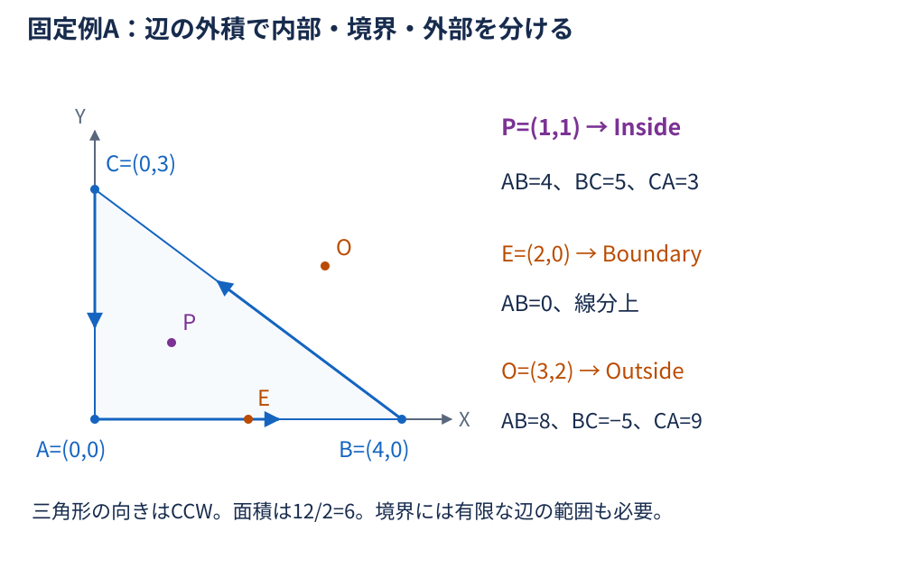
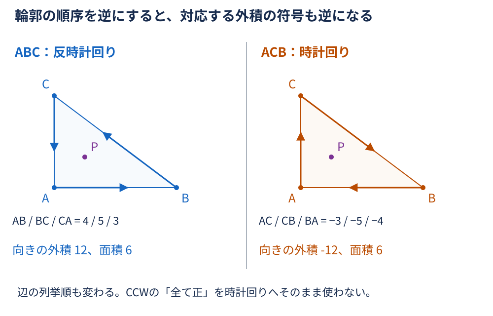
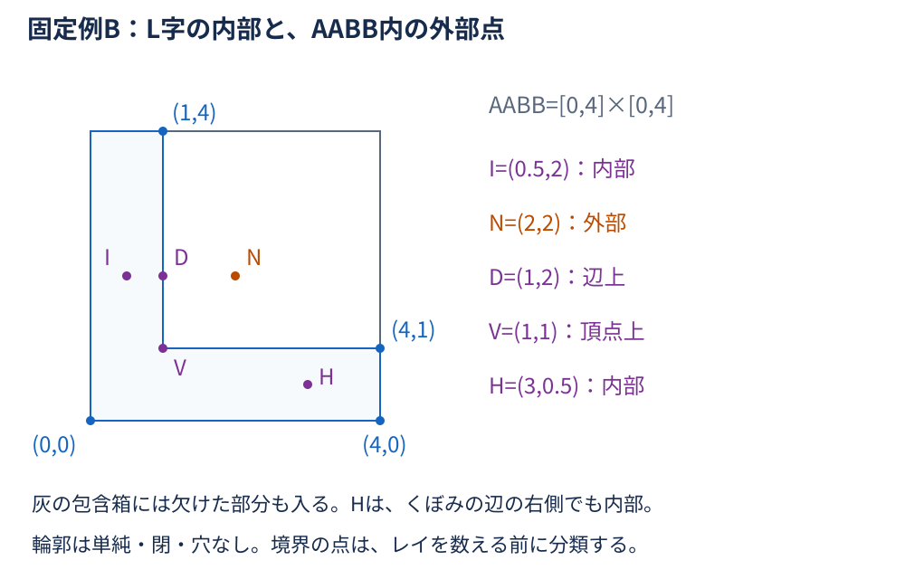
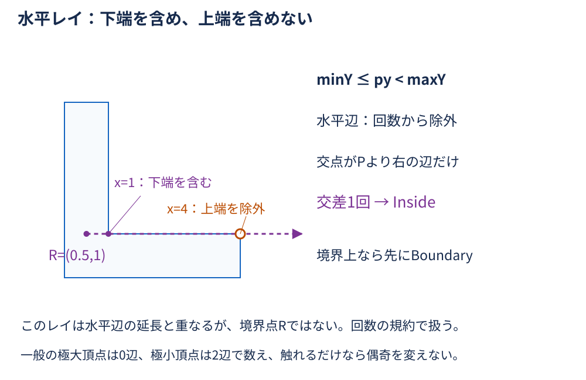
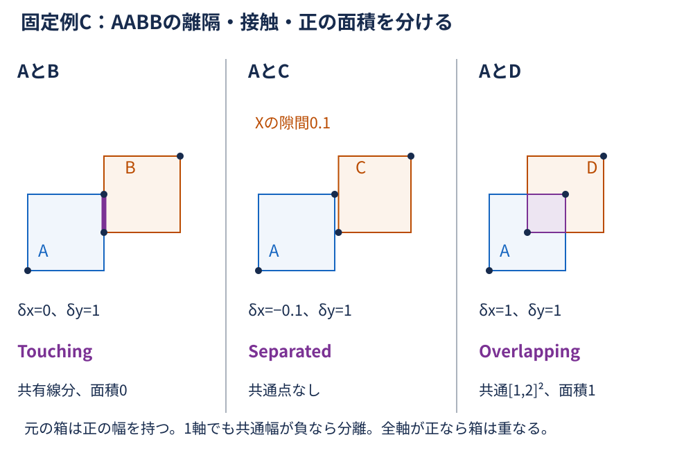
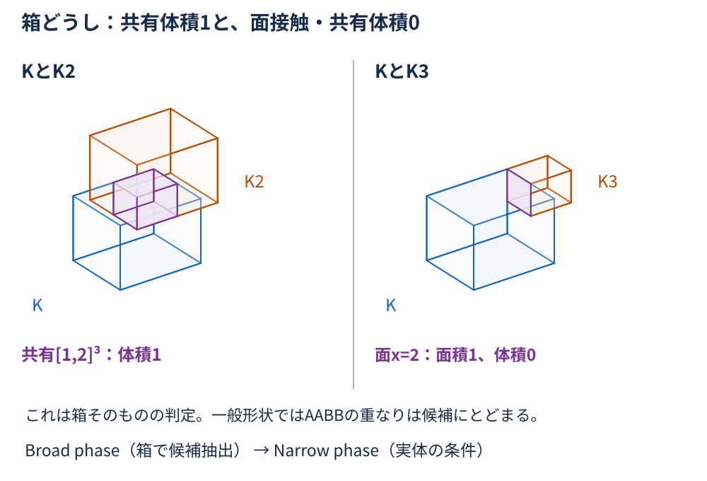
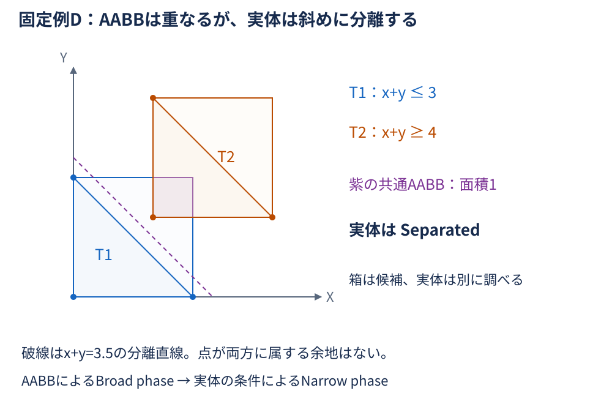
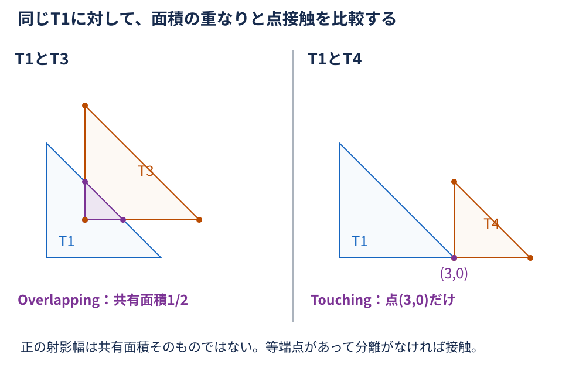

# 第5回：なぜ図形の内外や干渉を判定できるのか？ — 宿題の解答・解説

**準備中／レビュー待ちの下書き。** [問題ページ](problems.md) の全20設問に対応する。座標系・固定例・分類規約は [詳細解説](../explanation.md) と同じとし、数値はまず厳密な実数として計算する。

## 基本問題1の解答・解説：三角形の点包含と境界

### 1. 外積・向き・面積

**答え：** 向きの外積は12で、ABCはCCW。面積は6。

**途中計算：** $B-A=(4,0)$ 、 $C-A=(0,3)$ より、

$$
\begin{aligned}
\mathrm{cross2}(B-A,C-A)
&=4\times3-0\times0 \\
&=12.
\end{aligned}
$$

$$
S=\frac{|12|}{2}=6.
$$

**理由：** 2D外積は、2辺の張る平行四辺形の符号付き面積である。X右・Y上では正がCCWを表す。三角形はその半分なので1/2を掛け、通常の面積には向きによらない絶対値を使う。[第2回の外積](../../02-vector/explanation.md) と同じ関係である。

**間違えやすい点：** 外積12を三角形の面積としない。符号付きの値と、非負の面積を分ける。

### 2. Pの3つの外積

**答え：** AB・BC・CAの順に4・5・3で、PはInside（内部）。

**途中計算：** 一般の点 $(x,y)$ に対する値を辺ごとに展開する。

$$
c_{AB}=\mathrm{cross2}((4,0),(x,y))=4y.
$$

$$
\begin{aligned}
c_{BC}
&=\mathrm{cross2}((-4,3),(x-4,y)) \\
&=-4y-3(x-4) \\
&=12-3x-4y.
\end{aligned}
$$

$$
c_{CA}=\mathrm{cross2}((0,-3),(x,y-3))=3x.
$$

Pを代入すると、 $c_{AB}=4\times1=4$ 、 $c_{BC}=12-3-4=5$ 、 $c_{CA}=3\times1=3$ 。

**理由：** 非退化なCCW三角形の内部は、全辺の左側の共通部分である。3つ全てが正なので全ての辺から内側へ離れており、境界ではない。

**間違えやすい点：** 1辺の左側だけでは内部と決まらない。凹多角形にこの全辺の左側条件をそのまま使うこともできない。

### 3. Eと有限な線分AB

**答え：** EはBoundary（境界）。外積は0・6・6で、有限な線分ABの範囲内にもある。

**途中計算：** $(x,y)=(2,0)$ を代入する。

$$
c_{AB}=0,\qquad c_{BC}=12-6=6,\qquad c_{CA}=6.
$$

ABについて $e=B-A=(4,0)$ 、 $w=E-A=(2,0)$ とすると、

$$
w\cdot e=2\times4+0\times0=8,
$$

$$
\lVert e\rVert^2=4^2+0^2=16,\qquad 0\leq8\leq16.
$$

線分の媒介変数も $t=8/16=1/2$ で、両端を含む区間内にある。

**理由：** 外積0はABの無限直線上にあることしか示さない。内積の範囲を合わせると、AからBまでの有限な辺上と分かる。[第3回の線分の範囲](../../03-intersection/explanation.md) と同じ条件である。

**間違えやすい点：** 延長線上の $F=(5,0)$ もABの外積は0だが、射影は20で16を超える。さらにBCの値は−3なので外部である。「どれかが0」だけで境界を返さない。

### 4. Oの分類

**答え：** 8・−5・9となり、OはOutside（外部）。

**途中計算：** $(x,y)=(3,2)$ を代入する。

$$
c_{AB}=4\times2=8,
$$

$$
c_{BC}=12-3\times3-4\times2=-5,
$$

$$
c_{CA}=3\times3=9.
$$

**理由：** BCに対して右側にあるため、全辺の左側という条件を満たさない。負の値が1つでもあれば、CCW三角形の外部になる。

**間違えやすい点：** 正の数が多数でも、多数決では判定しない。3つの値を足す判定も内部条件を表さない。

### 5. 頂点順序の反転と退化

**答え：** ACBでは向きの外積が−12、面積は6。Pの値はAC・CB・BAの順に−3・−5・−4で、全て負が内部条件となる。面積0や重複点は入力不正／未定義として分ける。

**途中計算：** 向きは $\mathrm{cross2}((0,3),(4,0))=-12$ 、面積は $|-12|/2=6$ 。Pについて各辺から引き直す。

$$
\mathrm{cross2}((0,3),(1,1))=-3,
$$

$$
\mathrm{cross2}((4,-3),(1,-2))=-8+3=-5,
$$

$$
\mathrm{cross2}((-4,0),(-3,1))=-4.
$$

一直線の例 $(0,0),(1,0),(2,0)$ では $\mathrm{cross2}((1,0),(2,0))=0$ 。重複点を含む例では辺自体がゼロ長になる。

**理由：** 辺を逆向きにすると左右も反転するが、図形の面積の大きさは変わらない。面積0では2Dの内部がなく、非退化三角形の包含規則の前提を満たさない。

**間違えやすい点：** 反転後は辺の列挙順も変わる。元の4・5・3へ単に負号を付けた並びと混同しない。退化した入力を通常のOutsideやBoundaryとして処理せず、線分・点として扱うなら別の仕様を定める。

## 基本問題2の解答・解説：凹L字多角形と水平レイ

### 1. Iのレイと偶奇

**答え：** Iは辺上ではなく、右向きの交差はx=1で1回なのでInside。

**途中計算：** y=2が半開のY範囲に入る非水平辺は、x=1の辺 $(1,1)\to(1,4)$ と、x=0の辺 $(0,4)\to(0,0)$ 。前者では、

$$
t=\frac{2-1}{4-1}=\frac13,\qquad
x_{\mathrm{hit}}=1+\frac13(1-1)=1.
$$

後者では $t=(2-4)/(0-4)=1/2$ で交点はx=0。Iの $p_x=0.5$ より右なのはx=1だけなので、計数は1。

**理由：** 単純で閉じた有界な輪郭では、十分右は外部である。境界を横断するたびに内外が切り替わるため、右端までの計数が奇数なら出発点は内部、偶数なら外部となる。頂点や水平辺は設問4の統一規則で扱う。

**間違えやすい点：** 無限直線全体の交点を数えず、 $x_{\mathrm{hit}}>p_x$ だけを数える。辺上かどうかは先に検査する。

### 2. Nと包含箱

**答え：** NはAABB内だが、L字ではOutside。右向きの交差は0回。

**途中計算：** $0\leq2\leq4$ がX・Yとも成り立ち、Nは箱内にある。y=2の交点候補は設問1と同じx=0とx=1だが、どちらも $p_x=2$ より左なので計数0。

**理由：** AABBは図形を全て含むが、凹部も埋めた箱である。箱の外なら元の図形の外だが、箱の内側に入った後は元の輪郭による詳細判定が必要になる。

**間違えやすい点：** 包含箱内という必要条件を、元の図形内という十分条件にしない。凸多角形用の全辺の左側条件も凹形状には流用しない。

### 3. D・Vの境界先行判定

**答え：** DもVもBoundary。交差回数による分類に進まず、有限な辺上であることから決める。

**途中計算：** 辺 $a=(1,1)$ 、 $b=(1,4)$ について、 $e=b-a=(0,3)$ 、 $\lVert e\rVert^2=9$ 。Dでは $D-a=(0,1)$ なので、

$$
\mathrm{cross2}(e,D-a)=0,\qquad (D-a)\cdot e=3,
$$

$$
0\leq3\leq9.
$$

Vはaそのものなので、外積0、射影0で $0\leq0\leq9$ 。どちらも線分上にある。

**理由：** 偶奇は、境界上でない点の内外を決める規則である。境界を含むかを偶奇の実装の偶然に委ねず、3状態を返すためにBoundaryを先に確定する。水平辺上や頂点上もこの段階で扱える。

**間違えやすい点：** レイの $x_{\mathrm{hit}}=p_x$ を数えるかだけでBoundaryを決めない。線分の両端を含むので、Vも境界である。

### 4. 半開区間・頂点・水平辺

**答え：** 下端を含み上端を除外する。Rではx=1の辺を採用し、x=4の辺の上端と水平辺は除外する。右向きの計数は1でInside。全ての頂点を必ず1回数えるという規則ではない。

**途中計算：** Rのy=1に対する候補を整理する。

| 辺 | 半開のY範囲 | y=1を採用するか | 交点と向き |
| --- | --- | --- | --- |
| (4,0)→(4,1) | [0,1) | しない（上端） | 計数しない |
| (4,1)→(1,1) | [1,1) | しない（水平） | 計数しない |
| (1,1)→(1,4) | [1,4) | する（下端） | x=1、Rより右 |
| (0,4)→(0,0) | [0,4) | する | x=0、Rより左 |

残るy=0とy=4の水平辺も除外する。採用したx=1は $1>0.5$ なので1回。R自身はどの有限な辺上にもない。

**理由：** 水平でない2辺がつながる通常の通過頂点では、一方の上端を除外し、他方の下端を含める。Yの局所極大では両方の上端を除外して0回、局所極小では両方の下端を含めて2回となり、触れるだけなら偶奇を変えない。これは同じ位置の交点でも辺ごとの寄与を扱う規則である。水平辺は分母 $b_y-a_y=0$ となり、横断も表さないため計数から除く。

**間違えやすい点：** 極小の2寄与を位置が同じだから1回へまとめると偶奇が壊れる。水平辺上の点を捨てるのではなく、境界判定では既に検査している。Rのレイは先の水平辺と重なるが、この半開規則で統一して数える。

### 5. L字の面積

**答え：** 面積は7。包含箱の面積16とは異なる。

**途中計算：** 横の長方形 $[0,4]\times[0,1]$ と、縦の上部 $[0,1]\times[1,4]$ に分ける。境界の共有はあるが、面積の重複はない。

$$
S=4\times1+1\times(4-1)=4+3=7.
$$

箱から欠けた部分 $[1,4]\times[1,4]$ の面積9を引いても $16-9=7$ となる。ここでは面積の計算なので、欠けた部分の端点の開閉は値に影響しない。

**理由：** 面積は、内部の重ならない部分へ分ければ加算できる。AABBは凹部を含むので面積まで保存しない。

**間違えやすい点：** 縦全体の長方形の面積4と横全体の面積4をそのまま足すと、左下の単位正方形を二重に数える。

## 基本問題3の解答・解説：AABBの接触と重なり

### 1. 各軸の共通区間と分類

**答え：** AとBはTouching（境界接触）、AとCはSeparated（離隔）、AとDはOverlapping（正の面積を伴う重なり）。

**途中計算：** 軸ごとに候補下端・上端・差を求める。

$$
\ell=\max(a_{\min},b_{\min}),\qquad
h=\min(a_{\max},b_{\max}),\qquad \delta=h-\ell.
$$

| 組 | Xの下端・上端・差 | Yの下端・上端・差 | 共通区間 |
| --- | --- | --- | --- |
| A・B | 2、2、0 | 1、2、1 | Xは{2}、Yは[1,2] |
| A・C | 2.1、2、−0.1 | 1、2、1 | Xは空、全体も空 |
| A・D | 1、2、1 | 1、2、1 | X・Yとも[1,2] |

例えばA・CのXでは $\delta_x=\min(2,4)-\max(0,2.1)=2-2.1=-0.1$ 。

**理由：** 箱は軸区間の直積なので、1軸でも空なら共通点がない。全軸が非空でも差が0の軸があれば面積0で接触、全て正なら箱どうしは正の面積で重なる。

**間違えやすい点：** 下端が上端を超えた候補を通常の区間と書かない。箱の重なりから、その箱に入っている任意の形状の実体の重なりまでは確定しない。

### 2. 共通集合と面積0

**答え：** AとDの共通集合は $[1,2]\times[1,2]$ で面積1。AとBは $\{2\}\times[1,2]$ という線分で、空ではないが面積0。

**途中計算：** A・Dは両軸の幅が $2-1=1$ なので共有面積は $1\times1=1$ 。A・Bの幅はXが $2-2=0$ 、Yが $2-1=1$ なので面積は $0\times1=0$ 。共有線分には例えば $(2,1.5)$ が含まれる。

**理由：** 点や線分は2Dの面積を持たなくても集合として存在する。空集合であることと、面積が0であることは異なる。

**間違えやすい点：** 面積が0だからSeparatedとはしない。閉区間では一致する端点も共通集合に含む。

### 3. 用途の規約とBoolean

**答え：** 「共通点があれば干渉」とする規約ではB・Dがtrue、Cがfalse。「正の共有面積だけを干渉」とする規約ではDだけがtrueで、B・Cはfalse。

**途中計算：** 設問1の差を比較する。

| 相手 | 各軸の差 | 全軸で0以上（接触込み） | 全軸で正（面積あり） |
| --- | --- | --- | --- |
| B | (0,1) | true | false |
| C | (−0.1,1) | false | false |
| D | (1,1) | true | true |

**理由：** 3状態分類は接触を区別した情報を持つ。Booleanへ変換するときに、どの状態をtrueへ含めるかを用途が選ぶ。部材の接触も検出する検査と、体積の食い込みだけを調べる検査では目的が異なる。

**間違えやすい点：** 「干渉あり」という語だけでは等号の扱いが決まらない。隙間や施工上の許容値も、この数学的な分類だけから決めない。

### 4. 3D箱の共有体積と面接触

**答え：** KとK2は $[1,2]^3$ を共有し、体積1でOverlapping。KとK3は $\{2\}\times[1,2]\times[1,2]$ の面を共有し、共有面積1・共有体積0でTouching。

**途中計算：** 同じ下端・上端の比較をZにも行う。

| 組 | Xの共通区間 | Yの共通区間 | Zの共通区間 | 幅 |
| --- | --- | --- | --- | --- |
| K・K2 | [1,2] | [1,2] | [1,2] | (1,1,1) |
| K・K3 | {2} | [1,2] | [1,2] | (0,1,1) |

K・K2の共有体積は $1\times1\times1=1$ 。K・K3はYZ方向の面積が $1\times1=1$ 、Xの幅が0なので体積は $0\times1\times1=0$ 。

**理由：** 正の体積には3軸全てに正の幅が必要である。面積を持つ共有面でも、3D領域どうしでは接触になる。

**間違えやすい点：** 2Dの正の面積と3Dの正の体積を混同しない。これは中身を含む箱の計算であり、任意の表面メッシュや殻の判定を代替しない。

## 発展問題の解答・解説：凸三角形のSAT

### 1. T1・T2のAABB

**答え：** T1は $[0,3]^2$ 、T2は $[2,5]^2$ に包まれ、共通AABBは $[2,3]^2$ で面積1。

**途中計算：** T1のX・Yの最小値は0、最大値は3。T2は両軸とも最小2・最大5。軸ごとの共通区間は、

$$
[\max(0,2),\min(3,5)]=[2,3].
$$

幅は両軸とも $3-2=1$ なので共通面積は $1\times1=1$ 。

**理由：** 座標の最小・最大は各軸方向への射影範囲であり、これを組み合わせると軸に平行な包含箱になる。

**間違えやすい点：** 共通AABBの面積を三角形どうしの共有面積と呼ばない。斜めの辺の制約はこの箱には含まれていない。

### 2. 斜め軸への内積射影

**答え：** T1の内積値は0・3・3で区間[0,3]、T2は4・7・7で区間[4,7]。区間が離れているので、この軸で分離を証明できる。単位軸でなくてもよい。

**途中計算：** $n=(1,1)$ に対して $q=n\cdot(x,y)=x+y$ 。

| 三角形 | 各頂点の内積計算 | 最小値・最大値 |
| --- | --- | --- |
| T1 | 0+0=0、3+0=3、0+3=3 | [0,3] |
| T2 | 2+2=4、5+2=7、2+5=7 | [4,7] |

例えばT1の斜辺の方向 $(-3,3)$ とnの内積は $-3+3=0$ なので、nは辺の法線である。区間の間の差は $4-3=1>0$ 。軸長は $\sqrt2$ なので、単位軸へ換算すれば、

$$
q_{\mathrm{unit}}=\frac{x+y}{\sqrt2},\qquad
\text{gap}=\frac1{\sqrt2}.
$$

**理由：** 共通点があれば、その点の内積値は両方の射影区間に入るはずである。区間が離れていれば共通点はない。同じ非ゼロ軸を両者へ使う限り、正の倍率で拡大しても区間の重なりは変わらない。負の倍率でも最小・最大を取り直せば同じ結論になる。[第2回の内積](../../02-vector/explanation.md) を位置の比較へ使っている。

**間違えやすい点：** 非単位軸の差1を世界座標の距離1と呼ばない。異なる軸や異なる倍率で片方ずつ射影して比較しない。ゼロ軸は使えない。

![同じ非単位軸n=(1,1)への射影で、T1の区間[0,3]とT2の区間[4,7]が分離する図](../images/07-sat-projection.svg)

### 3. AABB候補と実体の分離

**答え：** T1とT2の実体はSeparated。AABBの重なりは詳細判定へ進む候補にすぎない。

**途中計算：** T1内では $x+y\leq3$ 、T2内では $x+y\geq4$ 。共通点があると仮定すると、

$$
4\leq x+y\leq3
$$

となり矛盾する。一方、X・Yだけの区間はどちらも[2,3]で重なる。

**理由：** AABBは座標軸方向の制約だけを残している。斜め方向の制約を調べると、箱では残った候補を棄却できる。この例では1本の分離軸が見つかった時点で離隔が確定する。

**間違えやすい点：** 「箱が重なるから実体も重なる」としない。逆に、元の図形を正しく含むAABBが離れていれば、実体も離れている。

### 4. T1とT3の正の共有面積

**答え：** T1とT3はOverlapping。Qは両方の厳密な内部にあり、共通集合は面積1/2の三角形にもなる。

**途中計算：** T1のCCW各辺に対するQの外積は、

$$
3\times1.1=3.3,\qquad
9-3\times1.1-3\times1.1=2.4,\qquad
3\times1.1=3.3.
$$

T3では辺の方向も $(3,0),(-3,3),(0,-3)$ なので、

$$
3(1.1-1)=0.3,
$$

$$
-3(1.1-1)-3(1.1-4)=8.4,
$$

$$
3(1.1-1)=0.3.
$$

全て正。さらに両領域の条件を重ねると、

$$
x\geq1,\qquad y\geq1,\qquad x+y\leq3.
$$

したがって共通集合は頂点 $(1,1),(2,1),(1,2)$ の三角形で、面積は $1\times1/2=1/2$ 。T3の条件 $x+y\leq5$ は、この共通部分では自動的に満たす。

**理由：** Qは境界上ではなく両方の内部にあるため、十分小さな円をQの周囲に置いても両方の領域に含まれる。その円は正の面積を持つので、単なる点接触ではない。

**間違えやすい点：** 共通点が1つあるだけでは正の面積を証明できない。点が両方の厳密な内部にあること、または共通領域の面積を示す必要がある。

### 5. T1とT4の点接触

**答え：** 共通集合は $\{(3,0)\}$ だけなのでTouching。射影区間の端点一致を、分離や正の面積の重なりと混同しない。

**途中計算：** T1では $x\leq3$ 、T4では $x\geq3$ なので、共通点のXは3。T1の $y\geq0$ と $x+y\leq3$ に代入するとy=0。この点はT4の頂点でもある。

両三角形の辺法線は、符号と非ゼロ倍率を除けばX軸・Y軸・ $(1,1)$ で尽くされる。全候補を確認する。

| 候補軸 | T1の区間 | T4の区間 | 共通区間の幅 |
| --- | --- | --- | --- |
| (1,0) | [0,3] | [3,5] | 0 |
| (0,1) | [0,3] | [0,2] | 2 |
| (1,1) | [0,3] | [3,5] | 0 |

全軸で共通区間は非空で、一部が端点だけになっている。

**理由：** 閉領域では射影端点の一致も共通点を許す。ここでは実際に同じ頂点を共有し、共有面積は0である。全候補軸で分離がなく、かつ幅0の軸があるので、非退化な凸多角形どうしの接触と整合する。

**間違えやすい点：** 1軸だけの端点一致では、他の軸で分離する可能性が残る。他の候補も調べてから接触とする。端点の等号を除くと、この共通点を失う。

### 6. 候補軸と適用範囲

**答え：** 有効な非退化2D凸多角形どうしでは、両方の全辺の非ゼロ法線を調べればよい。非凸多角形や任意の3Dメッシュには、この軸集合と結論をそのまま使えない。

**途中計算：** 各辺の方向を $e=(e_x,e_y)$ とすると、

$$
n=(-e_y,e_x),\qquad n\cdot e=-e_ye_x+e_xe_y=0.
$$

各候補nで全頂点の $q=n\cdot p$ の最小・最大を取り、設問2と同様に比較する。1本でも区間が離れればSeparated。全候補で非空なら交差し、幅0の軸があればTouching、全て正ならOverlappingとなる。ゼロ長辺からはゼロ法線しか得られないため、入力の検査を先に行う。

**理由：** 片方の領域の全ての点pと、もう片方の全ての点qについて、差p−qが作る領域を考える。共通点があることはp=qとなる組があること、つまり原点がこの差の領域に入ることと同じである。元が凸多角形ならこの領域も凸多角形で、その境界辺は元のどちらかの辺と平行になる。このため辺法線方向の区間検査で分離を検出できる。片方の辺だけではもう片方に由来する制約を落とすため、両方が必要である。この考え方と定理の案内は [詳細解説のSAT](../explanation.md) を参照する。[第4回の法線](../../04-modeling/explanation.md) と同様に、法線は境界に垂直な方向を表す。

**間違えやすい点：** 凹形状の射影の最小・最大は凹部を埋めた凸包と同じになり、全区間が重なっても実体の交差は保証できない。3D凸多面体でも面法線だけでなく辺どうしの外積方向が必要になる場合がある。任意のメッシュには閉鎖性・内部の定義・自己交差などの確認も必要で、ここでは扱わない。

## 数値誤差と境界を照合する

上の等号は厳密な実数についてのもの。浮動小数点では、理論上0の外積や区間幅が小さな正負へ丸まることがある。逆に小さな隙間が0へ丸まり、離隔を接触と誤ることもある。表示用に丸めた値で再判定しない。

外積は長さの2乗の尺度なので、距離の許容差をそのまま比較しない。非ゼロ辺に対する直線までの距離なら、

$$
d=\frac{|\mathrm{cross2}(e,P-a)|}{\lVert e\rVert}.
$$

非単位SAT軸の差も、距離へ直すには軸長で割る。これで有限な辺の範囲や、浮動小数点の頑健性まで自動的に解決するわけではない。

許容誤差で「ほぼ境界」をまとめるのは厳密な接触の証明ではない。単位・尺度に合わせた境界の帯や判定保留の規約が必要になる。半開区間の片側だけを無計画に緩めると頂点の偶奇も変わる。非有限座標・ゼロ長辺・面積0・無効な輪郭や箱は、通常のOutside／Separatedとは別の入力不正／未定義として扱う。詳細は [本文の数値計算の注意](../explanation.md) を参照する。

固定例の値は [C#実装例](../examples/README.md) の254チェックでも確認できる。TODO：利用者が設問・導出・分類・図解の対応を通読レビューする。

[問題ページへ](problems.md) ／ [宿題トップへ戻る](README.md) ／ [セッションのトップへ戻る](../README.md)
