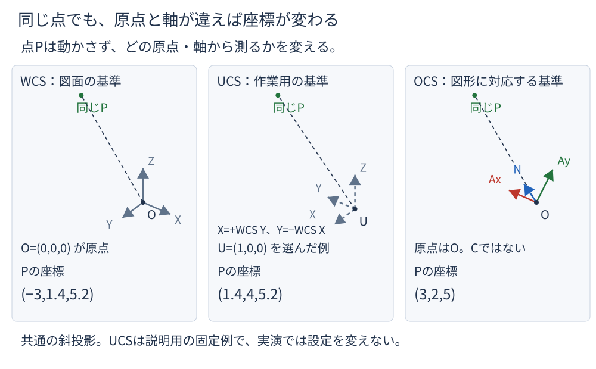
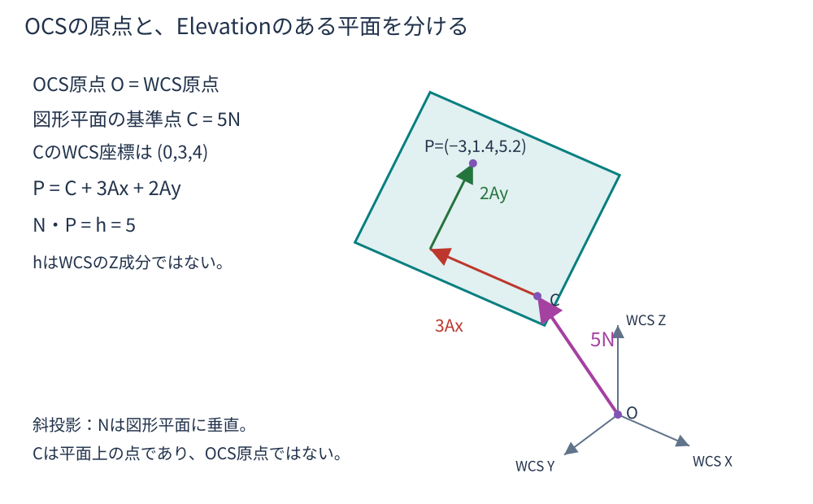
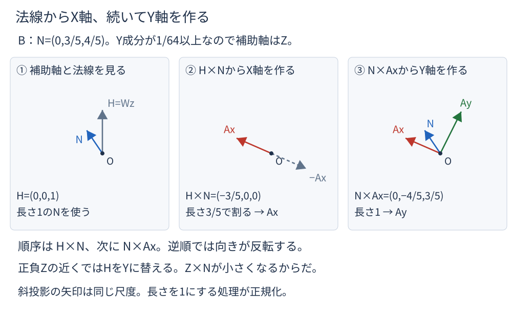
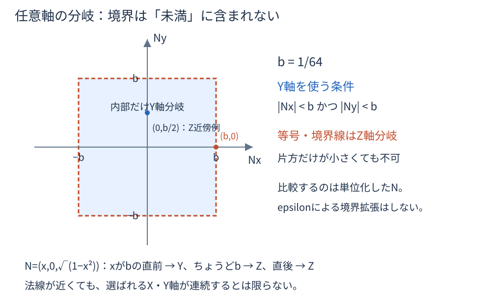
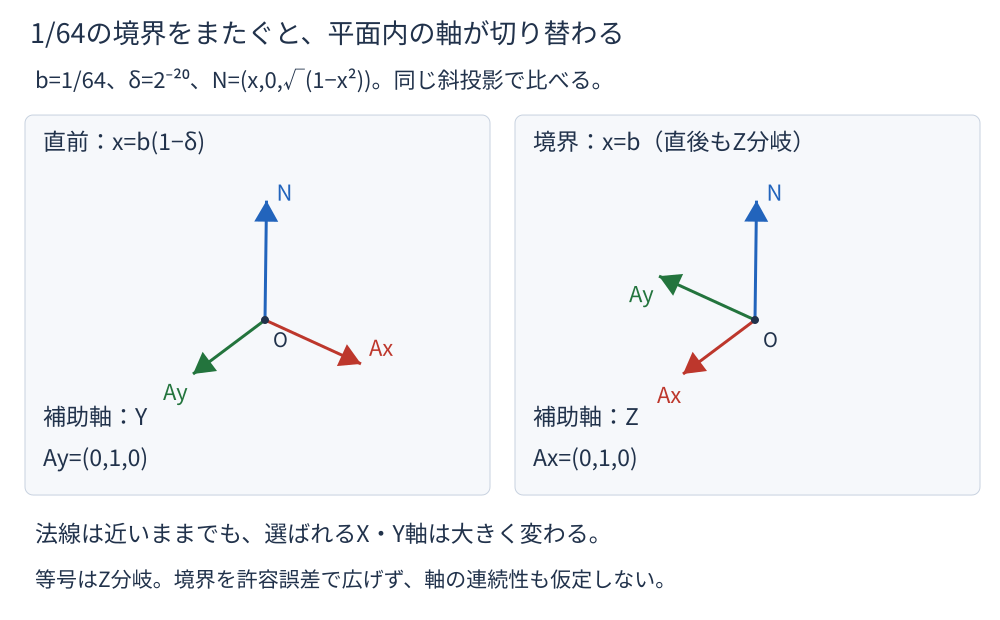
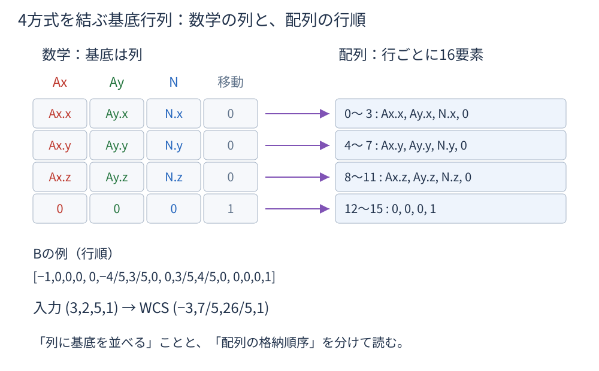
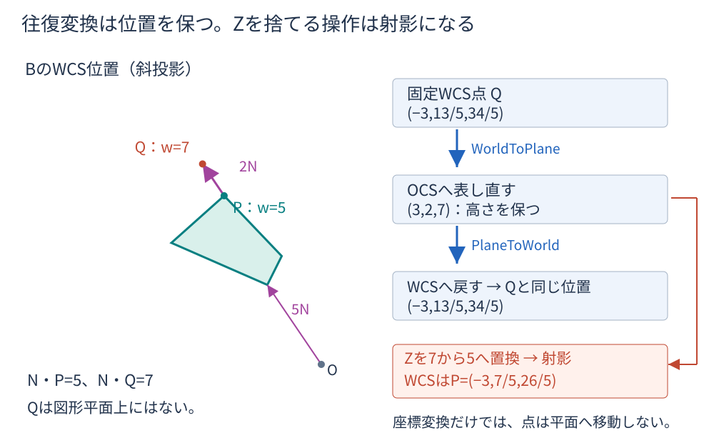

# 同じ図形変換のいろいろな実現方法を見てみよう

同じ頂点を調べたつもりなのに、返ってくる座標が違う。  
そんなときは、数値だけでなく「どの座標系で表した値か」を確認するところから始めよう。

この教材は、AutoCAD APIや実装方法の違いを数学で結び付け、普段見慣れないコードでも処理の意図を理解することを目指す。  
WCS・OCSと任意軸アルゴリズムを必須かつ最優先とし、基底や基本変換の復習を各題材に関連付ける。

対象はWindows版AutoCAD 2026 Update 1.2以降／.NET 10／Visual Studio。  
API仕様は末尾の2026版公式資料で静的に照合した。  
以下の数値は数式から得た期待値であり、職場の参照DLLでのビルド・NETLOAD・AutoCAD実機実行は未検証である。

## 学習の流れ

| 順序 | 主題 |
| --- | --- |
| 1 | 導入：同じ頂点なのに異なる座標が返る？ |
| 2 | WCS・UCS・OCSの役割と違い |
| 3 | 任意軸アルゴリズム（Arbitrary Axis Algorithm） |
| 4 | OCSからWCSへの変換方法の比較 |
| 5 | WCSからOCSへの変換方法の比較 |
| 6 | 座標系を考慮した移動・回転・逆変換・合成 |
| 7 | その他の変換方法の比較 |
| 8 | まとめ：異なるコードの処理意図を読み解く |

第1〜5章を連続して読み、APIから得る座標と、その背景の基底・相互変換を対応させる。  
第6〜8章は題材と問いの骨格を示す。

## 1. 導入：同じ頂点なのに異なる座標が返る？

### 同じ頂点番号で比べてみよう

`Polyline` の頂点を調べる、次のコードを考える。

| 使用するAPI | 引数 | 戻り値と座標系 |
| --- | --- | --- |
| `Polyline.GetPoint2dAt(int index)` | `int`：0始まりの頂点番号。頂点数未満を指定 | `Point2d`：頂点のOCSでのXY座標 |
| `Polyline.GetPoint3dAt(int value)` | `int`：同じ頂点番号 | `Point3d`：同じ頂点のWCSでのXYZ座標 |

```csharp
Point2d ocs2d = polyline.GetPoint2dAt(2);
Point3d wcs3d = polyline.GetPoint3dAt(2);
```

どちらも頂点番号2を読んでいるのに、成分が違う。  
これは別の頂点を取得したからではない！  
[`GetPoint2dAt`](https://help.autodesk.com/cloudhelp/2026/ENU/OARX-ManagedRefGuide/files/OARX-ManagedRefGuide-Autodesk_AutoCAD_DatabaseServices_Polyline_GetPoint2dAt_int.html) はPolyline自身のOCS（オブジェクト座標系）での2D位置、[`GetPoint3dAt`](https://help.autodesk.com/cloudhelp/2026/ENU/OARX-ManagedRefGuide/files/OARX-ManagedRefGuide-Autodesk_AutoCAD_DatabaseServices_Polyline_GetPoint3dAt_int.html) はWCS（世界座標系）での3D位置を返す。  
同じ位置を、違う軸に沿って測っているのである。

まず図の頂点番号2に注目しよう。  
左のOCS座標と右のWCS座標は、同じ頂点を違う軸から測った値である。


本文・図・実演では、次のOCS頂点を順に結んだ閉じたPolylineを使う。  
頂点番号は0始まり、直線だけの非対称な輪郭とし、bulge・始点幅・終点幅はすべて0にする。  
座標の長さ単位は作図単位で統一し、mmなどを仮定しない。

| 頂点番号 | OCSの2D座標 |
| --- | --- |
| 0 | (0,0) |
| 1 | (4,0) |
| 2 | (3,2) |
| 3 | (0,1) |

最後の頂点から最初へも辺を置くが、始点を末尾に重複保存しない。  
非対称にするのは、軸の入替えや反転を、輪郭の見た目だけで見逃さないためである。

### XY平面では違いが隠れる

固定例Aでは、`Normal=(0,0,1)`、`Elevation=0` とする。  
OCSのX・Y軸がWCSのX・Y軸に一致するので、頂点2は次のようになる。

| API | 頂点2の期待値 |
| --- | --- |
| `GetPoint2dAt(2)` | (3,2) |
| `GetPoint3dAt(2)` | (3,2,0) |

この例だけだと「2D座標にZ=0を追加すればよい」と思えてしまう。  
では、図形の平面が傾いたらどうなるだろう？

### 傾いた平面では、Zを追加するだけでは足りない

固定例Bも、4つのOCS頂点は同じままにする。  
法線の長さを1にした `Normal=(0,3/5,4/5)`、`Elevation=5` とする。  
長さを1にすることを、正規化という。  
この例の法線のWCS成分と長さは、

$$
N=\begin{bmatrix}
0 \\
3/5 \\
4/5
\end{bmatrix},\qquad
\|N\|=\sqrt{(3/5)^2+(4/5)^2}=1.
$$

このときの期待値は次のとおり。  
第2章で位置の表し方を、第3章で軸の決め方を説明する。

| 頂点番号 | `GetPoint2dAt`：OCS | `GetPoint3dAt`：WCSの期待値 |
| --- | --- | --- |
| 0 | (0,0) | (0,3,4) |
| 1 | (4,0) | (−4,3,4) |
| 2 | (3,2) | (−3,7/5,26/5) = (−3,1.4,5.2) |
| 3 | (0,1) | (0,11/5,23/5) = (0,2.2,4.6) |

頂点2に高さだけを付けた `(3,2,5)` は、まだOCSで表した3成分である。  
それをそのままWCSの点として読むと、違う位置になってしまう。

実演の [`GEOAT_COORDINATES`](../../autocad-net/samples/autocad-transform/CoordinateSystemCommands.cs) は、AとBを同じ頂点一覧から独立に生成する。  
一方を動かした結果を、もう一方の比較元には使わない。

## 2. WCS・UCS・OCSの役割と違い

### API紹介：平面の向き・高さ・頂点を指定する

| PolylineのAPI | 型・値と意味・座標系 |
| --- | --- |
| `Normal`（読み書き） | `Vector3d`：平面に垂直な向き。WCS成分。本文・実演では0ではない入力を長さ1にして使う |
| `Elevation`（読み書き） | `double`：OCSのZ方向に測った共通の高さh。WCSのZ座標とは限らない |
| 頂点の `Point2d` | OCSのXY成分(u,v)。頂点ごとに異なる |
| `AddVertexAt` | OCSの2D頂点を追加する。戻り値は `void`。WCS点をそのまま渡さない |

この教材で使う `AddVertexAt` の引数は、次の5つである。

| 引数 | 型 | 意味 |
| --- | --- | --- |
| `index` | `int` | 0始まりの挿入位置。末尾へ追加するときは現在の頂点数 |
| `pt` | `Point2d` | PolylineのECS、ここでのOCSのXY座標 |
| `bulge` | `double` | 円弧の膨らみ。今回は0で直線 |
| `startWidth` | `double` | 頂点から始まる区間の始点幅。今回は0 |
| `endWidth` | `double` | 同じ区間の終点幅。今回は0 |

[`Normal`](https://help.autodesk.com/cloudhelp/2026/ENU/OARX-ManagedRefGuide/files/OARX-ManagedRefGuide-Autodesk_AutoCAD_DatabaseServices_Polyline_Normal.html)・[`Elevation`](https://help.autodesk.com/cloudhelp/2026/ENU/OARX-ManagedRefGuide/files/OARX-ManagedRefGuide-Autodesk_AutoCAD_DatabaseServices_Polyline_Elevation.html)・[`AddVertexAt`](https://help.autodesk.com/cloudhelp/2026/ENU/OARX-ManagedRefGuide/files/OARX-ManagedRefGuide-Autodesk_AutoCAD_DatabaseServices_Polyline_AddVertexAt_int_Point2d_double_double_double.html) の2026版仕様と、[LWPOLYLINEのDXF定義](https://help.autodesk.com/cloudhelp/2026/ENU/AutoCAD-DXF/files/GUID-748FC305-F3F2-4F74-825A-61F04D757A50.htm) を対応させる。  
これは通常の `Polyline` の例であり、`Polyline2d`・3D Polyline・任意のEntityの全座標へ一律に流用しない。

実演ではNormalとElevationを先に設定し、各 `Point2d` を追加する。

```csharp
polyline.Normal = new Vector3d(0, 3.0 / 5, 4.0 / 5);
polyline.Elevation = 5;
polyline.AddVertexAt(2, new Point2d(3, 2), 0, 0, 0);
```

この抜粋の頂点番号2は、番号0・1がすでに追加されている前提である。  
実行可能な全体は [管理元のソース](../../autocad-net/samples/autocad-transform/CoordinateSystemCommands.cs) を読む。

Normalは「向き」、Elevationは「その向きへ測る高さ」である。  
次の4例はすべて同じOCS頂点 `(3,2)` を使い、法線だけ・高さだけを変えた違いを示す。


### どの原点・軸から測った値か

座標は点そのものではなく、選んだ原点と軸に対する位置の数値表現である。  
AutoCADでは、まず次の3つを区別しよう。

次の図は、Bの頂点Pを動かさず、測る原点・軸だけを変えた比較である。  
UCSの例だけは、説明用に原点をWCSの `(1,0,0)`、X軸を+WCS Y、Y軸を−WCS X、Z軸を+WCS Zに選んだ。  
実演コードは現在のUCSを変更しない。



| 座標系 | 目的・原点・軸 | この教材での使い方 |
| --- | --- | --- |
| WCS：世界座標系 | 図面の基準となる固定の原点Oと直交XYZ軸 | 法線・各基底の成分、図形の3D位置を表す |
| UCS：ユーザー座標系 | 利用者が作業用に選ぶ原点と直交軸。WCSに対して位置と向きを持つ | OCSとの違いを理解するために扱い、実演では設定を変更しない |
| OCS：オブジェクト座標系。ECSとも呼ぶ | ここで扱うPolylineでは原点はWCS原点と同じ。Z軸の向きは法線、X・Y軸は任意軸アルゴリズムで決める | 平面上の頂点を2成分と共通の高さで記録する |

[公式DXFのOCS説明](https://help.autodesk.com/cloudhelp/2026/ENU/AutoCAD-DXF/files/GUID-D99F1509-E4E4-47A3-8691-92EA07DC88F5.htm) は、OCSの原点がWCS原点と一致し、X・Y軸を一貫した規則で定めることを示している。  
一般のローカル座標系なら、原点を任意の位置に置ける。  
AutoCADのOCSと同じものとして扱わない。  
UCSを変えたことだけで、既存Polylineの保存されたOCSを「今のUCS」と読み替えることもできない。

数学の説明では、WCSの標準基底を $W_x,W_y,W_z$ 、OCSの長さ1の軸（単位基底）を $A_x,A_y,N$ と書く。  
基底とは、座標を測る基準となるベクトルの組である。  
すべて右手系とし、ベクトルの成分はWCSで表す。  
各軸の長さは1で無次元、点の座標とElevationは共通の長さ単位を持つ。

### OCS原点と、図形平面の基準点は別

図では、共通の原点Oと、図形平面上の点Cを分けて見よう。



OCS原点はWCS原点Oと同じである。  
一方、Polylineが乗る平面はOCSの $z=h$ にある。  
平面上の `(u,v)=(0,0)` に当たる点をCと書くと、

$$
C=O+hN,\qquad P=O+uA_x+vA_y+hN=C+uA_x+vA_y.
$$

OCS座標の各成分は、その軸へ進む量を表すので、3つの変位を足す。  
ここでCは図形平面の基準点であって、OCS原点をCへ移したわけではない。  
hはNの向きに測った符号付きの高さであり、平面までの最短距離は $|h|$ になる。

Nは単位長さで、平面内の2軸と直交するから、図形平面上の点Pは、

$$
\begin{aligned}
N\cdot(P-O)
&=u(N\cdot A_x)+v(N\cdot A_y)+h(N\cdot N) \\
&=h.
\end{aligned}
$$

つまりElevationは平面を表す条件にもなる。  
固定例Bでは $C=(0,3,4)$ であり、h=5でもCのWCSのZ成分は4である。  
平面は $3y+4z=25$ となり、頂点2の $(-3,7/5,26/5)$ もこの条件を満たす。

### 法線だけでは平面内の軸が決まらない

次の図では、法線を同じにしたまま、平面内の2軸だけを回している。


Nを固定しても、それに垂直な2軸は、Nの周りに回せる。  
例えばNが+Zなら、X・Yを使っても、+Y・−Xを使っても、同じ平面に沿う右手系を作れる。  
しかし同じ座標 `(3,2)` が表す位置は、軸の選び方で変わる。

AutoCADはこの自由度を任意軸アルゴリズムという規則で固定する。  
「法線を指定したら、数学的に唯一のX・Yが決まる」という意味ではない。

### 座標の表現変更と、図形の移動を分ける

OCSの `(3,2,5)` をWCSの `(-3,1.4,5.2)` と表すとき、物理的な頂点は動いていない。  
`Point3d.TransformBy` で別表現を計算することと、`Entity.TransformBy` で図形自体を変更することは別の操作である。  
同じ行列を使える場合でも、何を変換するコードかを読もう。

点Pには原点が必要だが、2点の差という方向・変位には原点を足さない。  
同じ平面上の2点を引くと、共通の高さの項も消える。

$$
P_2-P_1=(u_2-u_1)A_x+(v_2-v_1)A_y.
$$

一般のローカル座標変換の平行移動も、方向には加わらない。  
今回のOCS全体とWCSは原点を共有するが、そのことと「図形平面の高さが0」は区別する。  
UCSについては [公式の座標系の説明](https://help.autodesk.com/cloudhelp/2026/ENU/OARX-DevGuide-Managed/files/GUID-0EFA65CC-C1AB-4B99-8159-C31602C1A5E8.htm) も参照できる。  
実演の固定入力はOCSまたはWCSと明記して直接与え、現在のUCSから取得しない。

### 補足：DXFに記録される成分

DXFでは頂点のOCS成分がグループ10・20、高さが38、法線方向が210・220・230に対応する。  
APIの値と保存データを対応させるための番号であり、WCSのXYZを頂点の2成分へそのまま保存する規約ではない。

## 3. 任意軸アルゴリズム（Arbitrary Axis Algorithm）

### API紹介：法線から平面→世界の行列を作る

OCSの向きをWCSで知りたいときは、まず `Matrix3d.PlaneToWorld(Vector3d normal)` を見る。  
法線を1本渡すだけで、平面座標をWCSへ変換する `Matrix3d` が返る。  
引数は平面の法線を表すWCSの `Vector3d` で、ここでは先に長さを1にしたNを渡す。  
平面を渡す別のオーバーロードではなく、この法線だけのオーバーロードを使う。

もう一つ使う [`Vector3d.TransformBy(Matrix3d leftSide)`](https://help.autodesk.com/cloudhelp/2026/ENU/OARX-ManagedRefGuide/files/OARX-ManagedRefGuide-Autodesk_AutoCAD_Geometry_Vector3d_TransformBy_Matrix3d.html) は、行列を適用した方向を `Vector3d` で返す。  
次は [管理元の実演](../../autocad-net/samples/autocad-transform/ArbitraryAxisCommands.cs) の抜粋である。  
入力のX・Y・Z方向はOCSの標準軸、結果の `apiX`・`apiY`・`apiZ` はWCS成分での向きとして読む。

```csharp
Matrix3d planeToWorld = Matrix3d.PlaneToWorld(Vector(frame.Normal));
Vector3d apiX = Vector3d.XAxis.TransformBy(planeToWorld);
Vector3d apiY = Vector3d.YAxis.TransformBy(planeToWorld);
Vector3d apiZ = Vector3d.ZAxis.TransformBy(planeToWorld);
```

ここでVectorは数学部分の3成分を同じ成分のVector3dにする補助関数で、別の変換ではない。  
[`PlaneToWorld(Vector3d)` の仕様](https://help.autodesk.com/cloudhelp/2026/ENU/OARX-ManagedRefGuide/files/OARX-ManagedRefGuide-Autodesk_AutoCAD_Geometry_Matrix3d_PlaneToWorld_Vector3d.html) は法線を用いた平面座標から世界座標への行列を返すと説明している。  
基底の向きはDXFのOCS規約・任意軸アルゴリズムと合わせて照合する。  
Managed APIのこのページ単体に1/64の分岐が書かれているわけではない。

法線だけでX・Yまで返せるのは、AutoCADが平面内の軸の選び方も決めているからだ。  
図では、補助軸との外積でXを作り、続いてYを作る順序を追ってみよう。



### 外積で平面内の方向を作る

2つの方向a・bが平行でなければ、その外積は両方に垂直な方向になる。  
成分で書くと、

$$
a\times b=\begin{bmatrix}
a_yb_z-a_zb_y \\
a_zb_x-a_xb_z \\
a_xb_y-a_yb_x
\end{bmatrix}.
$$

長さは $\|a\|\|b\||\sin\theta|$ 、向きは右手系の規約で決まる。  
したがって、Nと平行でない補助軸との外積を取れば、Nに垂直な、平面内の軸を作れる。  
外積をその長さで割ると、向きを保ったまま長さを1にできる。  
平行な場合は外積が0になり、割り算で向きを作ることはできない。  
詳しい導出は [数学基礎編の外積](../02-vector/explanation.md) と対応する。

### 公式の分岐は「両方が1/64未満」

図の正方形の**内側だけ**でY軸を使い、境界と外側ではZ軸を使う。



[Autodeskの任意軸アルゴリズム](https://help.autodesk.com/cloudhelp/2026/ENU/AutoCAD-DXF/files/GUID-E19E5B42-0CC7-4EBA-B29F-5E1D595149EE.htm) は、単位法線Nから次の規則で基底を作る。  
法線をWCS成分で表し、先に長さを1にする（正規化）。  
ここからの比較は、正規化した後の成分で行う。

1. $|N_x|<1/64$ **かつ** $|N_y|<1/64$ なら、補助軸をWCSのY軸にする。
2. それ以外は、補助軸をWCSのZ軸にする。どちらかがちょうど1/64でもこちら。
3. 補助軸×Nの長さを1にしてX軸を作る。
4. N×X軸の長さを1にしてY軸を作る。

補助軸をH、長さを1にする前のX方向をUと書くと、

$$
H=\begin{cases}
W_y & (|N_x|<1/64\ \text{かつ}\ |N_y|<1/64), \\
W_z & (\text{それ以外}),
\end{cases}
$$

$$
U=H\times N,\qquad A_x=\frac{U}{\|U\|},\qquad
A_y=\frac{N\times A_x}{\|N\times A_x\|}.
$$

順序は **H×N、次にN×X** である。  
外積の順を逆にすると符号が変わり、同じOCS基底にはならない。  
`<` を `<=` に変えたり、比較にepsilonを足したりするのも、公式と異なる規則になる。

なぜ補助軸を切り替えるのか、考えてみよう。  
Nが正負Z軸の近くにあると、 $W_z\times N$ は小さくなり、長さを1にする割り算で、誤差を大きくしやすい。  
そこで、その近傍ではY軸を使う。  
判定領域はX・Y成分の両方を比べた正方形状の領域で、一定の角度だけで区切る円形の領域ではない。

### 直交・単位長・右手系を確かめる

X軸はNに垂直で単位長さ。  
N×Xから作ったY軸も両方に垂直で、単位長さになる。  
この順序ならX×YはNを向き、右手系になる。  
その理由を式で確かめる計算は、章末の補足に残す。  
実演では、3本の長さ、3組の内積、 $(A_x\times A_y)\cdot N$ を出力する。  
期待値はそれぞれ1、0、1である。

0の法線・NaN・無限大は、APIへ渡す前に数学部分で拒否する。  
境界の1/64は軸を選ぶ規則であり、計算結果を照合する許容誤差とは別である。  
分岐をまたぐと軸が大きく変わることもあるので、向きが連続して変わるとは仮定しない。

### 固定例B：頂点2のWCS座標を計算する

N=(0,3/5,4/5)はY成分が1/64以上なので、Z軸を使う。

$$
\begin{aligned}
W_z\times N&=\begin{bmatrix}
-3/5 \\
0 \\
0
\end{bmatrix}, \\
A_x&=\begin{bmatrix}
-1 \\
0 \\
0
\end{bmatrix},\qquad
A_y=N\times A_x=\begin{bmatrix}
0 \\
-4/5 \\
3/5
\end{bmatrix}.
\end{aligned}
$$

第2章の位置の式に、頂点2のu=3、v=2と高さh=5を代入する。  
つまり、X軸を3倍、Y軸を2倍、法線を5倍して足す。

$$
\begin{aligned}
P&=3A_x+2A_y+5N \\
&=\begin{bmatrix}
-3 \\
0 \\
0
\end{bmatrix}+\begin{bmatrix}
0 \\
-8/5 \\
6/5
\end{bmatrix}+\begin{bmatrix}
0 \\
3 \\
4
\end{bmatrix} \\
&=\begin{bmatrix}
-3 \\
7/5 \\
26/5
\end{bmatrix}.
\end{aligned}
$$

これで、第1章の異なる座標が同じ頂点を表す理由が分かった。  
WCSのXが負になるのは、OCSのX軸が−WCS Xを向くからである。  
WCSのY・Zには、vによる移動分とhによる移動分の両方が加わる。

基底を列に並べれば、[第1回の行列による表現](../01-matrix/explanation.md) にもつながる。  
OCS原点とWCS原点が共通なので、この変換行列自体に平行移動はない。  
Elevationは入力側の3成分目に含める。

$$
M=\begin{bmatrix}
-1 & 0 & 0 & 0 \\
0 & -4/5 & 3/5 & 0 \\
0 & 3/5 & 4/5 & 0 \\
0 & 0 & 0 & 1
\end{bmatrix},\qquad
M\begin{bmatrix}
3 \\
2 \\
5 \\
1
\end{bmatrix}=\begin{bmatrix}
-3 \\
7/5 \\
26/5 \\
1
\end{bmatrix}.
$$

平面内の2D配置としてCを原点にした行列を別に作ることもできるが、入力を `(u,v,h)` にする方式と二重に高さを加えない。

### 成分計算とPlaneToWorldを照合する

数学部分は [`ArbitraryAxisMath.cs`](../../autocad-net/samples/autocad-transform/ArbitraryAxisMath.cs) に分け、次の順で計算する。

```csharp
Vec n = Unit(normal);
bool usesWorldY = Math.Abs(n.X) < AxisBoundary && Math.Abs(n.Y) < AxisBoundary;
Vec helper = usesWorldY ? new Vec(0, 1, 0) : new Vec(0, 0, 1);
Vec x = Unit(Cross(helper, n));
Vec y = Unit(Cross(n, x));
```

この抜粋は同ファイル内の `Build` の計算部分で、Vecは3成分の方向、Unitは長さを1にする処理を表す。  
[`GEOAT_ARBITRARY_AXIS`](../../autocad-net/samples/autocad-transform/ArbitraryAxisCommands.cs) は同じNをAPIへ渡し、WCSの各標準基底を別々に変換する。

自作の軸とAPIの軸のずれが小さく、長さ1・直交・右手系が保たれることを期待する。  
同じ出発点から計算し、APIが返した軸を自作計算の入力として流用しない。  
第1章のコマンドでは、同じOCS点に対する取得API・PlaneToWorld・各軸を何倍かして足した結果も並べる。  
図面上で軸が重なって見えることだけを、一致の根拠にはしない。

### 補足：外積が0にならず、右手系になる理由 (発展)

選択した外積が0にならないことも確認できる。  
単位Nに対し、Z軸を使う側では少なくとも一方のX・Y成分が1/64以上だから、

$$
\|W_z\times N\|=\sqrt{N_x^2+N_y^2}\geq1/64.
$$

Y軸を使う側では $|N_y|<1/64$ なので、

$$
\|W_y\times N\|=\sqrt{N_x^2+N_z^2}
=\sqrt{1-N_y^2}>\sqrt{1-1/4096}.
$$

厳密な実数の計算では、どちらも0ではない。  
固定入力を長さ1にせず比較すると、この根拠もOCSの規則も崩れる。

さらに、ベクトル三重積の関係から、

$$
A_x\times(N\times A_x)
=N(A_x\cdot A_x)-A_x(A_x\cdot N)=N.
$$

よって $A_x\times A_y=N$ となり、右手系が得られる。

### 補足：正負Z・斜め法線と境界の固定値 (発展)

次の表のNは単位法線である。  
実演では固定例Bに `(0,3,4)`、3成分がすべて0ではない例に `(1,2,2)` を渡し、まず長さを1にする。  
近傍例の $c=\sqrt{16383}/128$ とする。

| 単位法線N | 補助軸 | X軸の期待値 | Y軸の期待値 |
| --- | --- | --- | --- |
| (0,0,1) | Y | (1,0,0) | (0,1,0) |
| (0,0,−1) | Y | (−1,0,0) | (0,1,0) |
| (1,0,0) | Z | (0,1,0) | (0,0,1) |
| (0,3/5,4/5)：固定例B | Z | (−1,0,0) | (0,−4/5,3/5) |
| (0,1/128,c)：Z近傍 | Y | (1,0,0) | (0,c,−1/128) |
| (1/3,2/3,2/3)：斜め | Z | (−2/√5,1/√5,0) | (−2/(3√5),−4/(3√5),√5/3) |

負ZでもX・Yを両方そのまま+WCS X・+WCS Yにしてはいけない。  
それではX×Yが+Zになり、指定したNと逆になってしまう。

図では境界の直前と、ちょうど境界の軸を比べる。  
Nの変化は小さくても、X・Yは大きく向きを変える。



境界の固定入力は $b=1/64$ 、 $\delta=2^{-20}$ とし、X成分を $b(1-\delta),b,b(1+\delta)$ にする。  
それぞれN=(x,0,√(1−x²))として、正Z側の単位法線を作る。

| 境界例 | 補助軸 | X軸の期待値 | Y軸の期待値 |
| --- | --- | --- | --- |
| x=b(1−δ)：直前 | Y | (√(1−x²),0,−x) | (0,1,0) |
| x=b：ちょうど | Z | (0,1,0) | (−√(1−x²),0,x) |
| x=b(1+δ)：直後 | Z | (0,1,0) | (−√(1−x²),0,x) |
| N=(0,b,√(1−b²))：Y成分が境界 | Z | (−1,0,0) | (0,−√(1−b²),b) |

直前はY軸が $(0,1,0)$ になり、ちょうど境界に達するとX軸が $(0,1,0)$ になる。  
法線は少ししか変わらなくても、分岐をまたぐX・Y軸は大きく変わり得る。  
軸の連続性を無条件に仮定した補間や、頂点のOCS値だけを固定した形状比較は行わない。

### 補足：無効入力と浮動小数点での注意

ゼロ法線は方向を持たず、NaN・無限大も通常の幾何入力として扱えない。  
数学部分はこれらをAPIへ渡す前に拒否する。  
どれほど小さくても、0ではない方向を数学的なゼロと決め付けることはしない。  
ただし実務では、入力精度に応じて「その方向を信頼できるか」も判断する。

長さを1にするときは、まず絶対値が最大の成分で全成分を割る。  
その後で長さを計算し、二乗和が大きすぎて表せなくなる桁あふれや、小さすぎて失われるアンダーフローを避ける。  
それでも極端な成分比や、入力の時点で失われた情報は回復できない。  
APIの `GetNormal()` はGlobal許容差を使い、短いベクトルの扱いには条件がある。  
自作の正規化と、無条件に同じ処理とは考えない。  
実演は数学部分で長さを1にしたNを `PlaneToWorld` に渡す。

1/64の分岐比較は厳密な `<` を使い、数値照合の許容誤差とは分離する。  
境界付近では正規化や入力の丸めで分岐が変わる可能性があるので、実際に比較したNの成分も出力する。  
G17の表示も、丸めた表示値から分岐をやり直すためのものではない。  
厳密な期待値と浮動小数点での計算値を区別し、計算結果のずれ（残差）・直交性・右手系を併せて確認する。

## 第1〜3章の公式出典と検証範囲

確認日：2026-11-16。AutoCAD 2026版の公式資料を静的に照合した。  
本文の数値・基底・行列は独立した成分計算による期待値であり、AutoCAD実機の出力記録ではない。

| 公式資料 | 照合した対象・適用範囲 |
| --- | --- |
| [DXF：OCS](https://help.autodesk.com/cloudhelp/2026/ENU/AutoCAD-DXF/files/GUID-D99F1509-E4E4-47A3-8691-92EA07DC88F5.htm) | OCS原点、法線方向、平面の高さ。任意ローカル座標との区別 |
| [DXF：任意軸アルゴリズム](https://help.autodesk.com/cloudhelp/2026/ENU/AutoCAD-DXF/files/GUID-E19E5B42-0CC7-4EBA-B29F-5E1D595149EE.htm) | 単位N、両成分の厳密な1/64比較、外積の順序と単位化 |
| [DXF：LWPOLYLINE](https://help.autodesk.com/cloudhelp/2026/ENU/AutoCAD-DXF/files/GUID-748FC305-F3F2-4F74-825A-61F04D757A50.htm) | 頂点・Elevation・押し出し方向の区別 |
| [座標系の説明](https://help.autodesk.com/cloudhelp/2026/ENU/OARX-DevGuide-Managed/files/GUID-0EFA65CC-C1AB-4B99-8159-C31602C1A5E8.htm) | WCS・UCS・OCSの役割。個別APIの座標系は各リファレンスを優先 |
| [GetNormal()](https://help.autodesk.com/cloudhelp/2026/ENU/OARX-ManagedRefGuide/files/OARX-ManagedRefGuide-Autodesk_AutoCAD_Geometry_Vector3d_GetNormal.html) ／ [GetNormal(Tolerance)](https://help.autodesk.com/cloudhelp/2026/ENU/OARX-ManagedRefGuide/files/OARX-ManagedRefGuide-Autodesk_AutoCAD_Geometry_Vector3d_GetNormal_Tolerance.html) | Global許容差と、短いベクトルが単位化されない条件 |

Polylineの各APIは第1・2章、PlaneToWorldは第3章のリンクを参照する。  
実演の起動・デバッガーで見る変数・図面への副作用は [実演コードの案内](examples/README.md) にまとめる。

## 4. OCSからWCSへの変換方法の比較

### API紹介：同じOCS点をWCSで表す

第1・3章の頂点取得と `PlaneToWorld(Vector3d)` を、今度は同じ位置の計算として比べよう。  
新たに使うAPIは、行列を自分で組み立てるためのものだ。

| 使用するAPI | 入力 | 得られる値・座標系 |
| --- | --- | --- |
| `Matrix3d(double[] data)` | 4×4行列の16要素 | 構築した `Matrix3d`。この例ではOCS→WCS |
| [`Point3d.TransformBy(Matrix3d leftSide)`](https://help.autodesk.com/cloudhelp/2026/ENU/OARX-ManagedRefGuide/files/OARX-ManagedRefGuide-Autodesk_AutoCAD_Geometry_Point3d_TransformBy_Matrix3d.html) | 変換行列。点は呼出し元の `Point3d` | 変換後の `Point3d`。OCS点に順方向行列を適用するとWCS点 |
| `Matrix3d.ToArray()` | 引数なし | 行ごとに並ぶ16要素の `double[]`。要素の並べ方自体には座標系の変換はない |

実演の [`OcsToWcsCommands.cs`](../../autocad-net/samples/autocad-transform/OcsToWcsCommands.cs) は、各方式の結果を別の変数に保持する。  
次は同ファイルの比較部分からの抜粋である。

```csharp
Point2d ocs2d = source.GetPoint2dAt(index);
Point3d ocs3d = new(ocs2d.X, ocs2d.Y, elevation);
Point3d byGetter = source.GetPoint3dAt(index);
Point3d byPlaneToWorld = ocs3d;
byPlaneToWorld = byPlaneToWorld.TransformBy(planeToWorld);
Point3d byBasisMatrix = ocs3d;
byBasisMatrix = byBasisMatrix.TransformBy(basisMatrix);
```

後ろ2方式も、元の `ocs3d` から始める。  
一方の変換結果に別の変換を重ねる比較にはしない。

図の4本の経路は、同じ頂点Pへたどり着くための別々の書き方である。  
頂点取得APIには頂点番号を渡し、残る3方式には同じOCSの3成分を渡す。


### 4つの書き方に共通する意味

第3章では、各軸をOCSの成分の分だけ進み、それらを足してWCSの位置を求めた。  
この「各軸のベクトルを何倍かして足す」計算を、線形結合という。  
では、普段使っていないAPIでも同じ処理を読めるだろうか？  
固定例A・Bの非対称なPolylineを使い、同じ頂点番号を次の4方式で比較する。

| 方式 | 入力と計算 | 共通する意味 |
| --- | --- | --- |
| 1. `GetPoint3dAt` | Polylineから頂点のWCS位置を直接取得 | 保存されたOCS頂点・高さ・法線に対応する位置を読む |
| 2. `PlaneToWorld` | `GetPoint2dAt`のXYとElevationを組み合わせ、平面→世界の行列を適用 | OCSの3成分をWCS成分へ変換 |
| 3. 自作基底行列 | 任意軸アルゴリズムの3基底を列に並べたMatrix3dを適用 | 各基底を、各OCS成分の分だけ足す |
| 4. 線形結合 | uX軸＋vY軸＋h法線を成分で直接計算 | 行列の積を展開したもの |

方式1はPolylineの頂点に対する取得APIであり、任意の点を渡す一般の変換関数ではない。  
方式2〜4は、同じOCSを定める基底・同じ3成分を使った場合に、方式1と同じ位置になることを期待する。  
APIの実機での一致は未検証である。

### 基底は列、配列に詰める順は行

まず図の左側は列、右側は行を追ってみよう。  
同じ行列でも、数学で基底を並べる向きと配列へ保存する順番は違う。



OCSのX・Y・Z成分をu・v・wと書く。  
Polylineの図形平面上ではw=hだが、任意のOCS点まで含めた変換ではwを自由な3成分目として扱う。  
OCS原点とWCS原点が共通なので、

$$
\begin{aligned}
P_W&=uA_x+vA_y+wN, \\
R&=\begin{bmatrix}
(A_x)_x & (A_y)_x & N_x \\
(A_x)_y & (A_y)_y & N_y \\
(A_x)_z & (A_y)_z & N_z
\end{bmatrix},\qquad
P_W=R\begin{bmatrix}
u \\
v \\
w
\end{bmatrix}.
\end{aligned}
$$

Rの第1列は、入力を `(1,0,0)` にしたときの行き先、つまりOCSのX軸である。  
第2・3列も同様にY軸・法線を表す。  
列ベクトルに行列を左から掛ける規約と、配列へ保存する順番は、分けて考えよう。

AutoCADの [`Matrix3d(double[])`](https://help.autodesk.com/cloudhelp/2026/ENU/OARX-ManagedRefGuide/files/OARX-ManagedRefGuide-Autodesk_AutoCAD_Geometry_Matrix3d_Matrix3d_double__.html) は配列から行列を作り、[`ToArray()`](https://help.autodesk.com/cloudhelp/2026/ENU/OARX-ManagedRefGuide/files/OARX-ManagedRefGuide-Autodesk_AutoCAD_Geometry_Matrix3d_ToArray.html) は `(行0,列0)…(行0,列3),(行1,列0)…` の順で16要素を返す。  
この行順に対応させてデータを用意し、返された16要素も比較する。

```csharp
double[] basisValues =
[
    frame.XAxis.X, frame.YAxis.X, frame.Normal.X, 0,
    frame.XAxis.Y, frame.YAxis.Y, frame.Normal.Y, 0,
    frame.XAxis.Z, frame.YAxis.Z, frame.Normal.Z, 0,
    0, 0, 0, 1,
];
Matrix3d basisMatrix = new(basisValues);
```

最初の3要素にX軸のX・Y・Zを並べると、基底を行に並べた転置の行列になってしまう。  
数学上の各列と、配列の行順をそれぞれ確認しよう。  
[`Matrix3d` の公式な点・方向の規約](https://help.autodesk.com/cloudhelp/2026/ENU/OARX-ManagedRefGuide/files/OARX-ManagedRefGuide-Autodesk_AutoCAD_Geometry_Matrix3d.html) では、点の同次成分は1、方向の同次成分は0である。

### 第3章の固定値を4方式で照合する

Bの高さは5で、OCS頂点2の3成分は `(3,2,5)` である。  
4方式のWCS期待値は、第3章で導いた $(-3,7/5,26/5)$ と同じになる。  
輪郭全体でも、各頂点が次の位置にそろうことを確認する。

| 頂点 | 共通のOCS座標 | A：N=+Z,h=0のWCS | B：N=(0,3/5,4/5),h=5のWCS |
| --- | --- | --- | --- |
| 0 | (0,0,h) | (0,0,0) | (0,3,4) |
| 1 | (4,0,h) | (4,0,0) | (−4,3,4) |
| 2 | (3,2,h) | (3,2,0) | (−3,7/5,26/5) |
| 3 | (0,1,h) | (0,1,0) | (0,11/5,23/5) |

各軸を何倍かして足した結果も、別の変数に保持する。

```csharp
Point3d byCombination = new(
    ocs3d.X * frame.XAxis.X + ocs3d.Y * frame.YAxis.X + ocs3d.Z * frame.Normal.X,
    ocs3d.X * frame.XAxis.Y + ocs3d.Y * frame.YAxis.Y + ocs3d.Z * frame.Normal.Y,
    ocs3d.X * frame.XAxis.Z + ocs3d.Y * frame.YAxis.Z + ocs3d.Z * frame.Normal.Z);
```

実演は各頂点の4結果・座標のずれの距離と、API行列・自作行列の全16要素を出力する。  
図面ではBのPolylineと、4結果から結んだ輪郭を同じ位置に描く。  
線が重なって見えることだけでなく、数値も照合する。

### 原点と高さを二重に加えない

OCS全体からWCSへの同次行列は、次の形で移動列が0になる。

$$
M=\begin{bmatrix}
R & 0 \\
0 & 1
\end{bmatrix}.
$$

点の入力は `(u,v,h,1)` で、高さはすでにhNとして加わる。  
さらにC=hNを移動列へ入れると、高さを二重に加えてしまう。

平面上のCを原点にした別のローカル座標系なら、次の行列と入力にする。

$$
L=\begin{bmatrix}
R & C \\
0 & 1
\end{bmatrix},\qquad
L\begin{bmatrix}
u \\
v \\
0 \\
1
\end{bmatrix}=M\begin{bmatrix}
u \\
v \\
h \\
1
\end{bmatrix}.
$$

同じ平面上の点を表せても、入力の第3成分と原点の規約が異なる。  
OCSの3成分か、Cから測る平面内の座標かをコードから読み取ろう。

方向・変位には原点を足さず、同次成分を0にする。  
平面内の変位はOCSで `(Δu,Δv,0)`、WCSでは $\Delta u A_x+\Delta v A_y$ である。  
今回のMでは移動列が0なので、同じ3成分の点と方向が数値上同じ結果になっても、両者の意味まで同じにはならない。

### Bだけでは分からない、逆向き・転置の誤り

Bの3×3行列は、たまたま転置すると元と同じになる。  
逆行列も同じなので、Bだけで `WorldToPlane` と `PlaneToWorld` の取り違えを検出することはできない。  
単純な+Zの例も単位行列で、やはり違いを隠してしまう。

そこで第3章の斜め法線N=(1/3,2/3,2/3)も比較する。  
任意軸の基底と行列は、

$$
R_s=\begin{bmatrix}
-2/\sqrt5 & -2/(3\sqrt5) & 1/3 \\
1/\sqrt5 & -4/(3\sqrt5) & 2/3 \\
0 & \sqrt5/3 & 2/3
\end{bmatrix}.
$$

頂点2の `(u,v,h)=(3,2,5)` に対し、順方向は各基底の3倍・2倍・5倍を足すので、

$$
\begin{aligned}
P_s&=3A_x+2A_y+5N \\
&=\begin{bmatrix}
5/3-22/(3\sqrt5) \\
10/3+1/(3\sqrt5) \\
(10+2\sqrt5)/3
\end{bmatrix}.
\end{aligned}
$$

| 斜め法線でOCSの(3,2,5)を渡す方法 | 返る3成分の期待値 |
| --- | --- |
| 正しい順方向R_s | 約(−1.612899700333,3.482404531833,4.824045318333) |
| 逆向きR_sの転置を誤って使う | (−4/√5,11/(3√5),17/3)、約(−1.788854382000,1.639783183500,5.666666666667) |

後者は、外積の符号だけの誤りでも単なる丸め誤差でもない。  
同じ入力から独立に計算し、変換の向きと行列要素を確認するための対照例である。

## 5. WCSからOCSへの変換方法の比較

### API紹介：WCS点からOCSの3成分を求める

第4章と逆に、WCSの点が「OCSの各軸へどれだけ進んだ点か」を求める。  
入力・出力の方向を先に確認しよう。

| 使用するAPI | 引数・呼出し元 | 戻り値と使い方 |
| --- | --- | --- |
| `Matrix3d.WorldToPlane(Vector3d normal)` | `Vector3d`：WCS成分の法線N。ここでは長さ1 | `Matrix3d`：WCS→平面座標。第3章と同じNでOCSを定める |
| `Matrix3d.Inverse()` | 引数なし。可逆な順方向行列から呼ぶ | `Matrix3d`：逆行列。OCS→WCSの逆ならWCS→OCS |
| `Vector3d.DotProduct(Vector3d v)` | `Vector3d`：内積の相手。両方を同じWCS成分で表す | `double`：ここでは単位軸方向に測った符号付きの成分 |
| `Matrix3d.Transpose()` | 引数なし。行と列を入れ替える対象の行列から呼ぶ | `Matrix3d`：転置行列。逆変換になるかどうかは別に条件を確かめる |

`WorldToPlane` は、平面を渡す別のオーバーロードではなく、法線 `Vector3d` だけを渡すものを使う。  
次は [管理元の実演](../../autocad-net/samples/autocad-transform/WcsToOcsCommands.cs) の抜粋である。

```csharp
Matrix3d worldToPlane = Matrix3d.WorldToPlane(Vector(frame.Normal));
Matrix3d planeToWorld = Matrix3d.PlaneToWorld(Vector(frame.Normal));
Matrix3d inverse = planeToWorld.Inverse();
Matrix3d transpose = basisMatrix.Transpose();
```

3本の単位軸が互いに直交していれば、各軸との内積で、それぞれの成分だけを取り出せる。  
図のPは第4章と同じ点で、矢印はPを動かす操作ではなく、Oからの位置を分けて測る様子を示す。


### 4方式を同じWCS点から比べる

[`WcsToOcsCommands.cs`](../../autocad-net/samples/autocad-transform/WcsToOcsCommands.cs) は、手計算で固定した同じWCS点から次の4方式を計算する。

| 方式 | 計算 | 成立条件・意味 |
| --- | --- | --- |
| 1. `WorldToPlane` | 法線からWCS→平面座標の行列を作る | 同じNによるOCSを使う |
| 2. `Inverse` | `PlaneToWorld`の逆行列を適用 | 正しい順方向行列が可逆であること |
| 3. 内積 | Oからの位置ベクトルと各単位基底の内積 | 原点が共通、基底が正規直交であること |
| 4. 転置 | 自作OCS基底の同次行列を転置して適用 | 今回は正規直交かつ移動列0。一般の4×4には拡張しない |

`basisMatrix` は第4章と同じ配列から別途作った行列で、Vectorは3成分を同じVector3dへ移すだけの補助関数である。  
内積を使う方式でも、同じ入力点から成分を取り出す。  
計算は次のとおりで、補助関数の中へ隠さない。

```csharp
Vector3d displacement = new(world.X, world.Y, world.Z);
Point3d byDot = new(
    displacement.DotProduct(Vector(frame.XAxis)),
    displacement.DotProduct(Vector(frame.YAxis)),
    displacement.DotProduct(Vector(frame.Normal)));
```

ここでPoint3dに入れた値はOCSの座標である。  
Point3dという型だけでは、どの座標系かは決まらない。  
変数名と入力の規約も一緒に読もう。  
実演ではAPIの3行列、4方式のOCS座標・計算結果のずれ、その後のWCSへの往復結果を出力する。

### 内積で、基底に沿う成分を取り出す

順変換は $P_W=uA_x+vA_y+wN$ である。  
3本の基底は長さ1で、互いに直交しているとする。  
OCS原点はWCS原点Oと同じなので、P_WをOからの位置ベクトルとして内積を取ると、

$$
\begin{aligned}
A_x\cdot P_W
&=u(A_x\cdot A_x)+v(A_x\cdot A_y)+w(A_x\cdot N) \\
&=u.
\end{aligned}
$$

他の2軸も同様で、

$$
\begin{bmatrix}
u \\
v \\
w
\end{bmatrix}=\begin{bmatrix}
A_x\cdot P_W \\
A_y\cdot P_W \\
N\cdot P_W
\end{bmatrix}=R^T P_W.
$$

転置の各行がそれぞれの基底との内積を計算する。  
Rの列どうしの内積を並べた $R^T R$ は、対角が1、それ以外が0になるため単位行列である。  
長さ1で互いに直交する基底を、正規直交基底という。  
したがって、この基底では $R^{-1}=R^T$ が成立する。

### 転置を逆行列として使える条件

長さを2倍にした基底を含む行列 $S=\operatorname{diag}(2,1,1)$ では、逆行列の第1成分は1/2であり、転置の2とは一致しない。  
直交しているだけでは足りず、単位長さも必要である。  
せん断を含む一般の基底でも同じように転置を逆行列とは扱えない。

また、原点Cを持つ一般のローカル配置 $P_W=C+Rq$ の逆変換は、

$$
q=R^T(P_W-C)
$$

であり、先にCを引く必要がある。  
同次行列全体の転置ではなく、正規直交な3×3部分の転置を使う。

$$
\begin{bmatrix}
R & C \\
0 & 1
\end{bmatrix}^{-1}=\begin{bmatrix}
R^T & -R^T C \\
0 & 1
\end{bmatrix}.
$$

原点の差まで消えるわけではない。  
今回OCS全体のMで転置を使えるのは、正規直交であることに加えて移動列が0だからである。

### 平面外の点を変換しても、射影にはならない

図では、青の往復経路と、Zを置き換える赤の経路を分けて追おう。  
前者は座標の表し方だけを変え、後者は点の位置も変える。



Bの頂点2をPとし、法線方向へ2進んだ別のWCS点をQとする。

$$
\begin{aligned}
P&=\begin{bmatrix}
-3 \\
7/5 \\
26/5
\end{bmatrix}, \\
Q=P+2N&=\begin{bmatrix}
-3 \\
13/5 \\
34/5
\end{bmatrix}.
\end{aligned}
$$

Pの平面条件はN・P=5だが、QはN・Q=7になる。  
基底と内積を取れば、PのOCS座標は `(3,2,5)`、Qは `(3,2,7)` である。  
X・Yが同じでZが違うのは、N方向だけに移動したためだ。

| 固定WCS点 | 4方式のOCS期待値 | 高さを捨てない往復のWCS期待値 |
| --- | --- | --- |
| Aの頂点2：(3,2,0) | (3,2,0) | (3,2,0) |
| Aの平面外：(3,2,2) | (3,2,2) | (3,2,2) |
| BのP：(−3,7/5,26/5) | (3,2,5) | Pと同じ |
| BのQ：(−3,13/5,34/5) | (3,2,7) | Qと同じ |
| 斜め法線のP_s | (3,2,5) | P_sと同じ |
| 斜め法線のP_s+2N | (3,2,7) | P_s+2Nと同じ |

順方向の `OCS→WCS→OCS` も、各頂点の `(u,v,h)` に戻ることを照合する。  
逆方向も `WCS→OCS→WCS` とすれば、平面外のQはQのままである。  
座標の表現を変えただけで、点は動いていない。

QのOCSのZを7から5へ置き換えて順変換した場合は、別の操作になる。  
正規直交基底なので、変化量は法線方向の−2Nで、Pへ戻る。  
これは指定した平面への直交射影であり、元のQを復元する往復変換ではない。

### Polylineの頂点に戻せる点かを調べる

同じPolylineへ `AddVertexAt` する場合は、OCSのXYだけでなく、求めたZとそのPolylineのElevationが一致するかも調べる。  
Qの `(3,2,7)` からXYだけを抜き出してh=5のPolylineへ渡すと、追加される位置はQではなくPになる。  
図形平面の条件を満たしていない点から、黙ってZを捨ててはいけない。

実演ではBの4つのWCS頂点を固定入力として逆変換し、次の判定を通った点だけで新しいPolylineを作る。

```csharp
bool finite = double.IsFinite(ocs.X) && double.IsFinite(ocs.Y) && double.IsFinite(ocs.Z);
if (!finite || Math.Abs(ocs.Z - reconstructed.Elevation) > vertexPlaneTolerance)
    throw new System.InvalidOperationException("同じ図形平面上の有限な頂点ではありません。");
reconstructed.AddVertexAt(reconstructed.NumberOfVertices, new Point2d(ocs.X, ocs.Y), 0, 0, 0);
```

Normal・Elevationは頂点追加前に設定し、WCS点を直接AddVertexAtへ渡さない。  
Qは高さの差が2なので、この判定を満たさず、頂点へ追加しない。  
描画では平面上のPと平面外のQも、別の十字で示す。

### 似ていても違うコードを、数値で見分ける

| 誤りやすい操作 | Bの頂点2に対する結果 | 何を取り違えたか |
| --- | --- | --- |
| 正しいOCSの(3,2,5)を変換 | (−3,7/5,26/5) | 比較の基準 |
| OCSのZを0にしてしまう | (−3,−8/5,6/5) | Elevationを落とした |
| (3,2,5)を変換後、さらにC=5Nを足す | (−3,22/5,46/5) | 高さを二重加算した |
| X'=A_y、Y'=−A_xという別の右手基底を使う | (2,3/5,29/5) | 法線が同じでも、同じOCS基底ではない |

いずれもBの固定値から、各軸のベクトルを何倍かして足すことで検算できる。  
変換の向きや行と列の入替えは、Bでは見分けられないので第4章の斜め例も使う。  
法線・直交性・右手系の確認は必要である。  
それだけでは、AutoCADが選ぶOCSと同じ基底だとは言えない。

例えば次のコードはOCSの高さを落としてから変換する誤りである。

```csharp
Point3d withoutElevation = new(ocs2d.X, ocs2d.Y, 0);
withoutElevation = withoutElevation.TransformBy(planeToWorld);
```

OCS値を `WorldToPlane` へ渡す逆向きの誤りも、同じようにコードは書けてしまう。  
`GEOAT_OCS_TO_WCS` は頂点2について、高さの欠落・逆向き・二重加算・別基底の結果を診断例として出力する。  
正しい4方式の結果や描画には混ぜず、Bで見分けられない誤りは斜め例と対比する。

### 補足：許容誤差と、数学的な等価性を分ける

ここまでの期待値は厳密な実数の値である。  
浮動小数点では、正規化・内積・逆行列・丸めにより、小さな座標のずれが生じる。  
完全一致だけで判断しない。  
例えば各成分a・bの照合では、絶対誤差と相対誤差を組み合わせた次の基準を使える。

$$
|a-b|\leq\varepsilon_{\mathrm{abs}}
+\varepsilon_{\mathrm{rel}}\max(|a|,|b|).
$$

今回の小さな固定座標なら、絶対許容誤差1e−10作図単位と相対係数1e−12は照合の一例となる。  
基底・回転行列の成分は無次元であり、長さの残差と同じ単位ではない。  
その場合は、例えば絶対・相対とも1e−12という別の基準で各要素を照合する。  
実演コマンドは座標・行列・座標のずれの距離をG17で出力する。  
数値を比較する規約も明示する。

頂点受入れの `vertexPlaneTolerance=1e-10` は、この固定例での平面までの距離の許容値である。  
Nが単位長さなので、 $|w-h|$ が距離になる。  
許容範囲内でもZを捨てて頂点にすると、その分だけ元の点から位置を調整することになる。  
「ほぼ同じ平面」と、厳密に同じ点・同じ平面という数学的条件を区別する。  
任意の大きさ・単位・原点の入力へこの値をそのまま流用せず、桁落ちや入力精度を検討する。  
任意軸の1/64という分岐定数は別の規則であり、この許容値で分岐を広げない。

## 第4〜5章の公式出典と検証範囲

確認日：2026-11-16。AutoCAD 2026版の公式Managed .NET APIと、第1〜3章のOCS規約を照合した。  
固定入力の期待値・成分計算と、AutoCAD参照DLLでのビルド・実機のAPI結果は区別する。

| 公式資料 | 照合した対象 |
| --- | --- |
| [Matrix3d](https://help.autodesk.com/cloudhelp/2026/ENU/OARX-ManagedRefGuide/files/OARX-ManagedRefGuide-Autodesk_AutoCAD_Geometry_Matrix3d.html) | 左から行列を掛ける列方式、点の同次成分1・方向0、移動列 |
| [配列コンストラクター](https://help.autodesk.com/cloudhelp/2026/ENU/OARX-ManagedRefGuide/files/OARX-ManagedRefGuide-Autodesk_AutoCAD_Geometry_Matrix3d_Matrix3d_double__.html) ／ [ToArray](https://help.autodesk.com/cloudhelp/2026/ENU/OARX-ManagedRefGuide/files/OARX-ManagedRefGuide-Autodesk_AutoCAD_Geometry_Matrix3d_ToArray.html) | 配列からの構築、16要素の行順と照合 |
| [PlaneToWorld](https://help.autodesk.com/cloudhelp/2026/ENU/OARX-ManagedRefGuide/files/OARX-ManagedRefGuide-Autodesk_AutoCAD_Geometry_Matrix3d_PlaneToWorld_Vector3d.html) ／ [WorldToPlane](https://help.autodesk.com/cloudhelp/2026/ENU/OARX-ManagedRefGuide/files/OARX-ManagedRefGuide-Autodesk_AutoCAD_Geometry_Matrix3d_WorldToPlane_Vector3d.html) | 同じ法線を用いる、平面→世界と世界→平面の向き |
| [Inverse](https://help.autodesk.com/cloudhelp/2026/ENU/OARX-ManagedRefGuide/files/OARX-ManagedRefGuide-Autodesk_AutoCAD_Geometry_Matrix3d_Inverse.html) ／ [Transpose](https://help.autodesk.com/cloudhelp/2026/ENU/OARX-ManagedRefGuide/files/OARX-ManagedRefGuide-Autodesk_AutoCAD_Geometry_Matrix3d_Transpose.html) | 戻り値Matrix3d。転置と逆行列が一致する条件は本文の正規直交性から確認 |
| [DotProduct](https://help.autodesk.com/cloudhelp/2026/ENU/OARX-ManagedRefGuide/files/OARX-ManagedRefGuide-Autodesk_AutoCAD_Geometry_Vector3d_DotProduct_Vector3d.html) | Vector3dの内積、各OCS成分の取り出し |

GetPoint3dAt・GetPoint2dAt・AddVertexAtとTransformByの署名は、第1〜3章と [実演コード側の照合表](../../autocad-net/samples/autocad-transform/README.md#公式資料との静的照合) に従う。  
職場の参照DLLでのビルド・NETLOAD・実機実行は未検証であり、実測済みの結果とは記載しない。

## 6. 座標系を考慮した移動・回転・逆変換・合成

順次変換、行列積、`PreMultiplyBy`、`PostMultiplyBy`、`AlignCoordinateSystem` を比較の候補とする。
引数や途中の座標を追い、掛ける位置と図形へ作用する順序をどう読み取るか考える。

## 7. その他の変換方法の比較

任意中心の回転、拡大縮小、鏡映、射影を題材候補とする。
WCS・OCS・任意軸アルゴリズムを先に扱い、各変換の目的・適用条件・使い分けを比較する構成とする。

## 8. まとめ：異なるコードの処理意図を読み解く

API名や書き方が違っても、目的・入力の座標系・数学的な意味・期待結果を対応させて読む。
コードの短さや見た目の一致だけで判断せず、何を変換し、どの条件で使えるかを説明する。

[この教材のトップへ戻る](README.md)
