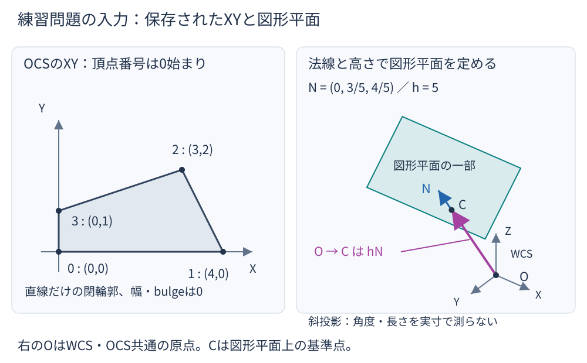

# 図形変換の練習問題：コードの意図を読み解く

AutoCADを起動せず、コード読解と手計算で取り組める基本3問＋発展1問である。  
API名を覚えているかではなく、入力の座標系・変換の向き・基準点・作用順序を説明できるかを確かめる。  
必要なAPIと補助関数の用途は、各問に示す。

コードは読解用の抜粋であり、図面への登録やコマンド起動の処理は含めない。  
型名が同じでも、変数がどの座標系の点や方向かは、コードと前提から判断する。  
数値は数学上の期待値として求め、実機での実測値とは区別する。

## 共通の入力・規約

- 右手系・列ベクトルの規約を使う。行列は点や方向へ左から掛ける。
- 座標と高さは共通の作図単位とし、mmなどを仮定しない。
- 問1〜3は、本文の固定例Bと同じPolylineを扱う。現在のUCSから座標を取得する例ではない。
- 法線はWCSで表した `N=(0,3/5,4/5)`、長さ1とする。Elevationは5。
- OCSの原点はWCS原点Oと同じ。図形平面の基準点Cは `C=5N` で、OCS原点とは区別する。
- 頂点は0始まりで、OCSのXYを次の順に保存する。直線だけの閉輪郭とし、bulge・始点幅・終点幅は0。

| 頂点番号 | OCSのXY |
| --- | --- |
| 0 | (0,0) |
| 1 | (4,0) |
| 2 | (3,2) |
| 3 | (0,1) |

厳密な実数で計算してよい。  
実装時の丸め誤差と、誤った座標系や変換順による違いを混同しない。

## 問1：Polylineの保存値を読む

### 読解に使うAPI

| API | 用途・引数 | 型・座標系 |
| --- | --- | --- |
| `Polyline.Normal` | 図形平面に垂直な向きを読み書きする | `Vector3d`、WCS成分 |
| `Polyline.Elevation` | OCSのZ方向に測った共通の高さを読み書きする | `double`。一般のWCSのZ座標とは限らない |
| `Polyline.AddVertexAt` | `int index, Point2d pt, double bulge, double startWidth, double endWidth`：挿入位置・頂点・膨らみ・始点幅・終点幅 | 戻り値は `void`。ptはECS、ここでのOCSのXY |
| `Polyline.Closed` | 最後の頂点と最初の頂点を結ぶかを指定する | `bool`。始点を末尾へ重複保存する指定ではない |
| `GetPoint2dAt(int index)` | 0始まりの頂点番号を指定して読む | `Point2d`、OCSのXY |
| `GetPoint3dAt(int value)` | 同じ頂点番号を指定して読む | `Point3d`、WCSのXYZ |

まず、共通の保存値と図形平面の関係を図で確認する。



```csharp
using Polyline source = new();
source.Normal = new Vector3d(0, 3.0 / 5, 4.0 / 5);
source.Elevation = 5;
source.AddVertexAt(0, new Point2d(0, 0), 0, 0, 0);
source.AddVertexAt(1, new Point2d(4, 0), 0, 0, 0);
source.AddVertexAt(2, new Point2d(3, 2), 0, 0, 0);
source.AddVertexAt(3, new Point2d(0, 1), 0, 0, 0);
source.Closed = true;

Point2d ocs2d = source.GetPoint2dAt(2);
Point3d wcsByGetter = source.GetPoint3dAt(2);
Point3d heightAdded = new(ocs2d.X, ocs2d.Y, source.Elevation);
```

1. `ocs2d` の値を求めよ。  
   Normal・Elevation・頂点のPoint2dが、それぞれ何を記録しているか説明せよ。
2. 基準点CのWCS座標を求め、Elevationが一般のWCSのZ座標ではない理由を説明せよ。
3. `heightAdded` と `wcsByGetter` が、同じ座標系の値か説明せよ。  
   heightAddedをそのままWCSの点として使ってよいか、理由を述べよ。  
   wcsByGetterの具体的な座標は問3で求める。

## 問2：法線からOCSのX・Y軸を作る

### 補助関数と読み方

次は、管理元の `ArbitraryAxisMath.Build` と同じ計算部分である。  
すべてのベクトルの成分をWCSで表す。

| 名前 | 用途 |
| --- | --- |
| `Vec` | 3つのdouble成分を持つ方向・変位 |
| `Unit(Vec v)` | 有限で0ではないVecを受け取り、同じ向きの単位ベクトルをVecで返す |
| `Cross(Vec a, Vec b)` | 右手の規則による外積a×bをVecで返す。平行でなければ両方向に垂直 |
| `AxisBoundary` | `1.0 / 64.0`。数値照合の許容誤差ではなく、軸を選ぶ規則 |

```csharp
Vec n = Unit(normal);
bool usesWorldY = Math.Abs(n.X) < AxisBoundary && Math.Abs(n.Y) < AxisBoundary;
Vec helper = usesWorldY ? new Vec(0, 1, 0) : new Vec(0, 0, 1);
Vec x = Unit(Cross(helper, n));
Vec y = Unit(Cross(n, x));
```

1. 固定例Bの法線Nについて、補助軸・x・yを求めよ。  
   外積を使う理由と、計算の途中で長さを1にする理由も説明せよ。
2. 法線が `(0,0,1)` の場合の補助軸・x・yを求めよ。  
   この法線で常にZ軸を補助軸にすると、何が起きるか説明せよ。
3. 厳密な単位法線を次の $N_b$ とする。  
   元の `<` と、比較を `<=` に変えたコードで、補助軸の選択が同じになるか説明せよ。  
   実装時の許容誤差を足して、この規則を変えてよいかも説明せよ。

$$
N_b=\begin{bmatrix}
1/64\\
0\\
\sqrt{4095}/64
\end{bmatrix}.
$$

小問(3)は式で表した厳密な値の比較とする。  
浮動小数点で正規化した値が、この境界と厳密に等しいかを実測する課題ではない。

## 問3：異なるコードと、似ている誤りを見分ける

### 読解に使うAPI

| API | 入力と用途 | 戻り値・出力 |
| --- | --- | --- |
| `Matrix3d.PlaneToWorld(Vector3d normal)` | WCSの法線から、平面座標→WCSの行列を作る。法線だけを渡すオーバーロードを使う | `Matrix3d`。この例はPolylineと同じNによるOCS→WCS |
| `Matrix3d.WorldToPlane(Vector3d normal)` | 同じNによるWCS→平面座標の行列を作る | `Matrix3d`。この例はWCS→OCS |
| `Point3d.TransformBy(Matrix3d leftSide)` | 点へ行列を適用する | 変換後の `Point3d`。入力・出力の座標系は行列の役割から読む |

`source` は問1と同じPolylineである。  
`frame.XAxis`・`frame.YAxis`・`frame.Normal` は、問2の手順で求めたOCSの3本の単位軸とする。  
`frame` は管理元コードのFrame型で、これらのWCS成分を保持する。  
A〜Fは、それぞれ元の入力から計算する比較であり、上から順に同じ点を変形し続けるものではない。

```csharp
Point2d ocs2d = source.GetPoint2dAt(2);
double elevation = source.Elevation;
Point3d ocs3d = new(ocs2d.X, ocs2d.Y, elevation);
Matrix3d planeToWorld = Matrix3d.PlaneToWorld(source.Normal);
Matrix3d worldToPlane = Matrix3d.WorldToPlane(source.Normal);

// A
Point3d byGetter = source.GetPoint3dAt(2);
// B
Point3d byPlaneToWorld = ocs3d.TransformBy(planeToWorld);
// C
Point3d byCombination = new(
    ocs3d.X * frame.XAxis.X + ocs3d.Y * frame.YAxis.X + ocs3d.Z * frame.Normal.X,
    ocs3d.X * frame.XAxis.Y + ocs3d.Y * frame.YAxis.Y + ocs3d.Z * frame.Normal.Y,
    ocs3d.X * frame.XAxis.Z + ocs3d.Y * frame.YAxis.Z + ocs3d.Z * frame.Normal.Z);
```

```csharp
// D
Point3d withoutElevation = new Point3d(ocs2d.X, ocs2d.Y, 0)
    .TransformBy(planeToWorld);
// E
Point3d wrongDirection = ocs3d.TransformBy(worldToPlane);
// F
Point3d twiceHeight = new(
    byCombination.X + elevation * frame.Normal.X,
    byCombination.Y + elevation * frame.Normal.Y,
    byCombination.Z + elevation * frame.Normal.Z);
```

1. A〜CのWCS座標を求め、3つの書き方が同じ位置を表す理由を説明せよ。
2. DとFのWCS座標を求め、それぞれ何が誤っているか、どう直すか説明せよ。
3. Eへ渡した値の座標系と、APIが要求する入力の座標系を説明せよ。  
   固定例BでEの3成分がA〜Cと一致するか計算し、この1例の一致だけで正しいコードと判断してよいか説明せよ。  
   正しい往復である次の `roundTrip` の値も求めよ。

```csharp
Point3d roundTrip = byPlaneToWorld.TransformBy(worldToPlane);
```

## 問4：合成順序と移動の基準を読み解く (発展)

### 読解に使うAPIと規約

| API・記法 | 引数・用途 | 戻り値・結果 |
| --- | --- | --- |
| `Matrix3d.Rotation` | `double angle, Vector3d axis, Point3d center`：ラジアンの角度、回転軸、軸が通る点。正方向は右手の規則 | `Matrix3d` |
| `Matrix3d.Displacement(Vector3d vector)` | 指定した成分の変位を表す行列を作る | `Matrix3d` |
| `a * b` | 行列aとbの積。列方式なので右端のbが先に作用する | `Matrix3d` |
| `PreMultiplyBy(Matrix3d leftSide)` | 呼出し元の行列へ左から掛ける | 結果の `Matrix3d` |
| `PostMultiplyBy(Matrix3d rightSide)` | 呼出し元の行列へ右から掛ける | 結果の `Matrix3d` |
| `Vector3d.TransformBy(Matrix3d leftSide)` | 方向・変位を行列で変換する | `Vector3d`。平行移動は加わらない |

Pre/Postを比較するときも、元の行列をコピーして戻り値を保持する。

### (1) 合成順序を分類する

この小問の `input` は、WCSの点として扱う。  
回転はWCS原点を通る+Z軸周りの+π/2（90°）、移動はWCSの `(10,0,3)` とする。  
次の `sequential`・`viaProduct`・`viaPre`・`viaPost` を、同じ結果になる組に分類せよ。  
それぞれの座標と、行列の積で表した作用順序を示して説明せよ。

```csharp
Point3d input = new(3, 2, 0);
Matrix3d rotation = Matrix3d.Rotation(Math.PI / 2, Vector3d.ZAxis, Point3d.Origin);
Matrix3d translation = Matrix3d.Displacement(new Vector3d(10, 0, 3));

Point3d sequential = input.TransformBy(rotation).TransformBy(translation);
Point3d viaProduct = input.TransformBy(translation * rotation);
Matrix3d pre = rotation;
pre = pre.PreMultiplyBy(translation);
Point3d viaPre = input.TransformBy(pre);
Matrix3d post = rotation;
post = post.PostMultiplyBy(translation);
Point3d viaPost = input.TransformBy(post);
```

### (2) WCS XとローカルXを区別する

**この小問では**、`input=(3,2,0)` を、図形平面の基準点Cから測るローカル座標として扱う。  
小問(1)のWCS点と同じ位置だとは考えない。  
配置先の軸は問2で求めたBの軸、Cは問1で求めた `5N` である。  
`source.Normal` もBのNのままとする。

次の `worldStep`・`localStep`・`viaDirection` のWCS座標を求め、同じ結果になる組を説明せよ。  
`worldDisplacement` のWCS成分も求め、どのX方向へ動かしているか説明せよ。

```csharp
Point3d input = new(3, 2, 0);
Vector3d normal = source.Normal;
Point3d center = new(
    source.Elevation * normal.X,
    source.Elevation * normal.Y,
    source.Elevation * normal.Z);
Matrix3d localToWorld = Matrix3d.Displacement(new Vector3d(center.X, center.Y, center.Z))
    * Matrix3d.PlaneToWorld(normal);
Vector3d localDisplacement = new(2, 0, 0);
Matrix3d move = Matrix3d.Displacement(localDisplacement);

Point3d worldStep = input.TransformBy(move * localToWorld);
Point3d localStep = input.TransformBy(localToWorld * move);
Vector3d worldDisplacement = localDisplacement.TransformBy(localToWorld);
Point3d viaDirection = input.TransformBy(localToWorld)
    .TransformBy(Matrix3d.Displacement(worldDisplacement));
```

この配置はCを原点に持つローカル座標系で、WCS原点を共有するOCS全体とは異なる。  
`localToWorld` の入力へ、さらにElevationを付け足すものではない。

### (3) 方向を点として変換したらどうなるか

小問(2)の `localDisplacement` の3成分をPoint3dに入れ、`localToWorld` で変換したとする。  
その出力の3成分をWCSの変位として使うと、何が余計に加わるか説明せよ。  
Vector3dを使った正しい処理との違いを、点と方向の同次成分で説明せよ。  
最終位置の数値を再計算することは必須としない。

## API仕様の参照先と検証範囲

補助情報はAutoCAD 2026版の公式資料と本文に従う。  
主な確認先は、[Polylineの頂点取得](https://help.autodesk.com/cloudhelp/2026/ENU/OARX-ManagedRefGuide/files/OARX-ManagedRefGuide-Autodesk_AutoCAD_DatabaseServices_Polyline_GetPoint3dAt_int.html)、[OCSの規約](https://help.autodesk.com/cloudhelp/2026/ENU/AutoCAD-DXF/files/GUID-D99F1509-E4E4-47A3-8691-92EA07DC88F5.htm)、[任意軸アルゴリズム](https://help.autodesk.com/cloudhelp/2026/ENU/AutoCAD-DXF/files/GUID-E19E5B42-0CC7-4EBA-B29F-5E1D595149EE.htm)、[PlaneToWorld](https://help.autodesk.com/cloudhelp/2026/ENU/OARX-ManagedRefGuide/files/OARX-ManagedRefGuide-Autodesk_AutoCAD_Geometry_Matrix3d_PlaneToWorld_Vector3d.html)、[PreMultiplyBy](https://help.autodesk.com/cloudhelp/2026/ENU/OARX-ManagedRefGuide/files/OARX-ManagedRefGuide-Autodesk_AutoCAD_Geometry_Matrix3d_PreMultiplyBy_Matrix3d.html) である。  
各メソッドの座標系と条件をそろえて読解する。

実機実行は任意の確認であり、解答に必要な前提ではない。  
職場の参照DLLによるビルド・NETLOAD・AutoCAD実機での結果照合は未検証である。

[解答・解説](solutions.md) ／ [宿題トップへ戻る](README.md) ／ [この教材のトップへ戻る](../README.md)
