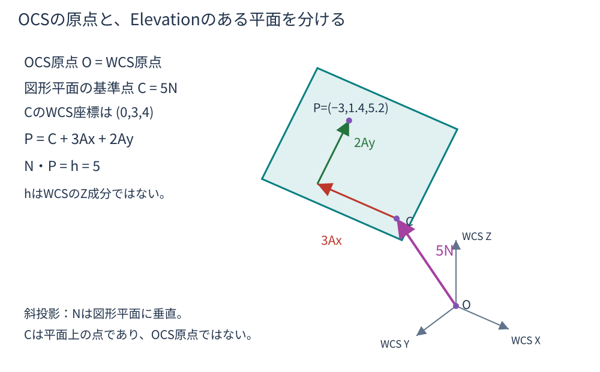
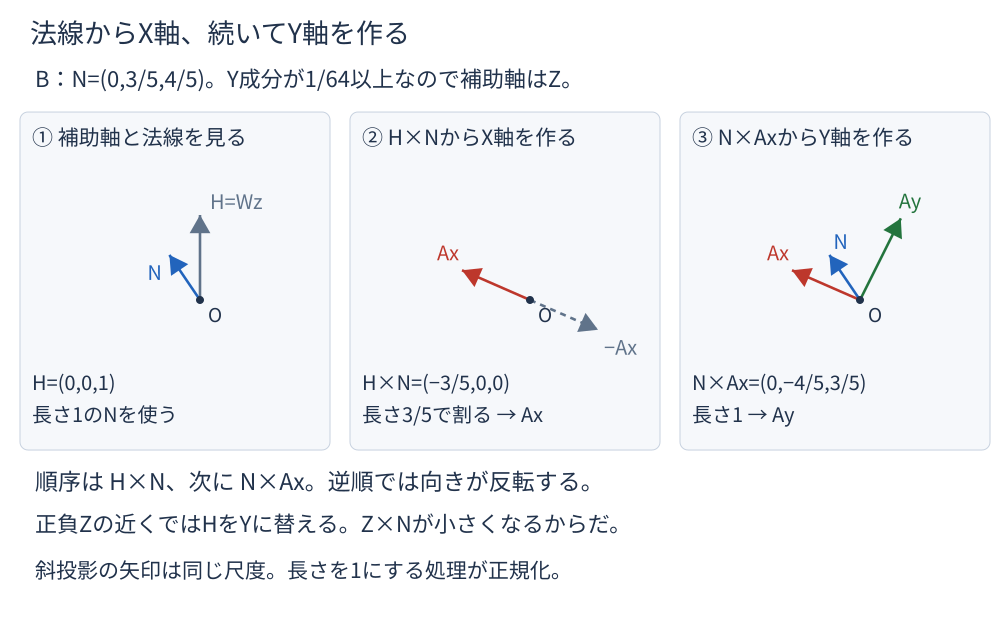
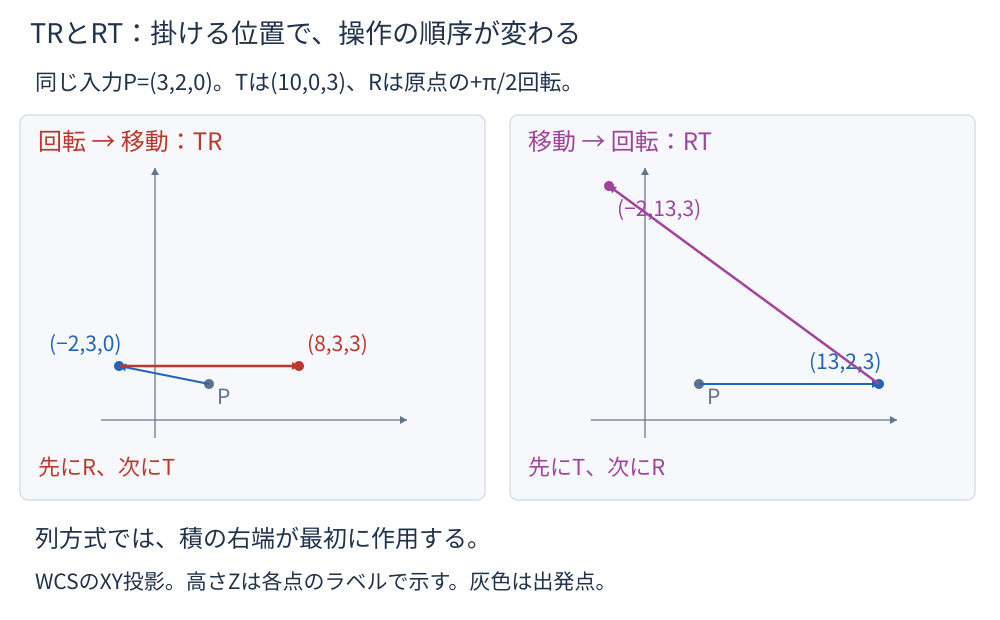
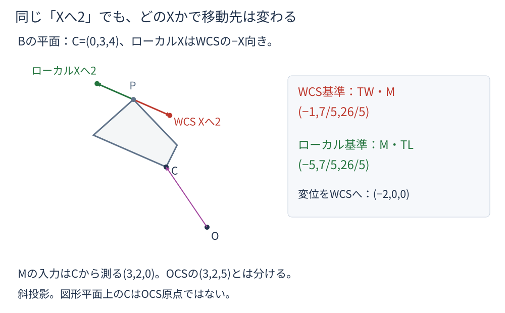

# 図形変換の解答・解説：コードの意図を読み解く

数値は本文と同じ規約から求めた数学上の期待値であり、AutoCAD実機での実測値ではない。  
問題と同じ右手系・列方式で、点には行列を左から掛ける。  
OCSの原点Oと、図形平面の基準点Cを区別しながら読もう。

## 問1：Polylineの保存値を読む

### (1) 保存されたXYと、向き・高さの役割

`ocs2d` はOCSの `(3,2)` である。  
`GetPoint2dAt(2)` は頂点2の保存値を読み、WCSのXYへ変換するものではない。

| 値 | 記録していること |
| --- | --- |
| `Normal` | WCSで表した図形平面の単位法線。OCSのZ軸の向き |
| `Elevation` | OCSのZ方向へ測った共通の高さ。この例では5 |
| 各頂点の `Point2d` | OCSのX・Y軸に沿って測った2成分。この例の頂点2は(3,2) |

Normalで向きを、Elevationで高さを定め、その平面内の位置を各頂点のXYで指定する。  
これらは別々の役割を持つ。

### (2) CのWCS座標とElevation

Cは、OCSのXYをともに0、高さを5とした点である。  
単位法線Nの方向へ5進むので、次のWCS座標になる。

$$
\begin{aligned}
C&=5N\\
&=5\begin{bmatrix}
0\\
3/5\\
4/5
\end{bmatrix}\\
&=\begin{bmatrix}
0\\
3\\
4
\end{bmatrix}.
\end{aligned}
$$

Elevationは5だが、CのWCSのZ座標は4である。  
高さを測る方向がWCSのZ軸ではなくNなので、この2つは一般には一致しない。

図形平面上の点Pは $N\cdot P=5$ を満たす。  
Nは単位ベクトルなので、5は原点から平面までの符号付きの距離でもある。  
距離の大きさは `|5|` である。  
Cを図形平面の基準点に選んでも、OCSそのものの原点OをCへ移すわけではない。

### (3) Point3dならWCS、とは限らない

`heightAdded=(3,2,5)` は、OCSのXYへOCSの高さを付けた3成分である。  
一方、`wcsByGetter` は同じ頂点をWCSで表した座標である。

`Point3d` 型に入れただけでは、軸の向きは変換されない。  
この例のOCSのX・Y軸はWCSのX・Y軸と異なるため、heightAddedをそのままWCSの点に使うと、別の位置を指す。  
正しくはOCS→WCSの変換を行う。  
具体的なWCS座標は問3で計算する。

現在のUCSを変えても、既に保存したOCSの頂点がUCSの値に読み替わるわけではない。

## 問2：法線からOCSのX・Y軸を作る

### (1) Bの補助軸・X軸・Y軸

Nの長さは次のとおり1なので、`Unit(normal)` は向きを変えない。

$$
\|N\|=\sqrt{0^2+(3/5)^2+(4/5)^2}=1.
$$

X成分の絶対値は0なので $1/64$ 未満だが、Y成分の絶対値は $3/5$ なので未満ではない。  
`&&` は両方の成立を要求するため、`usesWorldY` はfalseとなり、補助軸HにはWCSのZ軸を選ぶ。

$$
H=\begin{bmatrix}
0\\
0\\
1
\end{bmatrix}.
$$

外積で、補助軸とNの両方に垂直な向きを作る。  
ただし外積の長さは1とは限らないので、X軸として使う前に正規化する。

$$
\begin{aligned}
H\times N&=\begin{bmatrix}
-3/5\\
0\\
0
\end{bmatrix},\\
\|H\times N\|&=3/5,\\
A_x&=\frac{H\times N}{\|H\times N\|}
=\begin{bmatrix}
-1\\
0\\
0
\end{bmatrix}.
\end{aligned}
$$

続いて、NとX軸に垂直な向きを作る。

$$
\begin{aligned}
A_y&=\frac{N\times A_x}{\|N\times A_x\|}\\
&=\begin{bmatrix}
0\\
-4/5\\
3/5
\end{bmatrix}.
\end{aligned}
$$

この外積の長さは1である。  
3本は互いに直交する単位軸となり、X軸とY軸の外積がNになる右手系を作る。  
実際に外積を計算すると、向きも確認できる。

$$
A_x\times A_y=
\begin{bmatrix}
0\\
3/5\\
4/5
\end{bmatrix}
=N.
$$

ここは外積の順序も大事だ。  
$H\times N$ を $N\times H$ に入れ替えるとX軸の符号が変わり、それに続くY軸も変わる。  
同じ法線に垂直な平面でも、PolylineのOCSと同じXYの決め方にはならない。

### (2) 法線がWCSの+Z方向の場合

この法線では $N_x=N_y=0$ なので、補助軸にはWCSのY軸を選ぶ。

$$
\begin{aligned}
H&=\begin{bmatrix}
0\\
1\\
0
\end{bmatrix},&
N&=\begin{bmatrix}
0\\
0\\
1
\end{bmatrix},\\
A_x&=\frac{H\times N}{\|H\times N\|}
=\begin{bmatrix}
1\\
0\\
0
\end{bmatrix},&
A_y&=\frac{N\times A_x}{\|N\times A_x\|}
=\begin{bmatrix}
0\\
1\\
0
\end{bmatrix}.
\end{aligned}
$$

常にWCSのZ軸を補助軸にすると、このNとは平行になる。  
外積は0となり、長さで割って単位軸を作れない。  
Z方向に近い法線でY軸へ切り替えるのは、この退化を避けるためである。

### (3) 境界値の比較は許容誤差ではない

問題の $N_b$ は、厳密には次の長さを持つ。

$$
\|N_b\|^2=\frac{1+4095}{4096}=1.
$$

X成分の絶対値はちょうど `1/64` である。  
したがって、補助軸の選択は次のように分かれる。

| 条件 | X成分の比較 | Y成分の比較 | 補助軸 |
| --- | --- | --- | --- |
| 元の `<` | false | true | WCSのZ軸 |
| 変更した `<=` | true | true | WCSのY軸 |

`1/64` は、AutoCADと同じOCSの向きを定める分岐規則である。  
丸め誤差の許容値を足したり、等号を含めたりすると、別の規則になる。  
数値照合の許容誤差とは分けて扱う。

実装では、正規化した浮動小数点の成分が境界のどちら側になるかを確認する必要がある。  
丸めた表示値が同じだからといって、比較結果も同じとは限らない。  
厳密な式の比較と、doubleで正規化・比較した実測結果を混同しない。

また、0ベクトル・NaN・無限大は有効な法線ではない。  
管理元の `Unit` はこれらを拒否し、有限で0でない入力は最大絶対成分で縮尺してから正規化する。  
この工夫は途中計算のオーバーフローなどを避けるもので、入力時点で失った精度を復元するものではない。

## 問3：異なるコードと、似ている誤りを見分ける

### (1) A〜Cは同じ基底の合成を表す

問2の軸を使い、OCSの `(u,v,h)=(3,2,5)` をWCSの点Pへ変換する。  
各成分を、その成分を測った軸方向の変位に戻して足し合わせる。

$$
\begin{aligned}
P&=3A_x+2A_y+5N\\
&=\begin{bmatrix}
-3\\
0\\
0
\end{bmatrix}
+\begin{bmatrix}
0\\
-8/5\\
6/5
\end{bmatrix}
+\begin{bmatrix}
0\\
3\\
4
\end{bmatrix}\\
&=\begin{bmatrix}
-3\\
7/5\\
26/5
\end{bmatrix}.
\end{aligned}
$$

WCS座標は `(-3,1.4,5.2)` となる。

| コード | 同じ位置になる理由 |
| --- | --- |
| A：`GetPoint3dAt` | 保存済みのXY・Normal・Elevationに基づき、頂点をWCSで取得する |
| B：`PlaneToWorld` | 同じNから定まる基底を列に持つ行列で、OCSの3成分をWCSへ変換する |
| C：軸の線形結合 | Bの行列積を、各WCS成分の加算として直接書いている |

一致には、同じ法線・任意軸規則・軸の向き・原点を使い、Elevationをちょうど1回含めることが必要である。  
「法線が同じ」だけでは、平面内のX・Y軸まで一致するとは限らない。

### (2) Dは高さを落とし、Fは高さを二重に加える

DはOCSのZ成分を0にしている。  
Bと同じ平面内の変位は作れるが、高さ方向の変位 `5N` が抜けている。

$$
\begin{aligned}
P_D&=3A_x+2A_y\\
&=\begin{bmatrix}
-3\\
-8/5\\
6/5
\end{bmatrix}.
\end{aligned}
$$

入力を `new Point3d(ocs2d.X, ocs2d.Y, elevation)` に直し、その後でPlaneToWorldを1回適用すればよい。

Fの `byCombination` には既に `5N` が含まれる。  
そこへもう一度同じ高さを加えている。

$$
\begin{aligned}
P_F&=P+5N\\
&=\begin{bmatrix}
-3\\
7/5\\
26/5
\end{bmatrix}
+\begin{bmatrix}
0\\
3\\
4
\end{bmatrix}\\
&=\begin{bmatrix}
-3\\
22/5\\
46/5
\end{bmatrix}.
\end{aligned}
$$

追加の `elevation * frame.Normal` を取り除けばよい。  
Cを基準点にして `C+uA_x+vA_y` と書く方式も正しいが、その場合はさらに `hN` を足さない。  
高さを「入力のOCSのZ」と「配置の基準点」のどちらへ含めたかを確認しよう。

### (3) Eは数値が一致しても、変換の向きが誤っている

`WorldToPlane` が要求するのはWCSの点だが、EはOCSの3成分を渡している。  
APIと入力の意味が合っていない。

それでも、この固定例BではEの出力が `(-3,1.4,5.2)` となり、A〜Cの3成分と一致する。  
なぜだろうか。  
BのOCS→WCSの基底行列を実際に書くと、次の対称行列になる。

$$
R_B=\begin{bmatrix}
-1&0&0\\
0&-4/5&3/5\\
0&3/5&4/5
\end{bmatrix}.
$$

3本の列は正規直交基底なので、逆行列は転置である。  
さらにこの例では転置が元の行列と一致する。

$$
R_B^{-1}=R_B^{\mathsf T}=R_B.
$$

そのため、誤って逆行列を使っても、Bでは同じ数値を得てしまう。  
一般の法線で成り立つ性質ではない。  
1例の一致だけで正しいコードとは判断できず、APIの向きと入力の座標系を先に照合する必要がある。  
管理元の実演では対称でない基底になる斜め法線も使い、複数の点や行列も比較する。

正しい往復は、Bの出力であるWCSの点PへWorldToPlaneを適用する処理である。  
各OCS成分は、対応する単位軸との内積で取り出せる。

$$
\begin{aligned}
u&=A_x\cdot P=(-1)(-3)=3,\\
v&=A_y\cdot P
=\frac{-4\cdot7+3\cdot26}{25}=2,\\
h&=N\cdot P
=\frac{3\cdot7+4\cdot26}{25}=5.
\end{aligned}
$$

したがって `roundTrip=(3,2,5)` は、元のOCSの3成分へ戻っている。  
逆変換は平面への射影ではなく、高さも保持する座標変換である。  
途中でOCSのZを0にすれば、一般には別の点になる。

## 問4：合成順序と移動の基準を読み解く (発展)

### (1) 右端の行列が先に作用する

回転をR、移動をT、入力のWCSの点をqとする。  
まず回転する場合、+Z軸周りの90°回転はXYを $(x,y)\mapsto(-y,x)$ とする。

$$
\begin{aligned}
Rq&=\begin{bmatrix}
-2\\
3\\
0
\end{bmatrix},\\
T(Rq)&=\begin{bmatrix}
-2+10\\
3\\
0+3
\end{bmatrix}
=\begin{bmatrix}
8\\
3\\
3
\end{bmatrix}.
\end{aligned}
$$

先に移動すると、移動分のXYも回転する。

$$
\begin{aligned}
Tq&=\begin{bmatrix}
13\\
2\\
3
\end{bmatrix},\\
R(Tq)&=\begin{bmatrix}
-2\\
13\\
3
\end{bmatrix}.
\end{aligned}
$$

| 変数 | 行列の積 | 作用順序 | WCS座標 |
| --- | --- | --- | --- |
| `sequential` | TR | 回転→移動 | (8,3,3) |
| `viaProduct` | TR | 回転→移動 | (8,3,3) |
| `viaPre` | TR | 回転→移動 | (8,3,3) |
| `viaPost` | RT | 移動→回転 | (-2,13,3) |

`pre` はRから始め、Tを左に掛けるのでTRになる。  
`post` はRから始め、Tを右に掛けるのでRTになる。  
Pre/Postという名前だけで実行順を決めず、「どの行列を呼出し元にして、どちらから掛けたか」を読む。

本文と管理元の `CompositionCommands` には、Tから始めて `T.PostMultiplyBy(R)` でTRを作る比較もある。  
問題の `R.PostMultiplyBy(T)` とは呼出し元が異なるため、同じPostでも結果は違う。

### (2) WCS XとローカルXでは動く先が違う

この小問のqは、Cを原点とするローカル座標である。  
小問(1)のWCSのqとは、同じ3成分でも意味が異なる。

配置行列Mは、ローカルの軸をBの軸へ向け、その後で原点をCへ移す。  
3本の軸を先頭3列、Cを末尾列に置くと、次の同次行列になる。

$$
M=\begin{bmatrix}
-1&0&0&0\\
0&-4/5&3/5&3\\
0&3/5&4/5&4\\
0&0&0&1
\end{bmatrix}.
$$

入力のローカルZは0であり、高さは既にCに含まれる。  
配置するだけなら、問3と同じ位置Pになる。

$$
Mq=
\begin{bmatrix}
-3\\
7/5\\
26/5\\
1
\end{bmatrix}.
$$

同次座標で書くときは $q=(3,2,0,1)^{\mathsf T}$ としている。  
以下の点の式では、読みやすさのためWCSの3成分を示す。

`worldStep` は先にMで配置してから、WCSのX方向へ2進む。

$$
\begin{aligned}
P_{\mathrm{world}}&=P+\begin{bmatrix}
2\\
0\\
0
\end{bmatrix}\\
&=\begin{bmatrix}
-1\\
7/5\\
26/5
\end{bmatrix}.
\end{aligned}
$$

`localStep` は先にローカルのX成分を2増やし、`(5,2,0)` をMで配置する。

$$
\begin{aligned}
P_{\mathrm{local}}&=C+5A_x+2A_y\\
&=\begin{bmatrix}
-5\\
7/5\\
26/5
\end{bmatrix}.
\end{aligned}
$$

ローカルX方向への変位をWCSで表すと、次のようになる。  
方向・変位の同次成分は0なので、Mの移動部分Cは加わらない。

$$
M\begin{bmatrix}
2\\
0\\
0\\
0
\end{bmatrix}
=\begin{bmatrix}
-2\\
0\\
0\\
0
\end{bmatrix}.
$$

したがって `worldDisplacement=(-2,0,0)` である。  
`viaDirection` は配置後のPへこの変位を加えるので、localStepと同じ結果になる。

| 変数 | 移動の基準 | WCS座標 |
| --- | --- | --- |
| `worldStep` | WCS Xへ2 | (-1,7/5,26/5) |
| `localStep` | ローカルXへ2 | (-5,7/5,26/5) |
| `viaDirection` | ローカルXの変位をWCS成分へ直して加える | (-5,7/5,26/5) |

この例のローカルXはWCSの-X方向である。  
数値の `(2,0,0)` だけでは、どちらのXへ進むのかは決まらない。

一般にも、3成分のローカル座標qと変位dを使い、配置を $M(q)=C+R_Bq$ と書けば、先に変位を加える処理は次のように読める。

$$
\begin{aligned}
M(q+d)&=C+R_B(q+d)\\
&=M(q)+R_Bd.
\end{aligned}
$$

この関係が、localStepとviaDirectionを結び付けている。  
ここでのMの軸は正規直交基底であり、方向の長さも保つ。  
拡大縮小などを含む一般の配置まで、同じ長さが保たれるとは限らない。

### (3) 点として変換すると、基準点Cが混ざる

変位の3成分をPoint3dに入れると、同次成分は1として扱われる。

$$
M\begin{bmatrix}
2\\
0\\
0\\
1
\end{bmatrix}
=\begin{bmatrix}
-2\\
3\\
4\\
1
\end{bmatrix}.
$$

正しいWCS変位 `(-2,0,0)` に対し、Cの `(0,3,4)` が余計に加わっている。  
これを配置後の点への変位に使うと、配置に使ったCをもう一度足してしまう。

方向・変位は「どれだけ動くか」、点は「原点から見てどこにあるか」を表す。  
同じ3成分でも、同次成分0と1の違いが処理を変える。  
この意図をコードで表すために、変位には `Vector3d.TransformBy` を使っている。

## 成立条件・誤差と、実演コードとの対応

各解答は、同じ固定入力・右手系・列方式・単位法線と、その法線から定まる同じOCS基底を使う。  
PlaneToWorld／WorldToPlaneへ渡す法線だけでなく、点がどの座標系にあるかもそろえる。  
一方の行列で往復できることだけでは、AutoCADのOCSと一致する証明にはならない。

実装の照合では丸め誤差を見込むが、誤った座標系や高さの二重加算を許容誤差で吸収しない。  
本文の照合例では、座標の作図単位を踏まえた絶対許容値 $10^{-10}$ と相対許容値 $10^{-12}$、無次元の行列成分には絶対・相対とも $10^{-12}$ を使う。  
これらは例の検証用であり、入力の大きさ・作図単位・用途に応じて判断する。  
任意軸の分岐規則 `1/64` は別物で、変更しない。

| 問題 | 本文・実演コードとの対応 |
| --- | --- |
| 問1 | 本文の第1〜2章。保存値と座標系は [CoordinateSystemCommands.cs](../../../autocad-net/samples/autocad-transform/CoordinateSystemCommands.cs) |
| 問2 | 本文の第3章。[ArbitraryAxisMath.cs](../../../autocad-net/samples/autocad-transform/ArbitraryAxisMath.cs) のBuildとUnit、[ArbitraryAxisCommands.cs](../../../autocad-net/samples/autocad-transform/ArbitraryAxisCommands.cs) の比較 |
| 問3 | 本文の第4〜5章。[OcsToWcsCommands.cs](../../../autocad-net/samples/autocad-transform/OcsToWcsCommands.cs) と [WcsToOcsCommands.cs](../../../autocad-net/samples/autocad-transform/WcsToOcsCommands.cs) |
| 問4 | 本文の第6.3〜6.4節。[CompositionCommands.cs](../../../autocad-net/samples/autocad-transform/CompositionCommands.cs) と [LocalFrameCommands.cs](../../../autocad-net/samples/autocad-transform/LocalFrameCommands.cs) |

APIの用途・型・座標系と任意軸の規則は、[詳細解説](../explanation.md) と [問題末尾のAutoCAD 2026公式資料](problems.md#api仕様の参照先と検証範囲) に対応する。  
問題のコードは、比較対象が分かるように入力準備や変数名をそろえた抜粋である。  
実演全体は既存の `autocad-net` で管理する。

AutoCADを使わずに計算できることと、実機で確認済みであることは別である。  
職場の参照DLLによるビルド・NETLOAD・AutoCAD実機での結果照合は未検証であり、上記の数値は期待値として扱う。  
実機確認を行う場合は、同じ固定入力と実行環境を記録し、期待値と実測値を区別して比較する。

[問題へ戻る](problems.md) ／ [宿題トップへ戻る](README.md) ／ [この教材のトップへ戻る](../README.md)
